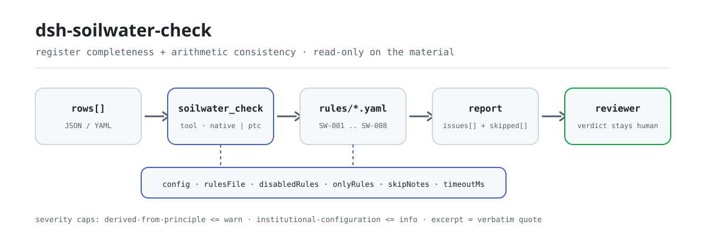

<div align="center">

<picture>
  <source media="(prefers-color-scheme: dark)" srcset="docs/assets/dsh-soilwater-check-flow-dark.svg">
  
</picture>

# dsh-soilwater-check

**Check a soil and groundwater monitoring register for completeness and arithmetic consistency — you get a list of which row, which column, and what to fix; the verdict stays with the reviewer.**

A data-only checker plugin for DeepSeek Harness: it reads one monitoring register (the project header plus one row per point and parameter), applies the versioned rule pack it ships (SW-001..SW-008), and lists only the differences it can point to inside the material — never a compliance verdict, never a liability finding.

[Install](#three-step-setup) · [Configuration](#configuration) · [FAQ](#faq) · [简体中文](README.md) · [English](README.en.md) · [Español](README.es.md) · [Português](README.pt.md) · [हिन्दी](README.hi.md)

[](LICENSE)
[](#compatibility)
[](https://www.npmjs.com/package/dsh-soilwater-check)
[](https://github.com/PerryLink/dsh-soilwater-check/actions/workflows/ci.yml)
[](#compatibility)

[](https://github.com/PerryLink/dsh-soilwater-check/stargazers)
[](https://www.npmjs.com/package/dsh-soilwater-check)
[](https://dshfind.com/en/plugins/PerryLink/dsh-soilwater-check?ref=badge)
[](https://securityscorecards.dev/viewer/?uri=github.com/PerryLink/dsh-soilwater-check)
[](https://dsh.market/)
[](https://gitee.com/perrylink/dsh-soilwater-check)

```sh
dsh plugin --profile <name> add dsh-soilwater-check
```

</div>

<sub>Community plugin, not affiliated with DeepSeek. Canonical repository: <https://github.com/PerryLink/dsh-soilwater-check> (Gitee is a mirror).</sub>

## What it is

`dsh-soilwater-check` reads one soil and groundwater monitoring register — the project header plus one row per point and parameter — and checks that register's own completeness and arithmetic: that each row names its point and its parameter, that the recorded result parses as a number, that the sampling date parses and is not later than the check date, that an applicable standard is recorded, that the exceedance verdict agrees with how the result compares to the limit the register itself states, that no sample number is repeated, that the header declares the project and the survey phase, and that no template placeholder survives in the parameter column.

It does not decide compliance, does not find liability, and does not replace the reviewer; it lists only the differences it can point to inside the material.

- **Who it is for**: environmental monitoring and site-investigation record keepers and reviewers; no command line required — hand the material over in chat.
- **What you give it**: the source material the check works on (a register, table, or document); the original is never modified. Excel can be converted to JSON/YAML first, in chat if the platform supports it.
- **What you get back**: a list of "which row, which column, what is missing, how to fix it"; every check that could not run is listed in `skipped` with its reason.

## Three-step setup

1. **Install** (pick one channel):

   ```sh
   # git channel (latest main; equivalent to git+https://github.com/PerryLink/dsh-soilwater-check.git)
   dsh plugin --profile <name> add github:PerryLink/dsh-soilwater-check
   # npm channel (published releases)
   dsh plugin --profile <name> add dsh-soilwater-check
   # tarball channel: pnpm pack in this repo, then
   dsh plugin --profile <name> add ./dsh-soilwater-check-<version>.tgz
   ```

2. **Minimal config** (sane defaults; a bundle row without `config` uses every default, with the rule-pack path pointing at the bundled `rules/soilwater-check.yaml`):

   ```yaml
   - insert:
       - id: dsh-soilwater-check
         name: dsh-soilwater-check
   ```

3. **Verify it mounts**:

   ```sh
   dsh --profile <name> --dump-config | grep 'dsh-soilwater-check'
   ```

   In a checkout, run `pnpm run build` first to produce `lib/`, then run the bundled sample (input in `samples/quickstart/input/`, expected output in `samples/quickstart/expected/result.json`):

   ```sh
   node samples/quickstart/run.mjs --json
   ```

   ```json
   {
     "tool": "soilwater_check",
     "issueCount": 1,
     "summary": {
       "error": 0,
       "warn": 1,
       "info": 0
     },
     "skippedCount": 0
   }
   ```

**Uninstall**: `dsh plugin --profile <name> remove dsh-soilwater-check` (or remove the row from the profile patch).

<details>
<summary>Use it in WorkBuddy / Coze</summary>

Search "Professional Document Check Suite" in WorkBuddy / Coze (the full set; this check is one part of it; availability as listed) to call the same checking capability without a command line.

</details>

<details>
<summary>Install from the DSH Desktop market</summary>

Every PerryLink plugin is listed in the built-in DSH Desktop market: **Market → Sources → Add source → paste** `https://perrylink-dsh-catalog.perrylink.workers.dev/catalog-source.json` **→ select**. Installation still requires the market's npm identity check and your confirmation.

</details>

## Core capabilities

`dsh-soilwater-check` registers the `soilwater_check` tool: it reads one monitoring register, applies a versioned rule pack, and returns a report.

- **Eight rules in one data pack** — the rule pack is data, not code (`rules/soilwater-check.yaml`); replacing it switches the whole rule set without touching a line of TypeScript.
- **Read-only on the material** — accepts JSON or YAML and never modifies the original; pure ESM, no network requests, no model calls.
- **No fabricated citations** — every rule carries `document` / `number` / `clause` / `excerpt` / `kind` / `source`. Every `excerpt` in this pack states, in so many words, that the clause text was not obtained; a paraphrase is never dressed up as a quotation. The load-time guard cannot tell a quotation from a description, so a test asserts that every `excerpt` admits the gap.
- **Severity follows the evidence** — `derived-from-principle` is capped at `warn`, institutional configuration (`institutional-configuration`) at `info`, and a test asserts it; every rule in this pack is `derived-from-principle` and therefore capped at `warn`.
- **An empty issue list is never "nothing is wrong"** — every check that could not run is reported in `skipped` with its reason; a missing field, an unset list, or an unparseable value makes the rule report itself in `skipped` rather than pass silently.
- **No adjudicating wording** — the report lists differences and never pronounces on compliance, liability, or correctness; a wording guard enforces this and every report carries the disclaimer.

| Rule | Check | Severity | Basis kind |
|---|---|---|---|
| `SW-001` | the point and the parameter are recorded | warn | principle |
| `SW-002` | the result parses as a number | warn | principle |
| `SW-003` | the sampling date parses and is not in the future | warn | principle |
| `SW-004` | every row records an applicable standard | warn | principle |
| `SW-005` | the verdict agrees with the result and the limit | warn | principle |
| `SW-006` | sample numbers are unique inside the register | warn | principle |
| `SW-007` | the header names its project and survey phase | warn | principle |
| `SW-008` | the parameter column holds no unreplaced placeholder | warn | principle |

### Examples

These are the plugin's real entry points; install once, then call one.

**Detailed example** — tool `soilwater_check`, input:

~~~json
{"rows":[{"监测结果":"80","标准限值":"60","超标情况":"达标"}]}
~~~

Output:

~~~json
{
  "id": "dsh-soilwater-check.SW-005.de09b5a6",
  "ruleId": "SW-005",
  "severity": "warn",
  "locator": {
    "row": 1,
    "field": "exceed"
  },
  "found": "第 1 行「result」为 80、「limit」为 60，而判定为「达标」",
  "expected": "80 超过限值 60，判定应表示超标",
  "fix": "核对三个数值与判定；本条只按台账自己写的限值比较，不判断该限值是否取对了标准"
}
~~~

*Observed from `dsh-soilwater-check/tests/fixtures/SW-005/SW-005-unsafe.json`*

## Standards it follows

| Document | Number | Cited by rules |
|---|---|---|
| Technical Guidelines for Soil Pollution Investigation of Construction Land (canonical Chinese title recorded in `rules/evidence/`) | HJ 25.1—2019 (replaces HJ 25.1-2014; clause numbers not obtained this pass) | SW-001, SW-003, SW-007, SW-008 |
| Technical Specification for Groundwater Environmental Monitoring (canonical Chinese title recorded in `rules/evidence/`) | HJ 164—2020 (replaces HJ/T 164—2004; issued 2020-12-01, effective 2021-03-01; clause numbers not obtained this pass) | SW-002, SW-006 |
| Soil Environmental Quality — Risk Control Standard for Soil Contamination of Development Land (trial) (canonical Chinese title recorded in `rules/evidence/`) | GB 36600—2018 (clause text not obtained this pass) | SW-004, SW-005 |

**Hierarchy of force:** GB 36600—2018 is a national standard (mandatory, in force, review of 2024-07-23 kept it valid, number carries no `/T`); GB/T 14848—2017 is a recommended national standard (not itself the basis of any rule in this pack); HJ 25.1—2019 and HJ 164—2020 are industry standards, not mandatory national standards. Do not conflate HJ/T 164—2004 with HJ 164—2020 — the new number carries no `/T`.

## Configuration

All tunables are Schemastery `Config` fields in `src/config.ts` (changeable from cordis.yml); the per-rule thresholds live in the rule pack under `rules/`. An id-targeted override replaces the whole row — restate every key you need.

| Key | Type | Default | Description |
|---|---|---|---|
| `rulesFile` | string | `rules/soilwater-check.yaml` | Rule-pack path, relative to the package root |
| `disabledRules` | string[] | `[]` | Rule ids to stop running; each appears in `skipped` |
| `onlyRules` | string[] | `[]` | Run only these rule ids; empty runs every rule |
| `skipNotes` | string | `""` | Note appended to every `skipped` reason |
| `timeoutMs` | number | `120000` | Cooperative tool timeout budget |

Rule-level parameters worth knowing:

- `SW-005` `valueField` / `limitField` / `verdictField` / `overValues` / `atMostValues` / `tolerance` — the three columns and the two verdict vocabularies. A verdict outside both lists is reported so a new wording cannot slip through unnoticed.
- `SW-008` `terms` — the placeholder vocabulary to look for.
- `SW-001` `fields`, `SW-002` `field`, `SW-003` `field`, `SW-004` `field`, `SW-006` `field`, `SW-007` `fields` — the columns each rule reads; see `rules/soilwater-check.yaml` for the defaults.

The shipped default vocabularies (kept verbatim here because the register columns are in Chinese):

```text
SW-005 overValues:   [超标, 是, Y, yes, true, 超出, 不合格]
SW-005 atMostValues: [达标, 否, N, no, false, 未超标, 合格]
SW-008 terms:        ["【","】","{{","}}","XXX","xxx","待填","待补充","TBD","todo","示例"]
```

Example override in your profile patch:

```yaml
- insert:
    - id: dsh-soilwater-check
      name: dsh-soilwater-check
      config:
        disabledRules: [SW-008]
        timeoutMs: 180000
```

## Material format

The tool accepts JSON or YAML:

```yaml
project: 某某场地调查
phase: 初步调查
rows:
  - { 序号: '1', 点位名称: S1 表层土, 介质: 土壤, 采样日期: 2026-03-05,
      样品编号: TR-2026-0018, 监测项目: 砷, 监测结果: '12.5', 单位: mg/kg,
      执行标准: GB 36600—2018 第二类用地筛选值, 标准限值: '60', 超标情况: 达标 }
```

Column names are matched case-insensitively and ignoring spaces, underscores and hyphens; the register's own column names are kept, so a finding names the column it read. A result may carry a unit; detection-limit notation (such as "not detected" or `<0.01`) is reported as unparseable on purpose. Fields are optional at the reader layer and validated by the check engine, so a partially exported register produces "missing item" findings instead of a crash. The header's `project` is the project name and `phase` is the survey phase (preliminary investigation, detailed investigation, remediation-effectiveness assessment, and so on).

## Rule sources

Rule data lives in `rules/soilwater-check.yaml`, separated from the code: every rule carries document, number, clause in the source's own numbering, a verbatim excerpt, and a source URL. The pack's header states the citation gap in full, and each rule's `note` repeats the part that matters for that rule. The load-time guard that normally enforces "an excerpt must be a real quotation of at least eight characters" cannot tell a quotation from a description — so this pack leans on the header, the per-rule notes, and a test asserting that every `excerpt` admits the gap. A pack that overstates its basis fails at load time instead of producing a confident-looking report. The boundaries confirmed during verification and the conclusions deliberately **not** drawn ship in the bundled `rules/evidence/` directory.

## FAQ

<details>
<summary>The register's verdict says the row is compliant, but the result is higher than the limit written beside it. Is that caught?</summary>

Yes. `SW-005` compares the result with the limit the register itself records and reports the row when the verdict disagrees with that comparison. It ships no limits of its own, so it cannot find a limit taken from the wrong standard or the wrong land-use category, and a verdict outside its configured over/at-most lists is reported separately.

</details>

<details>
<summary>The result cell reads "not detected" or `<0.01`, because the value is below the detection limit. What does the check do?</summary>

`SW-002` reports it. The rule reads only the numeric part of a cell (`0.85` and `1.2×10-3` are accepted), so detection-limit notation is reported as unparseable on purpose — record the value and put the remark in another column, or disable the rule. It checks parseability, not whether the figure is true or the method correct.

</details>

<details>
<summary>One row leaves the standard column empty. Is that caught?</summary>

`SW-004` requires the standard to be filled on every row that carries that column. It checks that a standard is written, not that it is the one that applies: whether the recorded standard matches the land use and the medium is a substantive question the plugin leaves to the reader.

</details>

<details>
<summary>A sampling date is later than the check date, and another row writes the date as `2026/3/15`. What happens?</summary>

`SW-003` reports a `sampledAt` later than the check date. It reads `2026-03-15` and `2026-03-15 09:30`; any other form is reported as unparseable rather than silently skipped. The rule only compares the date — it does not judge whether the data is reliable.

</details>

<details>
<summary>The same sample number appears on two rows. Is that an error?</summary>

`SW-006` reports a repeated sample number, because a repeat breaks the link between the laboratory report and the register; comparison ignores whitespace. Several parameters of one sample sharing one sample number is the intended shape — keep them on separate rows, but do not reuse the row-number column. With no sample-number column at all, the rule reports itself in `skipped` instead of passing silently.

</details>

<details>
<summary>The parameter cell still reads a template placeholder, because the register was copied from the template. Is that caught?</summary>

`SW-008` reports the leftover placeholder in the parameter column (square brackets, double braces, `XXX`, `TBD`, and the packaging words for "to be filled" and "example"; the list is editable in the pack). Note that `SW-001` asks only that the point name or the parameter be filled, so a placeholder counts as filled there; the placeholder rule is what catches it. Neither rule judges whether the factor is the right one to monitor.

</details>

## Security boundaries

This plugin checks a **soil and groundwater monitoring register** for completeness and arithmetic — that each record names its point and parameter, that the result parses as a number, that the sampling date is not in the future, that an applicable standard is recorded, that the exceedance verdict agrees with how the result compares to the limit the register states, that sample numbers are unique, that the register names its project and survey phase, and that no placeholder survives. It does **not** decide whether a site is contaminated, whether remediation is needed, whether remediation targets were met, or whether a survey's conclusions hold.

> ### ⚠️ What this plugin deliberately cannot do
>
> **It ships no limits, and it does not check that the limit was taken from the right standard.** `SW-005` compares the measured result against the limit **the register itself records** and checks that the verdict agrees. So it **cannot find the consequential error: a screening value taken from the wrong standard or the wrong land-use category.** Deciding between GB 36600's first and second category screening values, or between GB 36600 and GB/T 14848, turns on the land use and the medium — this plugin reads neither. That limit is stated in the pack's header, in `SW-004`'s and `SW-005`'s notes, and in the troubleshooting section.
>
> `SW-002` requires a parseable number, so a register that writes detection-limit notation ("not detected", `<0.01`) is **reported as unparseable on purpose** — record the value with a remark, or disable the rule.
>
> **Every `excerpt` in the rule pack says, in so many words, that the clause text was not obtained.** The regime lives in GB 36600—2018, GB/T 14848—2017, HJ 25.1 and HJ 164. The verification pass could not retrieve verbatim clause text, so the pack states the gap in the `excerpt` field itself and keeps every rule at `warn` or `info`. **When the texts are in hand, replace each `excerpt` with the real clause and raise `kind` to `direct`.**

Around that capability boundary the plugin also keeps these constraints:

- **Read-only on the material.** The tool reads only the JSON/YAML handed to it; it writes no files, makes no network requests, and calls no model (`package.json#dsh.demo` declares `reads` as the user-specified material file, `writes: []`, and `network: false`).
- **No adjudication.** The report lists differences and carries the disclaimer; a wording guard forbids compliance, liability, or correctness conclusions.
- **No fabricated citations.** Without the source text, `kind` stays capped at `derived-from-principle` and severity at `warn` — a citation gap never gets the confidence of `direct`.
- **No silent pass.** Every check that could not run goes into `skipped` with its reason; an empty `issues` list does not mean "the material is fine".

## Known limitations

- **It does not check that the limit came from the right standard.** `SW-005` compares only against the limit the register itself states. Whether that limit belongs to the correct standard and land-use category is a substantive question it does not touch.
- **A result equal to its limit is not treated as exceeding it.** `SW-005` treats equality as "not exceeded"; if your rule treats "equal to the screening value" as exceeding, set `tolerance` slightly below zero or adjust the data.
- **Detection-limit notation is reported as unparseable.** `SW-002` requires a parseable number; "not detected" is not a number — record the value with a remark, or disable the rule.
- **Several parameters of one sample must each have their own row.** Sharing one sample number is normal; `SW-006` keys on the sample-number column, so do not reuse the row-number column for it.

### Troubleshooting

- **The plugin installs but the tool never appears.** Check that `main` resolves to `lib/index.mjs` and that `pnpm run build` produced it; a wrong `main` makes the loader skip the entry silently.
- **`dsh plugin add` refuses the package as incompatible.** The peer range covers `0.1.x` and `0.2.x`; if your runtime sits outside it, grant an explicit exemption: `dsh plugin --profile <name> allow-version dsh-soilwater-check@0.1.0 --dsh-version <runtime> --accept-risk`
- **A rule did not run.** Read the `skipped` array; it names the rule id and the reason.
- **`check` reports `manifest-peers` as failed.** The static checker compares against a hard-coded peer range that predates the 0.2 line. The runtime enforces peer compatibility at install time, so the declared range is the correct one; this is a known upstream issue in `dsh-plugin-dev`.
- **Times look shifted.** All arithmetic is wall-clock on the input strings, with no timezone conversion.

## Interoperability with other DSH plugins

This plugin is a data-only checker that registers a single tool, `soilwater_check`, and does not join the host's event chain:

- **No tool-name collision.** The tool name `soilwater_check` is specific to this plugin; it does not take over a built-in tool name.
- **No service-key collision.** It provides no service key at all, so it cannot collide on one.
- **No slot or route collision.** It registers no client slot and no `webServer` prefix or HTTP route.
- **No event collision.** It listens to no shared event (`agent/pre-step`, `tools/post-execute` and the like), so it does not compete in a listener chain.
- **No patch-layer collision.** The bundle patch (`cordis.patch.yml`) only `insert`s its own row; it never overrides a built-in row's `config`.
- **No global mutation.** It does not patch prototypes, rewrite `process.env`, or replace the global fetch dispatcher.
- **Reads only its own input.** The tool reads the material text the caller passes in; it does not read another plugin's storage, make network requests, or call a model.

## Compatibility

| Surface | Status |
|---|---|
| Harness | Peer range `>=0.1.2-rc.1 <0.2.0 \|\| >=0.2.0-0 <0.3.0` — verified to accept both `0.2.0-rc.2` and `0.2.1-rc.2`. `engines.dsh` is declared as `>=0.2.1-0 <0.3.0` and is enforced by the host since 0.2.1 |
| Node | `^22.19.0 \|\| >=24.0.0` |
| Platforms | All (plain ESM; no native code, no network, no model call) |
| Tool mode | Works in `native` and `ptc`; for a full sampling round use `ptc` |

## Ecosystem & quality

- [Gitee mirror](https://gitee.com/perrylink/dsh-soilwater-check) (sync mirror; GitHub is canonical)
- [dshfind plugin page](https://dshfind.com/en/plugins/PerryLink/dsh-soilwater-check) (installs and ranking)
- [OpenSSF Scorecard report](https://securityscorecards.dev/viewer/?uri=github.com/PerryLink/dsh-soilwater-check) (driven by [.github/workflows/scorecard.yml](.github/workflows/scorecard.yml))
- [DSH Market](https://dsh.market/) (listed)
- **1024 store channel**: `npm i -g dsh1024` once, then `dsh1024 plugin --profile <name> add dsh-soilwater-check` (counts toward the [deepseek1024.com](https://deepseek1024.com) install ranking)
- [Ecosystem knowledge base](https://perrylink.github.io/dsh-plugin-guide/) — plugin development guide · measured selection data · maintenance criteria

## Development

```sh
pnpm install                                        # node ^22.19 || >=24
pnpm run typecheck                                  # tsc --noEmit
pnpm test                                           # vitest: shared table-plugin suite + paired fixtures
pnpm run build                                      # tsdown -> lib/index.mjs + lib/index.d.mts
pnpm run verify:self-contained                      # dependency specs resolve from the registry
pnpm run check:lockfile                             # lockfile drift check
pnpm run check:readmes                              # five-language README consistency
pnpm run check:citations                            # rule-pack citation baseline
node ../scripts/sync-shared.mjs dsh-soilwater-check   # refresh src/shared from ../_shared
pnpm pack                                           # the published tarball
```

`sync-shared` copies the shared kit from `../_shared` into `src/shared/`; re-run it after every shared change. The plugin is **data-only**: `src/model.ts` declares the table shape, the shared kit supplies the reader and the check engine, and the rule pack declares every check.

Local sample run (needs `pnpm run build` first to produce `lib/`):

```sh
node samples/quickstart/run.mjs --json
```

The sample input lives in `samples/quickstart/input/` and the expected output in `samples/quickstart/expected/result.json`. The README images are generated programmatically by [`scripts/gen-readme-assets.py`](scripts/gen-readme-assets.py) (Python + Pillow) and are safe to re-run; the older single-skin flow diagram and demo images stay in `docs/assets/` for external deep links, while the READMEs reference only the new light/dark pair.

Topics: `deepseek-harness`, `dsh`, `dsh-plugin`, `cordis`, `soilwater`

## Family & thanks

This project is part of the DeepSeek Harness plugin family from [PerryLink](https://github.com/PerryLink) (all Apache-2.0). Full family index: [choose a checker by material](https://perrylink.github.io/zh/checkers/choose/) and [all plugins](https://github.com/PerryLink). If it is useful, **a star helps the next person find it** — nothing is gated behind it.

- [@PerryLink](https://github.com/PerryLink) — creator and maintainer: the data-only rule pack (SW-001..SW-008), the `soilwater_check` tool, the citation-verification record, and the five-language docs.

<details>
<summary>Expand all plugins</summary>

| Plugin | Status |
|---|---|
| **[dsh-aqua-input-check](https://github.com/PerryLink/dsh-aqua-input-check)** |  |
| **[dsh-archive-check](https://github.com/PerryLink/dsh-archive-check)** |  |
| **[dsh-auto-review](https://github.com/PerryLink/dsh-auto-review)** |  |
| **[dsh-autotier](https://github.com/PerryLink/dsh-autotier)** | 🧊 FROZEN — see the repo README |
| **[dsh-bid-ca-precheck](https://github.com/PerryLink/dsh-bid-ca-precheck)** |  |
| **[dsh-bid-qual-check](https://github.com/PerryLink/dsh-bid-qual-check)** |  |
| **[dsh-cert-mcp](https://github.com/PerryLink/dsh-cert-mcp)** | 🧊 FROZEN — see the repo README |
| **[dsh-checkpoint-rewind](https://github.com/PerryLink/dsh-checkpoint-rewind)** |  |
| **[dsh-click](https://github.com/PerryLink/dsh-click)** |  |
| **[dsh-composer-history](https://github.com/PerryLink/dsh-composer-history)** |  |
| **[dsh-contract-stance](https://github.com/PerryLink/dsh-contract-stance)** |  |
| **[dsh-customs-doc-check](https://github.com/PerryLink/dsh-customs-doc-check)** |  |
| **[dsh-data-quality](https://github.com/PerryLink/dsh-data-quality)** | 🧊 FROZEN — see the repo README |
| **[dsh-demurrage-ledger](https://github.com/PerryLink/dsh-demurrage-ledger)** |  |
| **[dsh-doublecheck](https://github.com/PerryLink/dsh-doublecheck)** |  |
| **[dsh-drill-script-check](https://github.com/PerryLink/dsh-drill-script-check)** |  |
| **[dsh-eia-guide-check](https://github.com/PerryLink/dsh-eia-guide-check)** |  |
| **[dsh-emergency-plan](https://github.com/PerryLink/dsh-emergency-plan)** |  |
| **[dsh-essay-rubric-check](https://github.com/PerryLink/dsh-essay-rubric-check)** |  |
| **[dsh-evidence-check](https://github.com/PerryLink/dsh-evidence-check)** |  |
| **[dsh-export-ctl-check](https://github.com/PerryLink/dsh-export-ctl-check)** |  |
| **[dsh-fast](https://github.com/PerryLink/dsh-fast)** |  |
| **[dsh-fmea-table-check](https://github.com/PerryLink/dsh-fmea-table-check)** |  |
| **[dsh-forecast-penalty](https://github.com/PerryLink/dsh-forecast-penalty)** |  |
| **[dsh-fund-research](https://github.com/PerryLink/dsh-fund-research)** |  |
| **[dsh-github](https://github.com/PerryLink/dsh-github)** |  |
| **[dsh-gongwen-flow-check](https://github.com/PerryLink/dsh-gongwen-flow-check)** |  |
| **[dsh-gongwen-word-check](https://github.com/PerryLink/dsh-gongwen-word-check)** |  |
| **[dsh-guard-plan-qc](https://github.com/PerryLink/dsh-guard-plan-qc)** |  |
| **[dsh-hazchem-check](https://github.com/PerryLink/dsh-hazchem-check)** |  |
| **[dsh-hazplan-check](https://github.com/PerryLink/dsh-hazplan-check)** |  |
| **[dsh-hidden-risk-map](https://github.com/PerryLink/dsh-hidden-risk-map)** |  |
| **[dsh-hs-classify](https://github.com/PerryLink/dsh-hs-classify)** |  |
| **[dsh-icd-rule-check](https://github.com/PerryLink/dsh-icd-rule-check)** |  |
| **[dsh-industry-research](https://github.com/PerryLink/dsh-industry-research)** |  |
| **[dsh-lawcite-adapter](https://github.com/PerryLink/dsh-lawcite-adapter)** |  |
| **[dsh-laya](https://github.com/PerryLink/dsh-laya)** |  |
| **[dsh-lc-doc-check](https://github.com/PerryLink/dsh-lc-doc-check)** |  |
| **[dsh-learning-gap-check](https://github.com/PerryLink/dsh-learning-gap-check)** |  |
| **[dsh-library](https://github.com/PerryLink/dsh-library)** |  |
| **[dsh-local-ai](https://github.com/PerryLink/dsh-local-ai)** |  |
| **[dsh-lsp-actions](https://github.com/PerryLink/dsh-lsp-actions)** |  |
| **[dsh-mask](https://github.com/PerryLink/dsh-mask)** |  |
| **[dsh-mcp-panel](https://github.com/PerryLink/dsh-mcp-panel)** |  |
| **[dsh-medrec-qc](https://github.com/PerryLink/dsh-medrec-qc)** |  |
| **[dsh-memento](https://github.com/PerryLink/dsh-memento)** | 🧊 FROZEN — see the repo README |
| **[dsh-nsfc-form-check](https://github.com/PerryLink/dsh-nsfc-form-check)** |  |
| **[dsh-nurse-record-check](https://github.com/PerryLink/dsh-nurse-record-check)** |  |
| **[dsh-observe](https://github.com/PerryLink/dsh-observe)** |  |
| **[dsh-origin-rvc-check](https://github.com/PerryLink/dsh-origin-rvc-check)** |  |
| **[dsh-ota-review-check](https://github.com/PerryLink/dsh-ota-review-check)** |  |
| **[dsh-output-styles](https://github.com/PerryLink/dsh-output-styles)** |  |
| **[dsh-paper-doc-adapter](https://github.com/PerryLink/dsh-paper-doc-adapter)** |  |
| **[dsh-permission-rules](https://github.com/PerryLink/dsh-permission-rules)** |  |
| **[dsh-permit-report-check](https://github.com/PerryLink/dsh-permit-report-check)** |  |
| **[dsh-pipeline-check](https://github.com/PerryLink/dsh-pipeline-check)** |  |
| **[dsh-pleading-draft](https://github.com/PerryLink/dsh-pleading-draft)** |  |
| **[dsh-plugin-doctor](https://github.com/PerryLink/dsh-plugin-doctor)** | 🚫 RETIRED (repo archived) |
| **[dsh-plugin-guide](https://github.com/PerryLink/dsh-plugin-guide)** |  |
| **[dsh-plugin-kit](https://github.com/PerryLink/dsh-plugin-kit)** | 🚫 RETIRED (repo archived) |
| **[dsh-plugin-upgrade](https://github.com/PerryLink/dsh-plugin-upgrade)** | 🚫 RETIRED (repo archived) |
| **[dsh-policy-brief-draft](https://github.com/PerryLink/dsh-policy-brief-draft)** |  |
| **[dsh-power-loss-split](https://github.com/PerryLink/dsh-power-loss-split)** |  |
| **[dsh-power-ticket-check](https://github.com/PerryLink/dsh-power-ticket-check)** |  |
| **[dsh-ppap-check](https://github.com/PerryLink/dsh-ppap-check)** |  |
| **[dsh-protest-deadline](https://github.com/PerryLink/dsh-protest-deadline)** |  |
| **[dsh-railway-window](https://github.com/PerryLink/dsh-railway-window)** |  |
| **[dsh-repair-order-qc](https://github.com/PerryLink/dsh-repair-order-qc)** |  |
| **[dsh-research-report](https://github.com/PerryLink/dsh-research-report)** |  |
| **[dsh-review-reply-check](https://github.com/PerryLink/dsh-review-reply-check)** |  |
| **[dsh-rulefile-check](https://github.com/PerryLink/dsh-rulefile-check)** |  |
| **[dsh-safety-brief-check](https://github.com/PerryLink/dsh-safety-brief-check)** |  |
| **[dsh-score](https://github.com/PerryLink/dsh-score)** | 🧊 FROZEN — see the repo README |
| **[dsh-session-sync](https://github.com/PerryLink/dsh-session-sync)** |  |
| **[dsh-site-log-check](https://github.com/PerryLink/dsh-site-log-check)** |  |
| **[dsh-skill-pack-security](https://github.com/PerryLink/dsh-skill-pack-security)** |  |
| **[dsh-soe-decision-check](https://github.com/PerryLink/dsh-soe-decision-check)** |  |
| **[dsh-soilwater-check](https://github.com/PerryLink/dsh-soilwater-check)** |  |
| **[dsh-sop-sync-check](https://github.com/PerryLink/dsh-sop-sync-check)** |  |
| **[dsh-spc-gbt-adapter](https://github.com/PerryLink/dsh-spc-gbt-adapter)** |  |
| **[dsh-talk](https://github.com/PerryLink/dsh-talk)** |  |
| **[dsh-tender-extract](https://github.com/PerryLink/dsh-tender-extract)** |  |
| **[dsh-tender-matrix](https://github.com/PerryLink/dsh-tender-matrix)** |  |
| **[dsh-test-drive](https://github.com/PerryLink/dsh-test-drive)** |  |
| **[dsh-ticktick](https://github.com/PerryLink/dsh-ticktick)** | 🚫 RETIRED (repo archived) |
| **[dsh-translate](https://github.com/PerryLink/dsh-translate)** |  |
| **[dsh-warranty-calc](https://github.com/PerryLink/dsh-warranty-calc)** |  |
| **[dsh-budget](https://github.com/PerryLink/dsh-budget)** | 🧊 FROZEN — see the repo README |
| **[dsh-claude-move](https://github.com/PerryLink/dsh-claude-move)** | 🧊 FROZEN — see the repo README |
| **[dsh-defend](https://github.com/PerryLink/dsh-defend)** | 🧊 FROZEN — see the repo README |
| **[dsh-draw](https://github.com/PerryLink/dsh-draw)** | 🧊 FROZEN — see the repo README |
| **[dsh-reach](https://github.com/PerryLink/dsh-reach)** | 🧊 FROZEN — see the repo README |
| **[dsh-background-agents](https://github.com/PerryLink/dsh-background-agents)** | 🚫 RETIRED (repo archived) |
| **[dsh-session-pin](https://github.com/PerryLink/dsh-session-pin)** | 🚫 RETIRED (repo archived) |
| **[dsh-team-rooms](https://github.com/PerryLink/dsh-team-rooms)** | 🚫 RETIRED (repo archived) |

</details>

## License

[LICENSE](LICENSE) (Apache License 2.0) © 2026 dsh-soilwater-check contributors

<p align="center"><sub>Apache-2.0 · Community plugin, not affiliated with DeepSeek.</sub></p>
