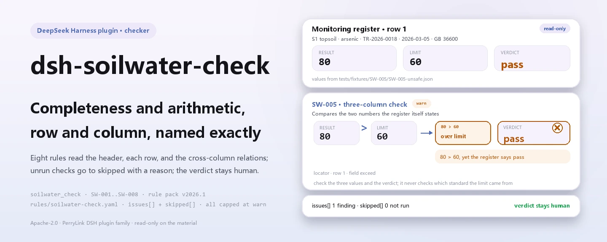
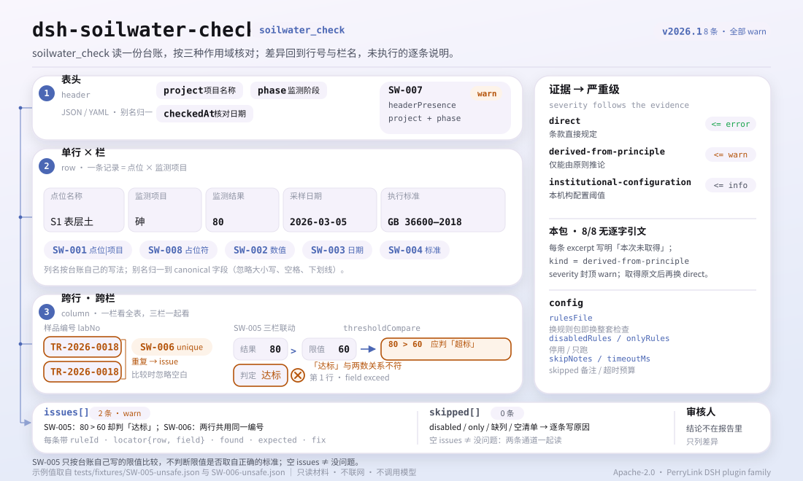

<div align="center">

<picture>
  <source media="(prefers-color-scheme: dark)" srcset="docs/assets/dsh-soilwater-check-hero-en-dark.webp">
   60 frente a ese veredicto, ubicada en la fila 1 · field exceed; una diferencia, ninguna comprobación sin ejecutar y el veredicto en manos del revisor">
</picture>

# dsh-soilwater-check

**Verifique un registro de monitoreo de suelo y agua subterránea en cuanto a integridad y coherencia aritmética: obtiene una lista de qué fila, qué columna y qué corregir; el veredicto queda en manos del revisor.**

Un plugin verificador de solo datos para DeepSeek Harness: lee un registro de monitoreo (la cabecera del proyecto más una fila por punto y parámetro), aplica el paquete de reglas versionado que incluye (SW-001..SW-008) y enumera solo las diferencias que puede señalar dentro del material: nunca un veredicto de cumplimiento, nunca una atribución de responsabilidad.

[Instalación](#instalación-en-tres-pasos) · [Configuración](#configuración) · [FAQ](#faq) · [简体中文](README.md) · [English](README.en.md) · [Español](README.es.md) · [Português](README.pt.md) · [हिन्दी](README.hi.md)

[](LICENSE)
[](#compatibilidad)
[](https://www.npmjs.com/package/dsh-soilwater-check)
[](https://github.com/PerryLink/dsh-soilwater-check/actions/workflows/ci.yml)
[](#compatibilidad)

[](https://github.com/PerryLink/dsh-soilwater-check/stargazers)
[](https://www.npmjs.com/package/dsh-soilwater-check)
[](https://dshfind.com/en/plugins/PerryLink/dsh-soilwater-check?ref=badge)
[](https://securityscorecards.dev/viewer/?uri=github.com/PerryLink/dsh-soilwater-check)
[](https://dsh.market/)
[](https://gitee.com/perrylink/dsh-soilwater-check)

```sh
dsh plugin --profile <name> add dsh-soilwater-check
```

</div>

<sub>Plugin de la comunidad, no afiliado a DeepSeek. Repositorio canónico: <https://github.com/PerryLink/dsh-soilwater-check> (Gitee es un espejo).</sub>

## Qué es

`dsh-soilwater-check` lee un registro de monitoreo de suelo y agua subterránea —la cabecera del proyecto más una fila por punto y parámetro— y comprueba la integridad y la aritmética de ese mismo registro: que cada fila nombre su punto y su parámetro, que el resultado registrado se pueda analizar como número, que la fecha de muestreo se pueda analizar y no sea posterior a la fecha de verificación, que se registre una norma aplicable, que el veredicto de superación concuerde con la relación entre el resultado y el límite que el propio registro declara, que no se repita ningún número de muestra, que la cabecera declare el proyecto y la fase de monitoreo, y que no quede ningún marcador de plantilla en la columna del parámetro.

No decide el cumplimiento, no atribuye responsabilidades y no sustituye al revisor; solo enumera las diferencias que puede señalar dentro del material.

- **Para quién**: personal de registros y revisión de monitoreo ambiental e investigación de sitios; no hace falta saber usar la línea de comandos: entregue el material en el chat.
- **Qué entrega**: el material original sobre el que trabaja la comprobación (un registro, tabla o documento); el original nunca se modifica. Excel puede convertirse antes a JSON/YAML, también en el chat si la plataforma lo permite.
- **Qué recibe**: una lista de «qué fila, qué columna, qué falta, cómo corregirlo»; toda comprobación que no pudo ejecutarse aparece en `skipped` con su motivo.

<picture>
  <source media="(prefers-color-scheme: dark)" srcset="docs/assets/dsh-soilwater-check-flow-v5-dark.svg">
  
</picture>

## Instalación en tres pasos

1. **Instalar** (elija un canal):

   ```sh
   # canal git (último main; equivale a git+https://github.com/PerryLink/dsh-soilwater-check.git)
   dsh plugin --profile <name> add github:PerryLink/dsh-soilwater-check
   # canal npm (versiones publicadas)
   dsh plugin --profile <name> add dsh-soilwater-check
   # canal tarball: tras pnpm pack en este repositorio
   dsh plugin --profile <name> add ./dsh-soilwater-check-<version>.tgz
   ```

2. **Configuración mínima** (los valores por defecto bastan; una fila de bundle sin `config` usa todos los valores por defecto, con la ruta del paquete de reglas apuntando al `rules/soilwater-check.yaml` incluido):

   ```yaml
   - insert:
       - id: dsh-soilwater-check
         name: dsh-soilwater-check
   ```

3. **Verificar que se monta**:

   ```sh
   dsh --profile <name> --dump-config | grep 'dsh-soilwater-check'
   ```

   En un checkout, ejecute primero `pnpm run build` para producir `lib/`, y luego la muestra incluida (entrada en `samples/quickstart/input/`, salida esperada en `samples/quickstart/expected/result.json`):

   ```sh
   node samples/quickstart/run.mjs --json
   ```

   ```json
   {
     "tool": "soilwater_check",
     "issueCount": 1,
     "summary": {
       "error": 0,
       "warn": 1,
       "info": 0
     },
     "skippedCount": 0
   }
   ```

**Desinstalar**: `dsh plugin --profile <name> remove dsh-soilwater-check` (o elimine la fila del patch del perfil).

<details>
<summary>Usarlo en WorkBuddy / Coze</summary>

Busque «Professional Document Check Suite» (el conjunto completo; esta comprobación es una parte; disponibilidad según el catálogo) en WorkBuddy / Coze para usar la misma capacidad de verificación sin línea de comandos.

</details>

<details>
<summary>Instalar desde el mercado de DSH Desktop</summary>

Todos los plugins de PerryLink se listan en el mercado integrado de DSH Desktop: **Mercado → Fuentes → Añadir fuente → pegar** `https://perrylink-dsh-catalog.perrylink.workers.dev/catalog-source.json` **→ seleccionar**. La instalación sigue requiriendo la verificación de identidad npm del mercado y su confirmación.

</details>

## Capacidades principales

`dsh-soilwater-check` registra la herramienta `soilwater_check`: lee un registro de monitoreo, aplica un paquete de reglas versionado y devuelve un informe.

- **Ocho reglas en un paquete de datos** — el paquete de reglas es datos, no código (`rules/soilwater-check.yaml`); sustituirlo cambia todo el conjunto de comprobaciones sin tocar una línea de TypeScript.
- **Solo lectura sobre el material** — acepta JSON o YAML y nunca modifica el original; ESM puro, sin peticiones de red, sin llamadas al modelo.
- **Sin citas fabricadas** — cada regla lleva `document` / `number` / `clause` / `excerpt` / `kind` / `source`. Cada `excerpt` de este paquete dice, con todas las letras, que el texto de la cláusula no se obtuvo; una paráfrasis nunca se disfraza de cita. El guardián de carga no distingue una cita de una descripción, así que una prueba exige que cada `excerpt` admita esa laguna.
- **La gravedad sigue a la evidencia** — `derived-from-principle` se limita a `warn`, la configuración institucional (`institutional-configuration`) a `info`, y una prueba lo exige; todas las reglas de este paquete son `derived-from-principle` y, por tanto, se limitan a `warn`.
- **Una lista vacía nunca es «no hay nada malo»** — toda comprobación que no pudo ejecutarse se informa en `skipped` con su motivo; un campo ausente, una lista sin configurar o un valor no analizable hacen que la regla se informe en `skipped` en lugar de pasar en silencio.
- **Sin lenguaje que adjudique** — el informe enumera diferencias y nunca se pronuncia sobre cumplimiento, responsabilidad o corrección; un guardián de redacción lo impone y todo informe lleva el descargo de responsabilidad.

| Regla | Comprobación | Gravedad | Tipo de base |
|---|---|---|---|
| `SW-001` | el punto y el parámetro están registrados | warn | principle |
| `SW-002` | el resultado se analiza como número | warn | principle |
| `SW-003` | la fecha de muestreo se analiza y no es futura | warn | principle |
| `SW-004` | cada fila registra una norma aplicable | warn | principle |
| `SW-005` | el veredicto concuerda con el resultado y el límite | warn | principle |
| `SW-006` | los números de muestra son únicos en el registro | warn | principle |
| `SW-007` | la cabecera nombra el proyecto y la fase de monitoreo | warn | principle |
| `SW-008` | la columna del parámetro no conserva marcadores sin sustituir | warn | principle |

### Ejemplos

Estos son los puntos de entrada reales del plugin; instálelo una vez y llame a uno.

**Ejemplo detallado** — herramienta `soilwater_check`, entrada:

~~~json
{"rows":[{"监测结果":"80","标准限值":"60","超标情况":"达标"}]}
~~~

Salida:

~~~json
{
  "id": "dsh-soilwater-check.SW-005.de09b5a6",
  "ruleId": "SW-005",
  "severity": "warn",
  "locator": {
    "row": 1,
    "field": "exceed"
  },
  "found": "第 1 行「result」为 80、「limit」为 60，而判定为「达标」",
  "expected": "80 超过限值 60，判定应表示超标",
  "fix": "核对三个数值与判定；本条只按台账自己写的限值比较，不判断该限值是否取对了标准"
}
~~~

*Observado en `dsh-soilwater-check/tests/fixtures/SW-005/SW-005-unsafe.json`*

## Normas que sigue

| Documento | Número | Reglas que lo citan |
|---|---|---|
| Directrices técnicas para la investigación de la contaminación del suelo en terrenos de construcción (título chino canónico en `rules/evidence/`) | HJ 25.1—2019 (sustituye a HJ 25.1-2014; números de cláusula no obtenidos en esta pasada) | SW-001, SW-003, SW-007, SW-008 |
| Especificación técnica para el monitoreo ambiental de aguas subterráneas (título chino canónico en `rules/evidence/`) | HJ 164—2020 (sustituye a HJ/T 164—2004; publicada el 2020-12-01, en vigor desde el 2021-03-01; números de cláusula no obtenidos en esta pasada) | SW-002, SW-006 |
| Calidad ambiental del suelo — Norma de control de riesgos de contaminación del suelo en terrenos de desarrollo (ensayo) (título chino canónico en `rules/evidence/`) | GB 36600—2018 (texto de cláusula no obtenido en esta pasada) | SW-004, SW-005 |

**Jerarquía normativa:** GB 36600—2018 es una norma nacional (obligatoria, vigente; la revisión del 2024-07-23 la mantuvo válida; el número no lleva `/T`); GB/T 14848—2017 es una norma nacional recomendada (no es la base de ninguna regla de este paquete); HJ 25.1—2019 y HJ 164—2020 son normas sectoriales, no normas nacionales obligatorias. No confunda HJ/T 164—2004 con HJ 164—2020: el número nuevo no lleva `/T`.

## Configuración

Todos los parámetros ajustables son campos Schemastery `Config` de `src/config.ts` (modificables desde cordis.yml); los umbrales por regla están en el paquete de reglas bajo `rules/`. Una sustitución dirigida por id reemplaza la fila entera: repita todas las claves que necesite.

| Clave | Tipo | Predeterminado | Descripción |
|---|---|---|---|
| `rulesFile` | string | `rules/soilwater-check.yaml` | Ruta del paquete de reglas, relativa a la raíz del paquete |
| `disabledRules` | string[] | `[]` | Ids de reglas que se dejan de ejecutar; cada una aparece en `skipped` |
| `onlyRules` | string[] | `[]` | Ejecutar solo estas reglas; vacío ejecuta todas |
| `skipNotes` | string | `""` | Nota añadida a cada motivo de `skipped` |
| `timeoutMs` | number | `120000` | Presupuesto de tiempo de espera cooperativo de la herramienta |

Parámetros a nivel de regla que conviene conocer:

- `SW-005` `valueField` / `limitField` / `verdictField` / `overValues` / `atMostValues` / `tolerance` — las tres columnas y los dos vocabularios de veredicto. Un veredicto fuera de ambas listas se informa para que una redacción nueva no pase inadvertida.
- `SW-008` `terms` — el vocabulario de marcadores que se busca.
- `SW-001` `fields`, `SW-002` `field`, `SW-003` `field`, `SW-004` `field`, `SW-006` `field`, `SW-007` `fields` — las columnas que lee cada regla; los valores por defecto están en `rules/soilwater-check.yaml`.

Vocabularios predeterminados incluidos (se conservan literalmente porque las columnas del registro están en chino):

```text
SW-005 overValues:   [超标, 是, Y, yes, true, 超出, 不合格]
SW-005 atMostValues: [达标, 否, N, no, false, 未超标, 合格]
SW-008 terms:        ["【","】","{{","}}","XXX","xxx","待填","待补充","TBD","todo","示例"]
```

Ejemplo de sustitución en el patch del perfil:

```yaml
- insert:
    - id: dsh-soilwater-check
      name: dsh-soilwater-check
      config:
        disabledRules: [SW-008]
        timeoutMs: 180000
```

## Formato del material

La herramienta acepta JSON o YAML:

```yaml
project: 某某场地调查
phase: 初步调查
rows:
  - { 序号: '1', 点位名称: S1 表层土, 介质: 土壤, 采样日期: 2026-03-05,
      样品编号: TR-2026-0018, 监测项目: 砷, 监测结果: '12.5', 单位: mg/kg,
      执行标准: GB 36600—2018 第二类用地筛选值, 标准限值: '60', 超标情况: 达标 }
```

Los nombres de columna se comparan sin distinguir mayúsculas y minúsculas y ignorando espacios, guiones bajos y guiones; se conservan los nombres de columna del propio registro, de modo que un hallazgo nombra la columna que leyó. El resultado puede llevar unidad; la notación de límite de detección (como «no detectado» o `<0.01`) se informa como no analizable a propósito. Los campos son opcionales en la capa de lectura y los valida el motor, de modo que una exportación parcial produce hallazgos sobre lo que falta en lugar de un fallo. El `project` de la cabecera es el nombre del proyecto y `phase` la fase de monitoreo (investigación preliminar, investigación detallada, evaluación de la eficacia de la remediación, etc.).

## Origen de las reglas

Los datos de las reglas están en `rules/soilwater-check.yaml`, separados del código: cada regla lleva documento, número, cláusula en la numeración propia de la fuente, extracto literal y URL de origen. La cabecera del paquete expone por completo la laguna de citas, y el `note` de cada regla repite la parte que le concierne. El guardián de carga que normalmente exige «un extracto debe ser una cita real de al menos ocho caracteres» no distingue una cita de una descripción; por eso este paquete se apoya en la cabecera, en las notas por regla y en una prueba que exige que cada `excerpt` admita la laguna. Un paquete que exagera su base falla en la carga en lugar de producir un informe de apariencia convincente. Los límites verificados y las conclusiones deliberadamente **no** afirmadas se incluyen en el directorio `rules/evidence/`.

## FAQ

<details>
<summary>El registro dice «达标», pero el resultado supera el límite escrito al lado. ¿Se detecta?</summary>

Sí. `SW-005` compara el resultado con el límite que el propio registro declara y señala la fila cuando el veredicto no concuerda con esa comparación. No incorpora ningún límite propio, así que no puede detectar un límite tomado de la norma o de la categoría de uso del suelo equivocada, y un veredicto fuera de sus listas configuradas se informa por separado.

</details>

<details>
<summary>La celda del resultado dice «no detectado» o `<0.01`, porque el valor está por debajo del límite de detección. ¿Qué hace la comprobación?</summary>

`SW-002` lo informa. La regla lee solo la parte numérica de la celda (`0.85` y `1.2×10-3` se aceptan), así que la notación de límite de detección se informa como no analizable a propósito: registre el valor y ponga la observación en otra columna, o desactive la regla. Comprueba que se pueda analizar, no si la cifra es real ni si el método es correcto.

</details>

<details>
<summary>Una fila deja vacía la columna de la norma. ¿Se detecta?</summary>

`SW-004` exige que la norma esté rellenada en toda fila que lleve esa columna. Comprueba que se escriba una norma, no que sea la que corresponde: si la norma registrada concuerda con el uso del suelo y el medio es una cuestión sustantiva que el plugin deja al lector.

</details>

<details>
<summary>Una fecha de muestreo es posterior a la fecha de verificación, y otra fila escribe la fecha como `2026/3/15`. ¿Qué pasa?</summary>

`SW-003` informa de un `sampledAt` posterior a la fecha de verificación. La regla lee `2026-03-15` y `2026-03-15 09:30`; cualquier otra forma se informa como no analizable en lugar de omitirse en silencio. Solo compara fechas: no juzga si el dato es fiable.

</details>

<details>
<summary>El mismo número de muestra aparece en dos filas. ¿Es un error?</summary>

`SW-006` informa de un número de muestra repetido, porque la repetición rompe el enlace entre el informe del laboratorio y el registro; la comparación ignora los espacios. Varios parámetros de una misma muestra que comparten un número de muestra es la forma prevista: manténgalos en filas separadas, pero no reutilice la columna del número de fila. Si no hay columna de número de muestra, la regla se informa en `skipped` en lugar de pasar en silencio.

</details>

<details>
<summary>La celda del parámetro todavía contiene un marcador de plantilla, porque el registro se copió de la plantilla. ¿Se detecta?</summary>

`SW-008` informa del marcador que queda en la columna del parámetro (corchetes, llaves dobles, `XXX`, `TBD` y las palabras de plantilla para «por rellenar» y «ejemplo»; la lista es editable en el paquete). Tenga en cuenta que `SW-001` solo pide que el nombre del punto o el parámetro esté rellenado, así que un marcador cuenta como relleno allí; la regla de marcadores es la que lo detecta. Ninguna de las dos juzga si el factor es el que se debe monitorear.

</details>

## Límites de seguridad

Este plugin comprueba un **registro de monitoreo de suelo y agua subterránea** en cuanto a integridad y aritmética: que cada registro nombre su punto y su parámetro, que el resultado se analice como número, que la fecha de muestreo no sea futura, que se registre una norma aplicable, que el veredicto de superación concuerde con la relación entre el resultado y el límite que el registro declara, que los números de muestra sean únicos, que el registro nombre su proyecto y fase de monitoreo, y que no sobreviva ningún marcador. **No** decide si un sitio está contaminado, si hace falta remediación, si se alcanzaron los objetivos de remediación o si las conclusiones de una investigación se sostienen.

> ### ⚠️ Lo que este plugin deliberadamente no puede hacer
>
> **No incorpora límites y no comprueba que el límite se haya tomado de la norma correcta.** `SW-005` compara el resultado medido con el límite **que el propio registro declara** y comprueba que el veredicto concuerde. Por eso **no puede encontrar el error consecuente: un valor de cribado tomado de la norma o de la categoría de uso del suelo equivocada.** Elegir entre los valores de cribado de la primera y la segunda categoría de GB 36600, o entre GB 36600 y GB/T 14848, depende del uso del suelo y del medio: este plugin no lee ninguno de los dos. Ese límite está declarado en la cabecera del paquete, en las notas de `SW-004` y `SW-005`, y en la sección de solución de problemas.
>
> `SW-002` exige un número analizable, así que un registro que escriba notación de límite de detección («no detectado», `<0.01`) se **informa como no analizable a propósito**: registre el valor con una observación, o desactive la regla.
>
> **Cada `excerpt` del paquete de reglas dice, con todas las letras, que el texto de la cláusula no se obtuvo.** El régimen vive en GB 36600—2018, GB/T 14848—2017, HJ 25.1 y HJ 164. La pasada de verificación no pudo recuperar el texto literal de las cláusulas, así que el paquete declara la laguna en el propio campo `excerpt` y mantiene cada regla en `warn` o `info`. **Cuando los textos estén disponibles, sustituya cada `excerpt` por la cláusula real y eleve `kind` a `direct`.**

En torno a ese límite de capacidad, el plugin también respeta estas restricciones:

- **Solo lectura sobre el material.** La herramienta solo lee el JSON/YAML que se le entrega; no escribe archivos, no hace peticiones de red y no llama a ningún modelo (`package.json#dsh.demo` declara `reads` como el archivo de material indicado por el usuario, `writes: []` y `network: false`).
- **Sin adjudicación.** El informe enumera diferencias y lleva el descargo de responsabilidad; un guardián de redacción prohíbe conclusiones de cumplimiento, responsabilidad o corrección.
- **Sin citas fabricadas.** Sin el texto fuente, `kind` se queda en `derived-from-principle` y la gravedad en `warn`: una laguna de cita nunca recibe la confianza de `direct`.
- **Sin aprobación silenciosa.** Toda comprobación que no pudo ejecutarse va a `skipped` con su motivo; una lista `issues` vacía no significa «el material está bien».

## Limitaciones conocidas

- **No comprueba que el límite provenga de la norma correcta.** `SW-005` solo compara con el límite que el propio registro declara. Si ese límite pertenece a la norma y a la categoría de uso del suelo correctas es una cuestión sustantiva que no toca.
- **Un resultado igual a su límite no se trata como superación.** `SW-005` trata la igualdad como «no superado»; si su criterio considera que «igual al valor de cribado» supera, ajuste `tolerance` ligeramente por debajo de cero o ajuste los datos.
- **La notación de límite de detección se informa como no analizable.** `SW-002` exige un número analizable; «no detectado» no es un número: registre el valor con una observación, o desactive la regla.
- **Varios parámetros de una muestra deben tener su propia fila.** Compartir un número de muestra es normal; `SW-006` usa como clave la columna del número de muestra, así que no reutilice la columna del número de fila.

### Solución de problemas

- **El plugin se instala pero la herramienta no aparece.** Compruebe que `main` resuelve a `lib/index.mjs` y que `pnpm run build` lo generó; un `main` incorrecto hace que el cargador omita la entrada en silencio.
- **`dsh plugin add` rechaza el paquete como incompatible.** El rango de peers cubre `0.1.x` y `0.2.x`; si su runtime queda fuera, conceda una exención explícita: `dsh plugin --profile <name> allow-version dsh-soilwater-check@0.1.0 --dsh-version <runtime> --accept-risk`
- **Una regla no se ejecutó.** Lea el arreglo `skipped`; indica el id de la regla y el motivo.
- **`check` informa `manifest-peers` como fallo.** El comprobador estático compara con un rango de peers codificado que es anterior a la línea 0.2. El runtime aplica la compatibilidad al instalar, así que el rango declarado es el correcto; es un problema conocido de `dsh-plugin-dev`.
- **Los horarios parecen desplazados.** Toda la aritmética es de hora local sobre las cadenas entregadas, sin conversión de zona horaria.

## Interoperabilidad con otros plugins de DSH

Este plugin es un verificador de solo datos que registra una única herramienta, `soilwater_check`, y no se une a la cadena de eventos del host:

- **Sin colisión de nombres de herramienta.** El nombre `soilwater_check` es propio de este plugin; no ocupa el nombre de una herramienta integrada.
- **Sin colisión de claves de servicio.** No proporciona ninguna clave de servicio, así que no puede colisionar en una.
- **Sin colisión de slots ni de rutas.** No registra ningún slot de cliente ni ningún prefijo `webServer` o ruta HTTP.
- **Sin colisión de eventos.** No escucha ningún evento compartido (`agent/pre-step`, `tools/post-execute` y similares), así que no compite en una cadena de listeners.
- **Sin colisión de capas de patch.** El patch del bundle (`cordis.patch.yml`) solo `insert`a su propia fila; nunca sobrescribe el `config` de una fila integrada.
- **Sin mutación global.** No parchea prototipos, no reescribe `process.env` ni sustituye el dispatcher global de fetch.
- **Solo lee su propia entrada.** La herramienta lee el texto del material que le pasa el llamador; no lee el almacenamiento de otro plugin, no hace peticiones de red ni llama a un modelo.

## Compatibilidad

| Superficie | Estado |
|---|---|
| Harness | Rango de peers `>=0.1.2-rc.1 <0.2.0 \|\| >=0.2.0-0 <0.3.0` — verificado para aceptar tanto `0.2.0-rc.2` como `0.2.1-rc.2`. **`engines.dsh` se declara como `>=0.2.1-0 <0.3.0`** y el host lo aplica desde 0.2.1 |
| Node | `^22.19.0 \|\| >=24.0.0` |
| Plataformas | Todas (ESM puro; sin código nativo, sin red, sin llamada al modelo) |
| Modo de herramienta | Funciona en `native` y `ptc`; para una ronda de muestreo completa use `ptc` |

## Ecosistema y calidad

- [Espejo en Gitee](https://gitee.com/perrylink/dsh-soilwater-check) (espejo sincronizado; GitHub es el canónico)
- [Página del plugin en dshfind](https://dshfind.com/en/plugins/PerryLink/dsh-soilwater-check) (instalaciones y ranking)
- [Informe de OpenSSF Scorecard](https://securityscorecards.dev/viewer/?uri=github.com/PerryLink/dsh-soilwater-check) (impulsado por [.github/workflows/scorecard.yml](.github/workflows/scorecard.yml))
- [DSH Market](https://dsh.market/) (listado)
- **Canal de la tienda 1024**: `npm i -g dsh1024` una vez, luego `dsh1024 plugin --profile <name> add dsh-soilwater-check` (cuenta para el ranking de instalaciones de [deepseek1024.com](https://deepseek1024.com))
- [Base de conocimiento del ecosistema](https://perrylink.github.io/dsh-plugin-guide/) — guía de desarrollo de plugins · datos de selección medidos · criterios de mantenimiento

## Desarrollo

```sh
pnpm install                                        # node ^22.19 || >=24
pnpm run typecheck                                  # tsc --noEmit
pnpm test                                           # vitest: suite compartida de plugins de tabla + fixtures emparejados
pnpm run build                                      # tsdown -> lib/index.mjs + lib/index.d.mts
pnpm run verify:self-contained                      # las dependencias se resuelven desde el registry
pnpm run check:lockfile                             # comprobación de deriva del lockfile
pnpm run check:readmes                              # consistencia de los README en cinco idiomas
pnpm run check:citations                            # línea base de citas del paquete de reglas
node ../scripts/sync-shared.mjs dsh-soilwater-check   # refrescar src/shared desde ../_shared
pnpm pack                                           # el tarball publicado
```

`sync-shared` copia el kit compartido de `../_shared` a `src/shared/`; vuelva a ejecutarlo tras cada cambio compartido. El plugin es **de solo datos**: `src/model.ts` declara la forma de la tabla, el kit compartido aporta el lector y el motor de comprobación, y el paquete de reglas declara cada comprobación.

Ejecución local de la muestra (requiere `pnpm run build` antes para producir `lib/`):

```sh
node samples/quickstart/run.mjs --json
```

La entrada de la muestra está en `samples/quickstart/input/` y la salida esperada en `samples/quickstart/expected/result.json`. Las imágenes del README se generan programáticamente con [`scripts/gen-readme-assets.py`](scripts/gen-readme-assets.py) (Pillow para la imagen principal y SVG escrito a mano para el diagrama de estructura) y se pueden volver a ejecutar; el diagrama de flujo y las imágenes de demostración de una sola versión permanecen en `docs/assets/` para enlaces externos, mientras que los README solo referencian el par claro/oscuro de la imagen principal y de flow-v5.

Topics: `deepseek-harness`, `dsh`, `dsh-plugin`, `cordis`, `soilwater`

## Familia y agradecimientos

Este proyecto forma parte de la familia de plugins de DeepSeek Harness de [PerryLink](https://github.com/PerryLink) (todos Apache-2.0). Índice completo de la familia: [elegir un verificador por material](https://perrylink.github.io/zh/checkers/choose/) y [todos los plugins](https://github.com/PerryLink). Si le resulta útil, **una estrella ayuda a que la siguiente persona lo encuentre** — no desbloquea nada.

- [@PerryLink](https://github.com/PerryLink) — creador y mantenedor: el paquete de reglas de solo datos (SW-001..SW-008), la herramienta `soilwater_check`, el registro de verificación de citas y la documentación en cinco idiomas.

<details>
<summary>Expandir todos los plugins</summary>

| Plugin | Estado |
|---|---|
| **[dsh-aqua-input-check](https://github.com/PerryLink/dsh-aqua-input-check)** |  |
| **[dsh-archive-check](https://github.com/PerryLink/dsh-archive-check)** |  |
| **[dsh-auto-review](https://github.com/PerryLink/dsh-auto-review)** |  |
| **[dsh-autotier](https://github.com/PerryLink/dsh-autotier)** | 🧊 CONGELADO — ver el README del repo |
| **[dsh-bid-ca-precheck](https://github.com/PerryLink/dsh-bid-ca-precheck)** |  |
| **[dsh-bid-qual-check](https://github.com/PerryLink/dsh-bid-qual-check)** |  |
| **[dsh-cert-mcp](https://github.com/PerryLink/dsh-cert-mcp)** | 🧊 CONGELADO — ver el README del repo |
| **[dsh-checkpoint-rewind](https://github.com/PerryLink/dsh-checkpoint-rewind)** |  |
| **[dsh-click](https://github.com/PerryLink/dsh-click)** |  |
| **[dsh-composer-history](https://github.com/PerryLink/dsh-composer-history)** |  |
| **[dsh-contract-stance](https://github.com/PerryLink/dsh-contract-stance)** |  |
| **[dsh-customs-doc-check](https://github.com/PerryLink/dsh-customs-doc-check)** |  |
| **[dsh-data-quality](https://github.com/PerryLink/dsh-data-quality)** | 🧊 CONGELADO — ver el README del repo |
| **[dsh-demurrage-ledger](https://github.com/PerryLink/dsh-demurrage-ledger)** |  |
| **[dsh-doublecheck](https://github.com/PerryLink/dsh-doublecheck)** |  |
| **[dsh-drill-script-check](https://github.com/PerryLink/dsh-drill-script-check)** |  |
| **[dsh-eia-guide-check](https://github.com/PerryLink/dsh-eia-guide-check)** |  |
| **[dsh-emergency-plan](https://github.com/PerryLink/dsh-emergency-plan)** |  |
| **[dsh-essay-rubric-check](https://github.com/PerryLink/dsh-essay-rubric-check)** |  |
| **[dsh-evidence-check](https://github.com/PerryLink/dsh-evidence-check)** |  |
| **[dsh-export-ctl-check](https://github.com/PerryLink/dsh-export-ctl-check)** |  |
| **[dsh-fast](https://github.com/PerryLink/dsh-fast)** |  |
| **[dsh-fmea-table-check](https://github.com/PerryLink/dsh-fmea-table-check)** |  |
| **[dsh-forecast-penalty](https://github.com/PerryLink/dsh-forecast-penalty)** |  |
| **[dsh-fund-research](https://github.com/PerryLink/dsh-fund-research)** |  |
| **[dsh-github](https://github.com/PerryLink/dsh-github)** |  |
| **[dsh-gongwen-flow-check](https://github.com/PerryLink/dsh-gongwen-flow-check)** |  |
| **[dsh-gongwen-word-check](https://github.com/PerryLink/dsh-gongwen-word-check)** |  |
| **[dsh-guard-plan-qc](https://github.com/PerryLink/dsh-guard-plan-qc)** |  |
| **[dsh-hazchem-check](https://github.com/PerryLink/dsh-hazchem-check)** |  |
| **[dsh-hazplan-check](https://github.com/PerryLink/dsh-hazplan-check)** |  |
| **[dsh-hidden-risk-map](https://github.com/PerryLink/dsh-hidden-risk-map)** |  |
| **[dsh-hs-classify](https://github.com/PerryLink/dsh-hs-classify)** |  |
| **[dsh-icd-rule-check](https://github.com/PerryLink/dsh-icd-rule-check)** |  |
| **[dsh-industry-research](https://github.com/PerryLink/dsh-industry-research)** |  |
| **[dsh-lawcite-adapter](https://github.com/PerryLink/dsh-lawcite-adapter)** |  |
| **[dsh-laya](https://github.com/PerryLink/dsh-laya)** |  |
| **[dsh-lc-doc-check](https://github.com/PerryLink/dsh-lc-doc-check)** |  |
| **[dsh-learning-gap-check](https://github.com/PerryLink/dsh-learning-gap-check)** |  |
| **[dsh-library](https://github.com/PerryLink/dsh-library)** |  |
| **[dsh-local-ai](https://github.com/PerryLink/dsh-local-ai)** |  |
| **[dsh-lsp-actions](https://github.com/PerryLink/dsh-lsp-actions)** |  |
| **[dsh-mask](https://github.com/PerryLink/dsh-mask)** |  |
| **[dsh-mcp-panel](https://github.com/PerryLink/dsh-mcp-panel)** |  |
| **[dsh-medrec-qc](https://github.com/PerryLink/dsh-medrec-qc)** |  |
| **[dsh-memento](https://github.com/PerryLink/dsh-memento)** | 🧊 CONGELADO — ver el README del repo |
| **[dsh-nsfc-form-check](https://github.com/PerryLink/dsh-nsfc-form-check)** |  |
| **[dsh-nurse-record-check](https://github.com/PerryLink/dsh-nurse-record-check)** |  |
| **[dsh-observe](https://github.com/PerryLink/dsh-observe)** |  |
| **[dsh-origin-rvc-check](https://github.com/PerryLink/dsh-origin-rvc-check)** |  |
| **[dsh-ota-review-check](https://github.com/PerryLink/dsh-ota-review-check)** |  |
| **[dsh-output-styles](https://github.com/PerryLink/dsh-output-styles)** |  |
| **[dsh-paper-doc-adapter](https://github.com/PerryLink/dsh-paper-doc-adapter)** |  |
| **[dsh-permission-rules](https://github.com/PerryLink/dsh-permission-rules)** |  |
| **[dsh-permit-report-check](https://github.com/PerryLink/dsh-permit-report-check)** |  |
| **[dsh-pipeline-check](https://github.com/PerryLink/dsh-pipeline-check)** |  |
| **[dsh-pleading-draft](https://github.com/PerryLink/dsh-pleading-draft)** |  |
| **[dsh-plugin-doctor](https://github.com/PerryLink/dsh-plugin-doctor)** | 🚫 RETIRADO (repo archivado) |
| **[dsh-plugin-guide](https://github.com/PerryLink/dsh-plugin-guide)** |  |
| **[dsh-plugin-kit](https://github.com/PerryLink/dsh-plugin-kit)** | 🚫 RETIRADO (repo archivado) |
| **[dsh-plugin-upgrade](https://github.com/PerryLink/dsh-plugin-upgrade)** | 🚫 RETIRADO (repo archivado) |
| **[dsh-policy-brief-draft](https://github.com/PerryLink/dsh-policy-brief-draft)** |  |
| **[dsh-power-loss-split](https://github.com/PerryLink/dsh-power-loss-split)** |  |
| **[dsh-power-ticket-check](https://github.com/PerryLink/dsh-power-ticket-check)** |  |
| **[dsh-ppap-check](https://github.com/PerryLink/dsh-ppap-check)** |  |
| **[dsh-protest-deadline](https://github.com/PerryLink/dsh-protest-deadline)** |  |
| **[dsh-railway-window](https://github.com/PerryLink/dsh-railway-window)** |  |
| **[dsh-repair-order-qc](https://github.com/PerryLink/dsh-repair-order-qc)** |  |
| **[dsh-research-report](https://github.com/PerryLink/dsh-research-report)** |  |
| **[dsh-review-reply-check](https://github.com/PerryLink/dsh-review-reply-check)** |  |
| **[dsh-rulefile-check](https://github.com/PerryLink/dsh-rulefile-check)** |  |
| **[dsh-safety-brief-check](https://github.com/PerryLink/dsh-safety-brief-check)** |  |
| **[dsh-score](https://github.com/PerryLink/dsh-score)** | 🧊 CONGELADO — ver el README del repo |
| **[dsh-session-sync](https://github.com/PerryLink/dsh-session-sync)** |  |
| **[dsh-site-log-check](https://github.com/PerryLink/dsh-site-log-check)** |  |
| **[dsh-skill-pack-security](https://github.com/PerryLink/dsh-skill-pack-security)** |  |
| **[dsh-soe-decision-check](https://github.com/PerryLink/dsh-soe-decision-check)** |  |
| **[dsh-soilwater-check](https://github.com/PerryLink/dsh-soilwater-check)** |  |
| **[dsh-sop-sync-check](https://github.com/PerryLink/dsh-sop-sync-check)** |  |
| **[dsh-spc-gbt-adapter](https://github.com/PerryLink/dsh-spc-gbt-adapter)** |  |
| **[dsh-talk](https://github.com/PerryLink/dsh-talk)** |  |
| **[dsh-tender-extract](https://github.com/PerryLink/dsh-tender-extract)** |  |
| **[dsh-tender-matrix](https://github.com/PerryLink/dsh-tender-matrix)** |  |
| **[dsh-test-drive](https://github.com/PerryLink/dsh-test-drive)** |  |
| **[dsh-ticktick](https://github.com/PerryLink/dsh-ticktick)** | 🚫 RETIRADO (repo archivado) |
| **[dsh-translate](https://github.com/PerryLink/dsh-translate)** |  |
| **[dsh-warranty-calc](https://github.com/PerryLink/dsh-warranty-calc)** |  |
| **[dsh-budget](https://github.com/PerryLink/dsh-budget)** | 🧊 CONGELADO — ver el README del repo |
| **[dsh-claude-move](https://github.com/PerryLink/dsh-claude-move)** | 🧊 CONGELADO — ver el README del repo |
| **[dsh-defend](https://github.com/PerryLink/dsh-defend)** | 🧊 CONGELADO — ver el README del repo |
| **[dsh-draw](https://github.com/PerryLink/dsh-draw)** | 🧊 CONGELADO — ver el README del repo |
| **[dsh-reach](https://github.com/PerryLink/dsh-reach)** | 🧊 CONGELADO — ver el README del repo |
| **[dsh-background-agents](https://github.com/PerryLink/dsh-background-agents)** | 🚫 RETIRADO (repo archivado) |
| **[dsh-session-pin](https://github.com/PerryLink/dsh-session-pin)** | 🚫 RETIRADO (repo archivado) |
| **[dsh-team-rooms](https://github.com/PerryLink/dsh-team-rooms)** | 🚫 RETIRADO (repo archivado) |

</details>

## Licencia

[LICENSE](LICENSE) (Apache License 2.0) © 2026 dsh-soilwater-check contributors

<p align="center"><sub>Apache-2.0 · Plugin de la comunidad, no afiliado a DeepSeek.</sub></p>
