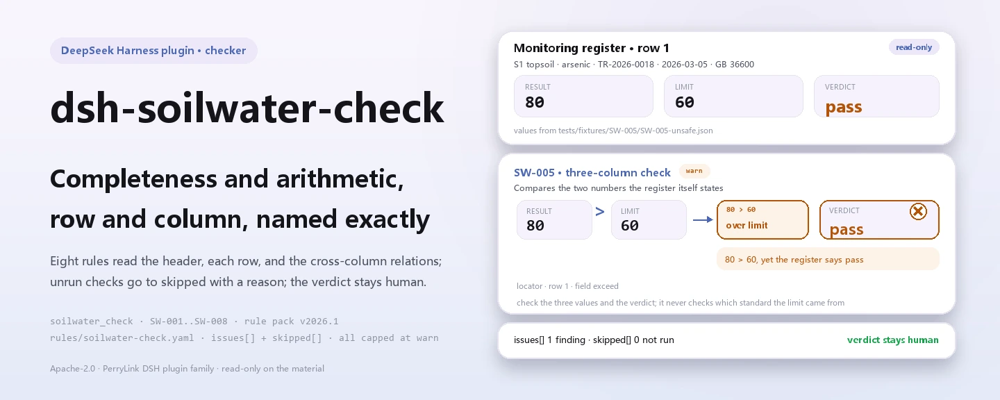
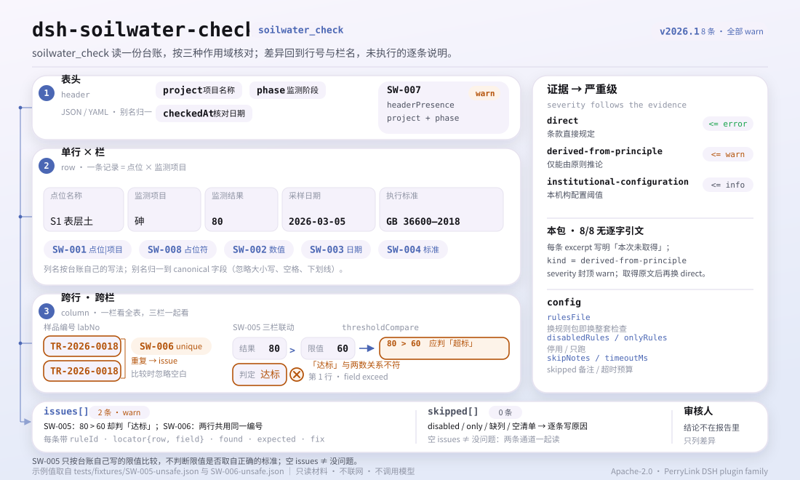

<div align="center">

<picture>
  <source media="(prefers-color-scheme: dark)" srcset="docs/assets/dsh-soilwater-check-hero-en-dark.webp">
   60 को उस निर्णय के सामने दिखाती है, स्थान पंक्ति 1 · field exceed; एक अंतर, कोई जाँच नहीं छूटी और निर्णय समीक्षक के पास">
</picture>

# dsh-soilwater-check

**मिट्टी और भूजल निगरानी रजिस्टर की पूर्णता और अंकगणितीय सुसंगति की जाँच करें — आपको यह सूची मिलती है कि कौन-सी पंक्ति, कौन-सा कॉलम और क्या सुधारना है; निर्णय समीक्षक के पास रहता है।**

DeepSeek Harness के लिए एक केवल-डेटा जाँच प्लगइन: यह एक निगरानी रजिस्टर पढ़ता है (परियोजना हेडर और प्रत्येक बिंदु तथा पैरामीटर की एक पंक्ति), अपने साथ आने वाला संस्करणित नियम-पैक (SW-001..SW-008) लागू करता है, और केवल वे अंतर गिनाता है जिन्हें वह सामग्री के भीतर इंगित कर सकता है — कभी अनुपालन का निर्णय नहीं, कभी दायित्व का निर्धारण नहीं।

[इंस्टॉल](#तीन-चरणों-में-शुरुआत) · [कॉन्फ़िगरेशन](#कॉन्फ़िगरेशन) · [FAQ](#faq) · [简体中文](README.md) · [English](README.en.md) · [Español](README.es.md) · [Português](README.pt.md) · [हिन्दी](README.hi.md)

[](LICENSE)
[](#अनुकूलता)
[](https://www.npmjs.com/package/dsh-soilwater-check)
[](https://github.com/PerryLink/dsh-soilwater-check/actions/workflows/ci.yml)
[](#अनुकूलता)

[](https://github.com/PerryLink/dsh-soilwater-check/stargazers)
[](https://www.npmjs.com/package/dsh-soilwater-check)
[](https://dshfind.com/en/plugins/PerryLink/dsh-soilwater-check?ref=badge)
[](https://securityscorecards.dev/viewer/?uri=github.com/PerryLink/dsh-soilwater-check)
[](https://dsh.market/)
[](https://gitee.com/perrylink/dsh-soilwater-check)

```sh
dsh plugin --profile <name> add dsh-soilwater-check
```

</div>

<sub>समुदाय प्लगइन, DeepSeek से संबद्ध नहीं। आधिकारिक रेपो: <https://github.com/PerryLink/dsh-soilwater-check> (Gitee एक मिरर है)।</sub>

## यह क्या है

`dsh-soilwater-check` मिट्टी और भूजल निगरानी का एक रजिस्टर पढ़ता है — परियोजना हेडर और प्रत्येक बिंदु तथा पैरामीटर की एक पंक्ति — और उसी रजिस्टर की पूर्णता और अंकगणित की जाँच करता है: क्या प्रत्येक पंक्ति में उसका बिंदु और पैरामीटर दर्ज है, क्या दर्ज परिणाम संख्या के रूप में पढ़ा जा सकता है, क्या नमूना-दिनांक पढ़ा जा सकता है और जाँच-दिनांक से बाद का नहीं है, क्या कोई लागू मानक दर्ज है, क्या सीमा-अतिक्रमण का निर्णय परिणाम और रजिस्टर में ही लिखी सीमा के संबंध से मेल खाता है, क्या कोई नमूना क्रमांक दोहराया नहीं गया है, क्या हेडर परियोजना और निगरानी-चरण घोषित करता है, और क्या पैरामीटर कॉलम में कोई टेम्पलेट प्लेसहोल्डर शेष नहीं है।

यह अनुपालन का निर्णय नहीं देता, दायित्व निर्धारित नहीं करता और समीक्षक का स्थान नहीं लेता; यह केवल वे अंतर गिनाता है जिन्हें सामग्री के भीतर इंगित किया जा सकता है।

- **किसके लिए**: पर्यावरण निगरानी और साइट-जाँच के रिकॉर्ड तथा समीक्षा कर्मी; कमांड लाइन जानने की आवश्यकता नहीं — सामग्री चैट में सौंप दें।
- **आप क्या देते हैं**: वह मूल सामग्री जिस पर यह जाँच काम करती है (रजिस्टर, तालिका या दस्तावेज़); मूल कभी नहीं बदला जाता। Excel को पहले JSON/YAML में बदला जा सकता है, प्लेटफ़ॉर्म समर्थन दे तो चैट में भी।
- **आपको क्या मिलता है**: «कौन-सी पंक्ति, कौन-सा कॉलम, क्या कमी है, कैसे सुधारें» की सूची; हर वह जाँच जो नहीं चल पाई, `skipped` में कारण के साथ दर्ज होती है।

<picture>
  <source media="(prefers-color-scheme: dark)" srcset="docs/assets/dsh-soilwater-check-flow-v5-dark.svg">
  
</picture>

## तीन चरणों में शुरुआत

1. **इंस्टॉल करें** (कोई एक चैनल चुनें):

   ```sh
   # git चैनल (नवीनतम main; git+https://github.com/PerryLink/dsh-soilwater-check.git के समतुल्य)
   dsh plugin --profile <name> add github:PerryLink/dsh-soilwater-check
   # npm चैनल (प्रकाशित संस्करण)
   dsh plugin --profile <name> add dsh-soilwater-check
   # tarball चैनल: इस रेपो में pnpm pack के बाद
   dsh plugin --profile <name> add ./dsh-soilwater-check-<version>.tgz
   ```

2. **न्यूनतम कॉन्फ़िगरेशन** (डिफ़ॉल्ट ही पर्याप्त हैं; बिना `config` वाली bundle पंक्ति सभी डिफ़ॉल्ट मान लेती है, और नियम-पैक का पथ साथ आने वाले `rules/soilwater-check.yaml` की ओर इंगित रहता है):

   ```yaml
   - insert:
       - id: dsh-soilwater-check
         name: dsh-soilwater-check
   ```

3. **जाँचें कि यह माउंट हुआ**:

   ```sh
   dsh --profile <name> --dump-config | grep 'dsh-soilwater-check'
   ```

   किसी checkout में पहले `pnpm run build` चलाकर `lib/` बनाएँ, फिर साथ आया नमूना चलाएँ (इनपुट `samples/quickstart/input/` में, अपेक्षित आउटपुट `samples/quickstart/expected/result.json` में):

   ```sh
   node samples/quickstart/run.mjs --json
   ```

   ```json
   {
     "tool": "soilwater_check",
     "issueCount": 1,
     "summary": {
       "error": 0,
       "warn": 1,
       "info": 0
     },
     "skippedCount": 0
   }
   ```

**अनइंस्टॉल**: `dsh plugin --profile <name> remove dsh-soilwater-check` (या प्रोफ़ाइल patch से वह पंक्ति हटा दें)।

<details>
<summary>WorkBuddy / Coze में उपयोग करें</summary>

WorkBuddy / Coze में «Professional Document Check Suite» खोजें (पूरा सेट; यह जाँच उसका एक भाग है; उपलब्धता स्टोर के अनुसार) और बिना कमांड लाइन के वही जाँच क्षमता पाएँ।

</details>

<details>
<summary>DSH Desktop मार्केट से इंस्टॉल करें</summary>

सभी PerryLink प्लगइन DSH Desktop के अंतर्निहित मार्केट में सूचीबद्ध हैं: **मार्केट → स्रोत → स्रोत जोड़ें → पेस्ट करें** `https://perrylink-dsh-catalog.perrylink.workers.dev/catalog-source.json` **→ चुनें**। इंस्टॉल के लिए अभी भी मार्केट का npm पहचान-सत्यापन और आपकी पुष्टि आवश्यक है।

</details>

## मुख्य क्षमताएँ

`dsh-soilwater-check` उपकरण `soilwater_check` पंजीकृत करता है: यह एक निगरानी रजिस्टर पढ़ता है, संस्करणित नियम-पैक लागू करता है और एक रिपोर्ट लौटाता है।

- **आठ नियम एक डेटा-पैक में** — नियम-पैक डेटा है, कोड नहीं (`rules/soilwater-check.yaml`); उसे बदलने से पूरा नियम-सेट बदल जाता है, TypeScript की एक पंक्ति भी नहीं छूनी पड़ती।
- **सामग्री पर केवल-पढ़ने** — JSON या YAML स्वीकार करता है और मूल कभी नहीं बदलता; शुद्ध ESM, कोई नेटवर्क अनुरोध नहीं, कोई मॉडल कॉल नहीं।
- **कोई गढ़ा हुआ उद्धरण नहीं** — प्रत्येक नियम में `document` / `number` / `clause` / `excerpt` / `kind` / `source` होते हैं। इस पैक का हर `excerpt` स्पष्ट शब्दों में कहता है कि धारा का मूल पाठ इस बार प्राप्त नहीं हुआ; किसी विवरण को उद्धरण का रूप नहीं दिया जाता। लोड-टाइम गार्ड उद्धरण और विवरण में अंतर नहीं कर सकता, इसलिए एक टेस्ट जाँचता है कि हर `excerpt` इस कमी को स्वीकार करता है।
- **गंभीरता साक्ष्य के अनुसार** — `derived-from-principle` अधिकतम `warn`, संस्थागत कॉन्फ़िगरेशन (`institutional-configuration`) अधिकतम `info`, और एक टेस्ट इसकी पुष्टि करता है; इस पैक के सभी नियम `derived-from-principle` हैं और इसलिए `warn` तक सीमित हैं।
- **खाली सूची का अर्थ «कुछ गलत नहीं» कभी नहीं** — हर वह जाँच जो नहीं चल पाई, `skipped` में कारण के साथ दर्ज होती है; क्षेत्र अनुपस्थित हो, सूची अनसेट हो या मान अपठनीय हो, तो नियम चुपचाप पास होने के बजाय स्वयं को `skipped` में दर्ज करता है।
- **कोई निर्णायक भाषा नहीं** — रिपोर्ट केवल अंतर गिनाती है और अनुपालन, दायित्व या शुद्धता पर कभी निर्णय नहीं देती; एक wording guard इसे लागू करता है और हर रिपोर्ट के साथ अस्वीकरण रहता है।

| नियम | जाँच | गंभीरता | आधार प्रकार |
|---|---|---|---|
| `SW-001` | बिंदु और पैरामीटर दर्ज हैं | warn | principle |
| `SW-002` | परिणाम संख्या के रूप में पढ़ा जा सकता है | warn | principle |
| `SW-003` | नमूना-दिनांक पढ़ा जा सकता है और भविष्य का नहीं है | warn | principle |
| `SW-004` | प्रत्येक पंक्ति में लागू मानक दर्ज है | warn | principle |
| `SW-005` | निर्णय परिणाम और सीमा से मेल खाता है | warn | principle |
| `SW-006` | नमूना क्रमांक रजिस्टर में अद्वितीय हैं | warn | principle |
| `SW-007` | हेडर परियोजना और निगरानी-चरण बताता है | warn | principle |
| `SW-008` | पैरामीटर कॉलम में कोई बिना बदला प्लेसहोल्डर नहीं | warn | principle |

### उदाहरण

ये प्लगइन के वास्तविक प्रवेश-बिंदु हैं; एक बार इंस्टॉल करें, फिर किसी एक को कॉल करें।

**विस्तृत उदाहरण** — उपकरण `soilwater_check`, इनपुट:

~~~json
{"rows":[{"监测结果":"80","标准限值":"60","超标情况":"达标"}]}
~~~

आउटपुट:

~~~json
{
  "id": "dsh-soilwater-check.SW-005.de09b5a6",
  "ruleId": "SW-005",
  "severity": "warn",
  "locator": {
    "row": 1,
    "field": "exceed"
  },
  "found": "第 1 行「result」为 80、「limit」为 60，而判定为「达标」",
  "expected": "80 超过限值 60，判定应表示超标",
  "fix": "核对三个数值与判定；本条只按台账自己写的限值比较，不判断该限值是否取对了标准"
}
~~~

*स्रोत: `dsh-soilwater-check/tests/fixtures/SW-005/SW-005-unsafe.json`*

## यह किन मानकों का पालन करता है

| दस्तावेज़ | संख्यांक | इन्हें उद्धृत करने वाले नियम |
|---|---|---|
| निर्माण भूमि पर मिट्टी प्रदूषण जाँच के लिए तकनीकी दिशानिर्देश (मूल चीनी शीर्षक `rules/evidence/` में) | HJ 25.1—2019 (HJ 25.1-2014 का स्थान लेता है; धारा संख्याएँ इस बार प्राप्त नहीं) | SW-001, SW-003, SW-007, SW-008 |
| भूजल पर्यावरण निगरानी के लिए तकनीकी विनिर्देश (मूल चीनी शीर्षक `rules/evidence/` में) | HJ 164—2020 (HJ/T 164—2004 का स्थान लेता है; 2020-12-01 को जारी, 2021-03-01 से प्रभावी; धारा संख्याएँ इस बार प्राप्त नहीं) | SW-002, SW-006 |
| मिट्टी पर्यावरण गुणवत्ता — विकास भूमि में मिट्टी प्रदूषण जोखिम नियंत्रण मानक (परीक्षण) (मूल चीनी शीर्षक `rules/evidence/` में) | GB 36600—2018 (धारा पाठ इस बार प्राप्त नहीं) | SW-004, SW-005 |

**प्रभाव-श्रेणी:** GB 36600—2018 राष्ट्रीय मानक है (अनिवार्य, प्रचलित; 2024-07-23 की समीक्षा ने इसे वैध बनाए रखा; संख्यांक में `/T` नहीं है); GB/T 14848—2017 अनुशंसित राष्ट्रीय मानक है (यह इस पैक के किसी नियम का आधार नहीं है); HJ 25.1—2019 और HJ 164—2020 उद्योग मानक हैं, अनिवार्य राष्ट्रीय मानक नहीं। HJ/T 164—2004 और HJ 164—2020 को एक ही संख्यांक न समझें — नए संख्यांक में `/T` नहीं है।

## कॉन्फ़िगरेशन

सभी समायोज्य पैरामीटर `src/config.ts` की Schemastery `Config` फ़ील्ड हैं (cordis.yml से बदले जा सकते हैं); प्रति-नियम सीमाएँ `rules/` के नियम-पैक में हैं। id-आधारित ओवरराइड पूरी पंक्ति बदल देता है — जिन भी कुंजियों की आवश्यकता हो, सब दोबारा लिखें।

| कुंजी | प्रकार | डिफ़ॉल्ट | विवरण |
|---|---|---|---|
| `rulesFile` | string | `rules/soilwater-check.yaml` | नियम-पैक का पथ, पैकेज रूट के सापेक्ष |
| `disabledRules` | string[] | `[]` | बंद करने वाले नियम id; प्रत्येक `skipped` में दिखता है |
| `onlyRules` | string[] | `[]` | केवल ये नियम चलाएँ; खाली होने पर सभी नियम चलते हैं |
| `skipNotes` | string | `""` | हर `skipped` कारण के आगे जोड़ी जाने वाली टिप्पणी |
| `timeoutMs` | number | `120000` | उपकरण का सहकारी समय-सीमा बजट |

नियम-स्तरीय पैरामीटर जिन्हें जानना उपयोगी है:

- `SW-005` `valueField` / `limitField` / `verdictField` / `overValues` / `atMostValues` / `tolerance` — तीन कॉलम और दो निर्णय-शब्दावलियाँ। दोनों सूचियों से बाहर का निर्णय अलग से दर्ज होता है ताकि नया शब्द-प्रयोग चुपचाप न निकल जाए।
- `SW-008` `terms` — खोजे जाने वाले प्लेसहोल्डर की शब्दावली।
- `SW-001` `fields`, `SW-002` `field`, `SW-003` `field`, `SW-004` `field`, `SW-006` `field`, `SW-007` `fields` — प्रत्येक नियम द्वारा पढ़े जाने वाले कॉलम; डिफ़ॉल्ट `rules/soilwater-check.yaml` में हैं।

साथ आई डिफ़ॉल्ट शब्दावलियाँ (यहाँ शब्दशः रखी गई हैं क्योंकि रजिस्टर के कॉलम चीनी में हैं):

```text
SW-005 overValues:   [超标, 是, Y, yes, true, 超出, 不合格]
SW-005 atMostValues: [达标, 否, N, no, false, 未超标, 合格]
SW-008 terms:        ["【","】","{{","}}","XXX","xxx","待填","待补充","TBD","todo","示例"]
```

प्रोफ़ाइल patch में ओवरराइड का उदाहरण:

```yaml
- insert:
    - id: dsh-soilwater-check
      name: dsh-soilwater-check
      config:
        disabledRules: [SW-008]
        timeoutMs: 180000
```

## सामग्री का प्रारूप

उपकरण JSON या YAML स्वीकार करता है:

```yaml
project: 某某场地调查
phase: 初步调查
rows:
  - { 序号: '1', 点位名称: S1 表层土, 介质: 土壤, 采样日期: 2026-03-05,
      样品编号: TR-2026-0018, 监测项目: 砷, 监测结果: '12.5', 单位: mg/kg,
      执行标准: GB 36600—2018 第二类用地筛选值, 标准限值: '60', 超标情况: 达标 }
```

कॉलम नाम बिना केस-भेद और रिक्त स्थान, अंडरस्कोर तथा हाइफ़न छोड़कर मिलाए जाते हैं; रजिस्टर के अपने कॉलम नाम सुरक्षित रहते हैं, इसलिए निष्कर्ष में वही कॉलम लिखा जाता है जो वास्तव में पढ़ा गया। परिणाम के साथ इकाई हो सकती है; पहचान-सीमा वाला लेखन (जैसे «पता नहीं चला» या `<0.01`) जान-बूझकर अपठनीय बताया जाता है। पढ़ने की परत में फ़ील्ड वैकल्पिक हैं और जाँच इंजन उन्हें सत्यापित करता है, इसलिए आंशिक निर्यात पर क्रैश के बजाय "अनुपस्थित" श्रेणी के निष्कर्ष मिलते हैं। हेडर का `project` परियोजना का नाम है और `phase` निगरानी-चरण (प्रारंभिक जाँच, विस्तृत जाँच, उपचार-प्रभावशीलता मूल्यांकन आदि)।

## नियमों का स्रोत

नियम-डेटा `rules/soilwater-check.yaml` में कोड से अलग है: प्रत्येक नियम में दस्तावेज़, संख्या, स्रोत की अपनी क्रमांकन-प्रणाली के अनुसार धारा, शब्दशः उद्धरण और स्रोत URL होता है। पैक का हेडर उद्धरण-कमी पूरी तरह बताता है, और प्रत्येक नियम का `note` उससे संबंधित भाग दोहराता है। लोड-टाइम गार्ड सामान्यतः «उद्धरण कम से कम आठ अक्षरों का वास्तविक उद्धरण हो» लागू करता है, पर वह उद्धरण और विवरण में अंतर नहीं कर सकता — इसलिए यह पैक हेडर, प्रति-नियम नोट और एक टेस्ट पर निर्भर है जो जाँचता है कि हर `excerpt` इस कमी को स्वीकार करता है। अपने आधार को बढ़ा-चढ़ाकर बताने वाला पैक लोड के समय विफल होता है, बजाय एक भरोसेमंद दिखने वाली रिपोर्ट बनाने के। सत्यापन में पुष्ट सीमाएँ और जान-बूझकर **न** निकाले गए निष्कर्ष `rules/evidence/` निर्देशिका में साथ आते हैं।

## FAQ

<details>
<summary>रजिस्टर में «达标» लिखा है, पर परिणाम उसके साथ लिखी सीमा से अधिक है। क्या यह पकड़ में आता है?</summary>

हाँ। `SW-005` परिणाम की तुलना रजिस्टर में ही दर्ज सीमा से करता है और जहाँ निर्णय इस तुलना से मेल नहीं खाता वह पंक्ति दर्ज करता है। इसमें अपनी कोई सीमा नहीं आती, इसलिए गलत मानक या गलत भूमि-उपयोग श्रेणी से ली गई सीमा यह नहीं पकड़ सकता, और विन्यस्त सूचियों से बाहर का निर्णय अलग से दर्ज होता है।

</details>

<details>
<summary>परिणाम सेल में «पता नहीं चला» या `<0.01` लिखा है, क्योंकि मान पहचान-सीमा से नीचे है। जाँच क्या करती है?</summary>

`SW-002` इसे दर्ज करता है। नियम सेल का केवल संख्यात्मक भाग पढ़ता है (`0.85` और `1.2×10-3` स्वीकार्य हैं), इसलिए पहचान-सीमा वाला लेखन जान-बूझकर अपठनीय बताया जाता है — मान दर्ज करें और टिप्पणी किसी अन्य कॉलम में रखें, या इस नियम को बंद कर दें। यह केवल पठनीयता देखता है, यह नहीं कि अंक सच है या विधि सही है।

</details>

<details>
<summary>एक पंक्ति में मानक का कॉलम खाली छोड़ दिया गया है। क्या यह पकड़ में आता है?</summary>

`SW-004` अपेक्षा करता है कि जिस भी पंक्ति में यह कॉलम हो, उसमें मानक भरा हो। यह देखता है कि मानक लिखा गया है, यह नहीं कि वही लागू होता है: दर्ज मानक भूमि-उपयोग और माध्यम से मेल खाता है या नहीं, यह ठोस प्रश्न है जिसे प्लगइन पाठक पर छोड़ता है।

</details>

<details>
<summary>एक नमूना-दिनांक जाँच-दिनांक के बाद का है, और दूसरी पंक्ति में दिनांक `2026/3/15` लिखा है। क्या होता है?</summary>

`SW-003` जाँच-दिनांक के बाद के `sampledAt` को दर्ज करता है। यह `2026-03-15` और `2026-03-15 09:30` पढ़ता है; कोई अन्य रूप चुपचाप छोड़े जाने के बजाय अपठनीय के रूप में दर्ज होता है। यह केवल दिनांकों की तुलना करता है — आँकड़ा विश्वसनीय है या नहीं, यह नहीं आँकता।

</details>

<details>
<summary>एक ही नमूना क्रमांक दो पंक्तियों में है। क्या यह गलती है?</summary>

`SW-006` दोहराया गया नमूना क्रमांक दर्ज करता है, क्योंकि दोहराव से प्रयोगशाला रिपोर्ट और रजिस्टर का संबंध टूट जाता है; तुलना में रिक्त स्थान छोड़ दिए जाते हैं। एक ही नमूने के कई पैरामीटर एक ही नमूना क्रमांक साझा करें — यही अपेक्षित रूप है: उन्हें अलग पंक्तियों में रखें, पर पंक्ति-क्रमांक कॉलम दोबारा न भरें। रजिस्टर में नमूना-क्रमांक कॉलम ही न हो तो यह नियम चुपचाप पास होने के बजाय `skipped` में दर्ज होता है।

</details>

<details>
<summary>पैरामीटर सेल में अब भी टेम्पलेट प्लेसहोल्डर है, क्योंकि रजिस्टर टेम्पलेट से कॉपी किया गया। क्या यह पकड़ में आता है?</summary>

`SW-008` पैरामीटर कॉलम में बचे प्लेसहोल्डर को दर्ज करता है (कोष्ठक, दोहरी ब्रेसिज़, `XXX`, `TBD` और «भरना बाकी» तथा «उदाहरण» के लिए टेम्पलेट-शब्द; सूची नियम-पैक में बदली जा सकती है)। ध्यान दें कि `SW-001` केवल यह देखता है कि बिंदु का नाम या पैरामीटर इनमें से कम से कम एक भरा हो, इसलिए प्लेसहोल्डर वहाँ भरा हुआ माना जाता है; इसे पकड़ने वाला नियम प्लेसहोल्डर वाला ही है। दोनों में से कोई यह नहीं आँकता कि निगरानी किया जाने वाला कारक सही चुना गया है या नहीं।

</details>

## सुरक्षा सीमाएँ

यह प्लगइन एक **मिट्टी और भूजल निगरानी रजिस्टर** की पूर्णता और अंकगणित की जाँच करता है: कि प्रत्येक रिकॉर्ड अपना बिंदु और पैरामीटर बताए, परिणाम संख्या के रूप में पढ़ा जाए, नमूना-दिनांक भविष्य का न हो, कोई लागू मानक दर्ज हो, सीमा-अतिक्रमण का निर्णय परिणाम और रजिस्टर में लिखी सीमा के संबंध से मेल खाए, नमूना क्रमांक अद्वितीय हों, रजिस्टर अपनी परियोजना और निगरानी-चरण बताए, और कोई प्लेसहोल्डर शेष न हो। यह **निर्णय नहीं** देता कि कोई साइट प्रदूषित है, उपचार आवश्यक है, उपचार के लक्ष्य पूरे हुए या किसी जाँच के निष्कर्ष मान्य हैं।

> ### ⚠️ यह प्लगइन जान-बूझकर क्या नहीं कर सकता
>
> **यह कोई सीमा अपने साथ नहीं लाता, और यह भी नहीं जाँचता कि सीमा सही मानक से ली गई है।** `SW-005` मापे गए परिणाम की तुलना **रजिस्टर में ही दर्ज** सीमा से करता है और देखता है कि निर्णय उससे मेल खाता है। इसलिए यह **वह गंभीर गलती नहीं पकड़ सकता: गलत मानक या गलत भूमि-उपयोग श्रेणी से लिया गया स्क्रीनिंग मान।** GB 36600 की पहली और दूसरी श्रेणी के स्क्रीनिंग मानों के बीच, या GB 36600 और GB/T 14848 के बीच चुनाव भूमि-उपयोग और माध्यम पर निर्भर है — यह प्लगइन दोनों में से कोई नहीं पढ़ता। यह सीमा पैक के हेडर, `SW-004` और `SW-005` के note तथा समस्या-समाधान अनुभाग में लिखी है।
>
> `SW-002` पठनीय संख्या माँगता है, इसलिए जो रजिस्टर पहचान-सीमा का लेखन करता है («पता नहीं चला», `<0.01`), वह **जान-बूझकर अपठनीय बताया जाता है** — मान को टिप्पणी के साथ दर्ज करें, या नियम बंद कर दें।
>
> **नियम-पैक का हर `excerpt` स्पष्ट शब्दों में कहता है कि धारा का मूल पाठ इस बार प्राप्त नहीं हुआ।** यह व्यवस्था GB 36600—2018, GB/T 14848—2017, HJ 25.1 और HJ 164 में है। सत्यापन चरण शब्दशः धारा-पाठ प्राप्त नहीं कर सका, इसलिए पैक उस कमी को `excerpt` फ़ील्ड में ही लिखता है और हर नियम को `warn` या `info` पर रखता है। **पाठ मिलने पर हर `excerpt` को वास्तविक धारा से बदलें और `kind` को `direct` तक बढ़ाएँ।**

इस क्षमता-सीमा के आसपास प्लगइन ये बंधन भी निभाता है:

- **सामग्री पर केवल-पढ़ने।** उपकरण केवल वही JSON/YAML पढ़ता है जो उसे दिया जाता है; न फ़ाइल लिखता है, न नेटवर्क अनुरोध करता है, न मॉडल कॉल करता है (`package.json#dsh.demo` में `reads` उपयोगकर्ता की निर्दिष्ट सामग्री फ़ाइल, `writes: []` और `network: false` घोषित हैं)।
- **कोई निर्णय नहीं।** रिपोर्ट अंतर गिनाती है और अस्वीकरण साथ रखती है; wording guard अनुपालन, दायित्व या शुद्धता के निष्कर्षों को रोकता है।
- **कोई गढ़ा हुआ उद्धरण नहीं।** मूल पाठ न होने पर `kind` `derived-from-principle` और गंभीरता `warn` तक सीमित रहती है — उद्धरण-कमी को कभी `direct` का भरोसा नहीं मिलता।
- **कोई मौन स्वीकृति नहीं।** हर वह जाँच जो नहीं चल पाई, कारण के साथ `skipped` में जाती है; खाली `issues` सूची का अर्थ «सामग्री ठीक है» नहीं है।

## ज्ञात सीमाएँ

- **यह नहीं जाँचता कि सीमा सही मानक से आई है।** `SW-005` केवल रजिस्टर में ही लिखी सीमा से तुलना करता है। वह सीमा सही मानक और भूमि-उपयोग श्रेणी की है या नहीं, यह ठोस प्रश्न है जिसे वह नहीं छूता।
- **सीमा के बराबर परिणाम अतिक्रमण नहीं माना जाता।** `SW-005` बराबरी को «अतिक्रमण नहीं» मानता है; यदि आपकी व्यवस्था «स्क्रीनिंग मान के बराबर» को अतिक्रमण मानती है, तो `tolerance` को शून्य से थोड़ा नीचे करें या डेटा बदलें।
- **पहचान-सीमा वाला लेखन अपठनीय बताया जाता है।** `SW-002` पठनीय संख्या माँगता है; «पता नहीं चला» संख्या नहीं है — मान टिप्पणी के साथ दर्ज करें, या नियम बंद करें।
- **एक नमूने के कई पैरामीटर अपनी अलग पंक्ति में होने चाहिए।** एक ही नमूना क्रमांक साझा करना सामान्य है; `SW-006` कुंजी के रूप में नमूना-क्रमांक कॉलम लेता है, इसलिए पंक्ति-क्रमांक कॉलम दोबारा न भरें।

### समस्या-समाधान

- **प्लगइन इंस्टॉल हो गया पर उपकरण दिखता नहीं।** जाँचें कि `main` `lib/index.mjs` पर जाता है और `pnpm run build` ने उसे बनाया है; गलत `main` लोडर को प्रविष्टि चुपचाप छोड़ने पर मजबूर करता है।
- **`dsh plugin add` पैकेज को असंगत कहकर मना करता है।** peer रेंज `0.1.x` और `0.2.x` को कवर करती है; यदि आपका runtime उससे बाहर है, तो स्पष्ट छूट दें: `dsh plugin --profile <name> allow-version dsh-soilwater-check@0.1.0 --dsh-version <runtime> --accept-risk`
- **कोई नियम नहीं चला।** `skipped` सरणी देखें; उसमें नियम id और कारण लिखा होता है।
- **`check` में `manifest-peers` विफल दिखता है।** स्थिर जाँचकर्ता 0.2 पंक्ति से पहले के हार्डकोडेड peer रेंज से तुलना करता है। runtime इंस्टॉल के समय peer अनुकूलता लागू करता है, इसलिए घोषित रेंज ही सही है; यह `dsh-plugin-dev` की ज्ञात अपस्ट्रीम समस्या है।
- **समय खिसका हुआ लगता है।** सारी गणना दिए गए स्ट्रिंग पर वॉल-क्लॉक है, कोई समय-क्षेत्र रूपांतरण नहीं।

## अन्य DSH प्लगइन के साथ अंतर-संचालन

यह प्लगइन केवल-डेटा जाँचकर्ता है जो एक ही उपकरण `soilwater_check` पंजीकृत करता है और होस्ट की घटना-श्रृंखला में शामिल नहीं होता:

- **उपकरण नाम का कोई टकराव नहीं।** नाम `soilwater_check` इस प्लगइन का विशिष्ट है; यह किसी अंतर्निहित उपकरण का नाम नहीं लेता।
- **सेवा-कुंजी का कोई टकराव नहीं।** यह कोई सेवा-कुंजी नहीं देता, इसलिए किसी पर टकरा नहीं सकता।
- **slot या route का कोई टकराव नहीं।** यह कोई क्लाइंट slot, कोई `webServer` उपसर्ग या HTTP route पंजीकृत नहीं करता।
- **घटना का कोई टकराव नहीं।** यह किसी साझा घटना (`agent/pre-step`, `tools/post-execute` आदि) को नहीं सुनता, इसलिए listener श्रृंखला में प्रतिस्पर्धा नहीं करता।
- **patch परत का कोई टकराव नहीं।** bundle patch (`cordis.patch.yml`) केवल अपनी पंक्ति `insert` करता है; किसी अंतर्निहित पंक्ति का `config` कभी नहीं बदलता।
- **कोई वैश्विक परिवर्तन नहीं।** यह prototype नहीं बदलता, `process.env` नहीं लिखता और वैश्विक fetch dispatcher नहीं बदलता।
- **केवल अपना इनपुट पढ़ता है।** उपकरण केवल वही सामग्री-पाठ पढ़ता है जो कॉलर देता है; किसी अन्य प्लगइन का संग्रहण नहीं पढ़ता, नेटवर्क अनुरोध नहीं करता और मॉडल कॉल नहीं करता।

## अनुकूलता

| सतह | स्थिति |
|---|---|
| Harness | peer रेंज `>=0.1.2-rc.1 <0.2.0 \|\| >=0.2.0-0 <0.3.0` — `0.2.0-rc.2` और `0.2.1-rc.2` दोनों को स्वीकार करने के लिए सत्यापित। **`engines.dsh` `>=0.2.1-0 <0.3.0` के रूप में घोषित है** और 0.2.1 से होस्ट इसे लागू करता है |
| Node | `^22.19.0 \|\| >=24.0.0` |
| प्लेटफ़ॉर्म | सभी (शुद्ध ESM; कोई नेटिव कोड नहीं, कोई नेटवर्क नहीं, कोई मॉडल कॉल नहीं) |
| टूल मोड | `native` और `ptc` में काम करता है; पूरी नमूनाकरण राउंड के लिए `ptc` चुनें |

## पारिस्थितिकी तंत्र और गुणवत्ता

- [Gitee मिरर](https://gitee.com/perrylink/dsh-soilwater-check) (सिंक मिरर; GitHub आधिकारिक है)
- [dshfind प्लगइन पृष्ठ](https://dshfind.com/en/plugins/PerryLink/dsh-soilwater-check) (इंस्टॉल और रैंकिंग)
- [OpenSSF Scorecard रिपोर्ट](https://securityscorecards.dev/viewer/?uri=github.com/PerryLink/dsh-soilwater-check) ([.github/workflows/scorecard.yml](.github/workflows/scorecard.yml) द्वारा संचालित)
- [DSH Market](https://dsh.market/) (सूचीबद्ध)
- **1024 स्टोर चैनल**: एक बार `npm i -g dsh1024`, फिर `dsh1024 plugin --profile <name> add dsh-soilwater-check` ([deepseek1024.com](https://deepseek1024.com) की इंस्टॉल रैंकिंग में गिना जाता है)
- [पारिस्थितिकी तंत्र ज्ञान-आधार](https://perrylink.github.io/dsh-plugin-guide/) — प्लगइन विकास गाइड · मापे गए चयन-आँकड़े · रखरखाव के मानदंड

## विकास

```sh
pnpm install                                        # node ^22.19 || >=24
pnpm run typecheck                                  # tsc --noEmit
pnpm test                                           # vitest: साझा टेबल-प्लगइन सूट + युग्मित fixtures
pnpm run build                                      # tsdown -> lib/index.mjs + lib/index.d.mts
pnpm run verify:self-contained                      # निर्भरताएँ registry से हल होती हैं
pnpm run check:lockfile                             # lockfile drift जाँच
pnpm run check:readmes                              # पाँच भाषाओं के README की संगति
pnpm run check:citations                            # नियम-पैक उद्धरण आधार-रेखा
node ../scripts/sync-shared.mjs dsh-soilwater-check   # ../_shared से src/shared ताज़ा करें
pnpm pack                                           # प्रकाशित tarball
```

`sync-shared` साझा किट को `../_shared` से `src/shared/` में कॉपी करता है; हर साझा बदलाव के बाद इसे दोबारा चलाएँ। यह प्लगइन **केवल-डेटा** है: `src/model.ts` तालिका का आकार बताता है, साझा किट पाठक और जाँच इंजन देता है, और नियम-पैक हर जाँच घोषित करता है।

स्थानीय नमूना चलाएँ (पहले `pnpm run build` से `lib/` बनाना आवश्यक):

```sh
node samples/quickstart/run.mjs --json
```

नमूना इनपुट `samples/quickstart/input/` में और अपेक्षित आउटपुट `samples/quickstart/expected/result.json` में है। README की छवियाँ [`scripts/gen-readme-assets.py`](scripts/gen-readme-assets.py) (मुख्य चित्र के लिए Pillow, संरचना आरेख के लिए हाथ से लिखा SVG) से प्रोग्रामेटिक रूप से बनती हैं और दोबारा चलाई जा सकती हैं; पुराना एकल-संस्करण प्रवाह आरेख और डेमो छवियाँ बाहरी लिंक के लिए `docs/assets/` में रहती हैं, जबकि README केवल मुख्य चित्र और flow-v5 के लाइट/डार्क युग्म का संदर्भ देते हैं।

Topics: `deepseek-harness`, `dsh`, `dsh-plugin`, `cordis`, `soilwater`

## परिवार और आभार

यह परियोजना [PerryLink](https://github.com/PerryLink) के DeepSeek Harness प्लगइन परिवार का हिस्सा है (सभी Apache-2.0)। पूरा परिवार सूचकांक: [सामग्री के अनुसार जाँचकर्ता चुनें](https://perrylink.github.io/zh/checkers/choose/) और [सभी प्लगइन](https://github.com/PerryLink)। यदि यह उपयोगी लगे, तो **एक star अगले व्यक्ति को इसे खोजने में मदद करता है** — इससे कोई सुविधा नहीं खुलती।

- [@PerryLink](https://github.com/PerryLink) — निर्माता और अनुरक्षक: केवल-डेटा नियम-पैक (SW-001..SW-008), `soilwater_check` उपकरण, उद्धरण-सत्यापन रिकॉर्ड और पाँच-भाषा दस्तावेज़।

<details>
<summary>सभी प्लगइन विस्तृत करें</summary>

| Plugin | स्थिति |
|---|---|
| **[dsh-aqua-input-check](https://github.com/PerryLink/dsh-aqua-input-check)** |  |
| **[dsh-archive-check](https://github.com/PerryLink/dsh-archive-check)** |  |
| **[dsh-auto-review](https://github.com/PerryLink/dsh-auto-review)** |  |
| **[dsh-autotier](https://github.com/PerryLink/dsh-autotier)** | 🧊 फ़्रोज़न — रेपो README देखें |
| **[dsh-bid-ca-precheck](https://github.com/PerryLink/dsh-bid-ca-precheck)** |  |
| **[dsh-bid-qual-check](https://github.com/PerryLink/dsh-bid-qual-check)** |  |
| **[dsh-cert-mcp](https://github.com/PerryLink/dsh-cert-mcp)** | 🧊 फ़्रोज़न — रेपो README देखें |
| **[dsh-checkpoint-rewind](https://github.com/PerryLink/dsh-checkpoint-rewind)** |  |
| **[dsh-click](https://github.com/PerryLink/dsh-click)** |  |
| **[dsh-composer-history](https://github.com/PerryLink/dsh-composer-history)** |  |
| **[dsh-contract-stance](https://github.com/PerryLink/dsh-contract-stance)** |  |
| **[dsh-customs-doc-check](https://github.com/PerryLink/dsh-customs-doc-check)** |  |
| **[dsh-data-quality](https://github.com/PerryLink/dsh-data-quality)** | 🧊 फ़्रोज़न — रेपो README देखें |
| **[dsh-demurrage-ledger](https://github.com/PerryLink/dsh-demurrage-ledger)** |  |
| **[dsh-doublecheck](https://github.com/PerryLink/dsh-doublecheck)** |  |
| **[dsh-drill-script-check](https://github.com/PerryLink/dsh-drill-script-check)** |  |
| **[dsh-eia-guide-check](https://github.com/PerryLink/dsh-eia-guide-check)** |  |
| **[dsh-emergency-plan](https://github.com/PerryLink/dsh-emergency-plan)** |  |
| **[dsh-essay-rubric-check](https://github.com/PerryLink/dsh-essay-rubric-check)** |  |
| **[dsh-evidence-check](https://github.com/PerryLink/dsh-evidence-check)** |  |
| **[dsh-export-ctl-check](https://github.com/PerryLink/dsh-export-ctl-check)** |  |
| **[dsh-fast](https://github.com/PerryLink/dsh-fast)** |  |
| **[dsh-fmea-table-check](https://github.com/PerryLink/dsh-fmea-table-check)** |  |
| **[dsh-forecast-penalty](https://github.com/PerryLink/dsh-forecast-penalty)** |  |
| **[dsh-fund-research](https://github.com/PerryLink/dsh-fund-research)** |  |
| **[dsh-github](https://github.com/PerryLink/dsh-github)** |  |
| **[dsh-gongwen-flow-check](https://github.com/PerryLink/dsh-gongwen-flow-check)** |  |
| **[dsh-gongwen-word-check](https://github.com/PerryLink/dsh-gongwen-word-check)** |  |
| **[dsh-guard-plan-qc](https://github.com/PerryLink/dsh-guard-plan-qc)** |  |
| **[dsh-hazchem-check](https://github.com/PerryLink/dsh-hazchem-check)** |  |
| **[dsh-hazplan-check](https://github.com/PerryLink/dsh-hazplan-check)** |  |
| **[dsh-hidden-risk-map](https://github.com/PerryLink/dsh-hidden-risk-map)** |  |
| **[dsh-hs-classify](https://github.com/PerryLink/dsh-hs-classify)** |  |
| **[dsh-icd-rule-check](https://github.com/PerryLink/dsh-icd-rule-check)** |  |
| **[dsh-industry-research](https://github.com/PerryLink/dsh-industry-research)** |  |
| **[dsh-lawcite-adapter](https://github.com/PerryLink/dsh-lawcite-adapter)** |  |
| **[dsh-laya](https://github.com/PerryLink/dsh-laya)** |  |
| **[dsh-lc-doc-check](https://github.com/PerryLink/dsh-lc-doc-check)** |  |
| **[dsh-learning-gap-check](https://github.com/PerryLink/dsh-learning-gap-check)** |  |
| **[dsh-library](https://github.com/PerryLink/dsh-library)** |  |
| **[dsh-local-ai](https://github.com/PerryLink/dsh-local-ai)** |  |
| **[dsh-lsp-actions](https://github.com/PerryLink/dsh-lsp-actions)** |  |
| **[dsh-mask](https://github.com/PerryLink/dsh-mask)** |  |
| **[dsh-mcp-panel](https://github.com/PerryLink/dsh-mcp-panel)** |  |
| **[dsh-medrec-qc](https://github.com/PerryLink/dsh-medrec-qc)** |  |
| **[dsh-memento](https://github.com/PerryLink/dsh-memento)** | 🧊 फ़्रोज़न — रेपो README देखें |
| **[dsh-nsfc-form-check](https://github.com/PerryLink/dsh-nsfc-form-check)** |  |
| **[dsh-nurse-record-check](https://github.com/PerryLink/dsh-nurse-record-check)** |  |
| **[dsh-observe](https://github.com/PerryLink/dsh-observe)** |  |
| **[dsh-origin-rvc-check](https://github.com/PerryLink/dsh-origin-rvc-check)** |  |
| **[dsh-ota-review-check](https://github.com/PerryLink/dsh-ota-review-check)** |  |
| **[dsh-output-styles](https://github.com/PerryLink/dsh-output-styles)** |  |
| **[dsh-paper-doc-adapter](https://github.com/PerryLink/dsh-paper-doc-adapter)** |  |
| **[dsh-permission-rules](https://github.com/PerryLink/dsh-permission-rules)** |  |
| **[dsh-permit-report-check](https://github.com/PerryLink/dsh-permit-report-check)** |  |
| **[dsh-pipeline-check](https://github.com/PerryLink/dsh-pipeline-check)** |  |
| **[dsh-pleading-draft](https://github.com/PerryLink/dsh-pleading-draft)** |  |
| **[dsh-plugin-doctor](https://github.com/PerryLink/dsh-plugin-doctor)** | 🚫 रिटायर्ड (रेपो संग्रहीत) |
| **[dsh-plugin-guide](https://github.com/PerryLink/dsh-plugin-guide)** |  |
| **[dsh-plugin-kit](https://github.com/PerryLink/dsh-plugin-kit)** | 🚫 रिटायर्ड (रेपो संग्रहीत) |
| **[dsh-plugin-upgrade](https://github.com/PerryLink/dsh-plugin-upgrade)** | 🚫 रिटायर्ड (रेपो संग्रहीत) |
| **[dsh-policy-brief-draft](https://github.com/PerryLink/dsh-policy-brief-draft)** |  |
| **[dsh-power-loss-split](https://github.com/PerryLink/dsh-power-loss-split)** |  |
| **[dsh-power-ticket-check](https://github.com/PerryLink/dsh-power-ticket-check)** |  |
| **[dsh-ppap-check](https://github.com/PerryLink/dsh-ppap-check)** |  |
| **[dsh-protest-deadline](https://github.com/PerryLink/dsh-protest-deadline)** |  |
| **[dsh-railway-window](https://github.com/PerryLink/dsh-railway-window)** |  |
| **[dsh-repair-order-qc](https://github.com/PerryLink/dsh-repair-order-qc)** |  |
| **[dsh-research-report](https://github.com/PerryLink/dsh-research-report)** |  |
| **[dsh-review-reply-check](https://github.com/PerryLink/dsh-review-reply-check)** |  |
| **[dsh-rulefile-check](https://github.com/PerryLink/dsh-rulefile-check)** |  |
| **[dsh-safety-brief-check](https://github.com/PerryLink/dsh-safety-brief-check)** |  |
| **[dsh-score](https://github.com/PerryLink/dsh-score)** | 🧊 फ़्रोज़न — रेपो README देखें |
| **[dsh-session-sync](https://github.com/PerryLink/dsh-session-sync)** |  |
| **[dsh-site-log-check](https://github.com/PerryLink/dsh-site-log-check)** |  |
| **[dsh-skill-pack-security](https://github.com/PerryLink/dsh-skill-pack-security)** |  |
| **[dsh-soe-decision-check](https://github.com/PerryLink/dsh-soe-decision-check)** |  |
| **[dsh-soilwater-check](https://github.com/PerryLink/dsh-soilwater-check)** |  |
| **[dsh-sop-sync-check](https://github.com/PerryLink/dsh-sop-sync-check)** |  |
| **[dsh-spc-gbt-adapter](https://github.com/PerryLink/dsh-spc-gbt-adapter)** |  |
| **[dsh-talk](https://github.com/PerryLink/dsh-talk)** |  |
| **[dsh-tender-extract](https://github.com/PerryLink/dsh-tender-extract)** |  |
| **[dsh-tender-matrix](https://github.com/PerryLink/dsh-tender-matrix)** |  |
| **[dsh-test-drive](https://github.com/PerryLink/dsh-test-drive)** |  |
| **[dsh-ticktick](https://github.com/PerryLink/dsh-ticktick)** | 🚫 रिटायर्ड (रेपो संग्रहीत) |
| **[dsh-translate](https://github.com/PerryLink/dsh-translate)** |  |
| **[dsh-warranty-calc](https://github.com/PerryLink/dsh-warranty-calc)** |  |
| **[dsh-budget](https://github.com/PerryLink/dsh-budget)** | 🧊 फ़्रोज़न — रेपो README देखें |
| **[dsh-claude-move](https://github.com/PerryLink/dsh-claude-move)** | 🧊 फ़्रोज़न — रेपो README देखें |
| **[dsh-defend](https://github.com/PerryLink/dsh-defend)** | 🧊 फ़्रोज़न — रेपो README देखें |
| **[dsh-draw](https://github.com/PerryLink/dsh-draw)** | 🧊 फ़्रोज़न — रेपो README देखें |
| **[dsh-reach](https://github.com/PerryLink/dsh-reach)** | 🧊 फ़्रोज़न — रेपो README देखें |
| **[dsh-background-agents](https://github.com/PerryLink/dsh-background-agents)** | 🚫 रिटायर्ड (रेपो संग्रहीत) |
| **[dsh-session-pin](https://github.com/PerryLink/dsh-session-pin)** | 🚫 रिटायर्ड (रेपो संग्रहीत) |
| **[dsh-team-rooms](https://github.com/PerryLink/dsh-team-rooms)** | 🚫 रिटायर्ड (रेपो संग्रहीत) |

</details>

## लाइसेंस

[LICENSE](LICENSE) (Apache License 2.0) © 2026 dsh-soilwater-check contributors

<p align="center"><sub>Apache-2.0 · समुदाय प्लगइन, DeepSeek से संबद्ध नहीं।</sub></p>
