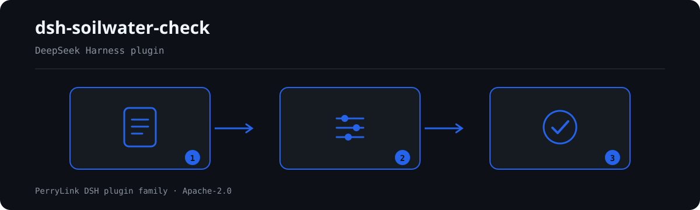

# dsh-soilwater-check — Soil and groundwater monitoring register completeness and arithmetic consistency check

[English](README.md) · [简体中文](README-zh.md) · [Español](README-es.md) · [Português](README-pt.md) · [हिन्दी](README-hi.md)

[](https://dsh.market/)
[](https://dshfind.com/en/plugins/PerryLink/dsh-soilwater-check?ref=badge)

`dsh-soilwater-check` reads one soil and groundwater monitoring register — the project header plus one row per point and parameter — and checks that register's own completeness and arithmetic: that each row names its point and its parameter, that the recorded result parses as a number, that the sampling date parses and is not later than the check date, that an applicable standard is recorded, that the exceedance verdict agrees with how the result compares to the limit the register itself states, that no sample number is repeated, that the header declares the project and the survey phase, and that no template placeholder survives in the parameter column.

## Install

```sh
dsh plugin --profile <name> add dsh-soilwater-check
dsh --profile <name> --dump-config | grep 'dsh-soilwater-check'
```

## What it looks like



*Workflow overview: document → rule pack → findings. The examples below use the real command surface.*


## What it answers

### Examples

The table below is the example set: the first row is the detailed walkthrough, the remaining rows are short cases.

| You ask | What it answers |
|---|---|
| The register's verdict says 达标, but the result is higher than the limit written beside it. Is that caught? | Yes. `SW-005` compares the result with the limit the register itself records and reports the row when the verdict disagrees with that comparison. It ships no limits of its own, so it cannot find a limit taken from the wrong standard or the wrong land-use category, and a verdict outside its configured over/at-most lists is reported separately. |
| The `result` cell reads `未检出` or `<0.01`, because the value is below the detection limit. What does the check do? | `SW-002` reports it. The rule reads only the numeric part of a cell (`0.85` and `1.2×10-3` are accepted), so detection-limit notation is reported as unparseable on purpose — record the value and put the remark in another column, or disable the rule. It checks parseability, not whether the figure is true or the method correct. |
| One row leaves the `standard` column empty. | `SW-004` requires the standard to be filled on every row that carries that column. It checks that a standard is written, not that it is the one that applies: whether the recorded standard matches the land use and the medium is a substantive question the plugin leaves to the reader. |
| A row records a sampling date later than the check date, and another row writes the date as `2026/3/15`. | `SW-003` reports a `sampledAt` later than the check date. It reads `2026-03-15` and `2026-03-15 09:30`; any other form is reported as unparseable rather than silently skipped. The rule only compares the date — it does not judge whether the data is reliable. |
| The same `labNo` appears on two rows, because one sample was analysed for several parameters. | `SW-006` reports a repeated sample number, because a repeat breaks the link between the laboratory report and the register; comparison ignores whitespace. Several parameters of one sample sharing one sample number is the intended shape — keep them on separate rows, but do not reuse the row-number column. With no sample-number column at all, the rule reports itself in `skipped` instead of passing silently. |
| The `parameter` cell still reads `待填` or `【】`, because the register was copied from the template. | `SW-008` reports the leftover placeholder in the parameter column (`【`, `】`, `{{`, `XXX`, `待填`, `TBD`, `示例` and similar terms, editable in the pack). Note that `SW-001` asks only that the point name or the parameter be filled, so a placeholder counts as filled there; the placeholder rule is what catches it. Neither rule judges whether the factor is the right one to monitor. |

## Standards it follows

| Document | Number | Cited by rules |
|---|---|---|
| 《建设用地土壤污染状况调查技术导则》 | HJ 25.1—2019（代替 HJ 25.1-2014；条号本次未取得） | SW-001, SW-003, SW-007, SW-008 |
| 《地下水环境监测技术规范》 | HJ 164—2020（代替 HJ/T 164—2004；2020-12-01 发布、2021-03-01 实施；条号本次未取得） | SW-002, SW-006 |
| 《土壤环境质量 建设用地土壤污染风险管控标准（试行）》 | GB 36600—2018（本次未取得条文） | SW-004, SW-005 |

**Boundary:** this plugin checks a **土壤与地下水监测台账** for completeness and arithmetic — that each record
names its point and parameter, that the result parses as a number, that the sampling date is not in the future,
that an applicable standard is recorded, that the exceedance verdict agrees with how the result compares to the
limit the register states, that sample numbers are unique, that the register names its project and survey phase,
and that no placeholder survives. It does **not** decide whether a site is contaminated, whether remediation is
needed, whether remediation targets were met, or whether a survey's conclusions hold.

> ### ⚠️ What this plugin deliberately cannot do
>
> **It ships no limits, and it does not check that the limit was taken from the right standard.** `SW-005`
> compares the measured result against the limit **the register itself records** and checks that the verdict
> agrees. So it **cannot find the consequential error: a screening value taken from the wrong standard or the
> wrong land-use category.** Deciding between GB 36600's first and second category screening values, or between
> GB 36600 and GB/T 14848, turns on the land use and the medium — this plugin reads neither. That limit is
> stated in the pack's header, in `SW-004`'s and `SW-005`'s notes, and in the troubleshooting section.
>
> `SW-002` requires a parseable number, so a register that writes detection-limit notation
> (`未检出`, `<0.01`) is **reported as unparseable on purpose** — record the value with a remark, or disable the
> rule.
>
> **Every `excerpt` in the rule pack says, in so many words, that the clause text was not obtained.** The regime
> lives in GB 36600—2018, GB/T 14848—2017, HJ 25.1 and HJ 164. The verification pass could not retrieve verbatim
> clause text, so the pack states the gap in the `excerpt` field itself and keeps every rule at `warn` or
> `info`. **When the texts are in hand, replace each `excerpt` with the real clause and raise `kind` to
> `direct`.**

## Compatibility

| Surface | Status |
|---|---|
| Harness | Peer range `>=0.1.2-rc.1 <0.2.0 \|\| >=0.2.0-0 <0.3.0` — verified to accept both `0.2.0-rc.2` and `0.2.1-rc.2`. `engines.dsh` is declared as `>=0.2.1-0 <0.3.0` and is enforced by the host since 0.2.1 |
| Node | `^22.19.0 || >=24.0.0` |
| Platforms | All (plain ESM; no native code, no network, no model call) |
| Tool mode | Works in `native` and `ptc`; for a full sampling round use `ptc` |

## What it does

Registers the `soilwater_check` tool. It reads one monitoring register — the project header plus one row per
point-and-parameter — applies a versioned rule pack, and returns a report.

| Rule | Check | Severity | Basis kind |
|---|---|---|---|
| `SW-001` | the point and the parameter are recorded | warn | principle |
| `SW-002` | the result parses as a number | warn | principle |
| `SW-003` | the sampling date is not in the future | warn | principle |
| `SW-004` | an applicable standard is recorded | warn | principle |
| `SW-005` | the verdict agrees with the result and the limit | warn | principle |
| `SW-006` | sample numbers are unique | warn | principle |
| `SW-007` | the register names its project and survey phase | warn | principle |
| `SW-008` | the parameter column holds no unreplaced placeholder | warn | principle |

## Configuration

| Key | Type | Default | Description |
|---|---|---|---|
| `rulesFile` | string | `rules/soilwater-check.yaml` | Rule-pack path, relative to the package root |
| `disabledRules` | string[] | `[]` | Rule ids to stop running; each appears in `skipped` |
| `onlyRules` | string[] | `[]` | Run only these rule ids; empty runs every rule |
| `skipNotes` | string | `""` | Note appended to every `skipped` reason |
| `timeoutMs` | number | `120000` | Cooperative tool timeout budget |

Rule-level parameters worth knowing:

- `SW-005` `valueField` / `limitField` / `verdictField` / `overValues` / `atMostValues` / `tolerance` — the
  three columns and the two verdict vocabularies, defaulting to `[超标, 是, Y, yes, true, 超出, 不合格]` and
  `[达标, 否, N, no, false, 未超标, 合格]`. A verdict outside both lists is reported so a new wording cannot
  slip through unnoticed.
- `SW-008` `terms` — the placeholders to look for.

## Material format

The tool accepts JSON or YAML:

```yaml
project: 某某场地调查
phase: 初步调查
rows:
  - { 序号: '1', 点位名称: S1 表层土, 介质: 土壤, 采样日期: 2026-03-05,
      样品编号: TR-2026-0018, 监测项目: 砷, 监测结果: '12.5', 单位: mg/kg,
      执行标准: GB 36600—2018 第二类用地筛选值, 标准限值: '60', 超标情况: 达标 }
```

Column names are matched case-insensitively and ignoring spaces, underscores and hyphens; the register's own
column names are kept, so a finding names the column it read. Results may carry a unit; a detection-limit
notation is reported as unparseable on purpose.

## Rule sources

Rule data lives in `rules/soilwater-check.yaml`. The pack's header states the citation gap in full, and each
rule's `note` repeats the part that matters for that rule. The load-time guard that normally enforces "an
excerpt must be a real quotation of at least eight characters" cannot tell a quotation from a description —
so this pack leans on the header, the per-rule notes and a test that asserts every `excerpt` admits the gap.

## Troubleshooting

- **`SW-005` passed a limit I know is wrong.** It compares against the limit the register states. Whether that
  limit belongs to the right standard and land-use category is a substantive question it does not touch.
- **`SW-005` fires on a result that equals its limit.** Equality counts as not exceeding; if your rule treats
  "equal to the screening value" as exceeding, raise `tolerance` slightly below zero or adjust the data.
- **`SW-002` fires on `未检出`.** Detection-limit notation is not a number. Record a value with a remark, or
  disable the rule.
- **`SW-006` fires on several rows for one sample.** Different parameters of one sample legitimately share a
  sample number — the rule keys on the sample number column, so do not reuse the row-number column for it.
- **The plugin installs but the tool never appears.** Check that `main` resolves to `lib/index.mjs` and
  that `pnpm run build` produced it; a wrong `main` makes the loader skip the entry silently.
- **`dsh plugin add` refuses the package as incompatible.** The peer range covers `0.1.x` and `0.2.x`; if
  your runtime sits outside it, grant an explicit exemption:
  `dsh plugin --profile <name> allow-version dsh-soilwater-check@0.1.0 --dsh-version <runtime> --accept-risk`
- **`check` reports `manifest-peers` as failed.** The static checker compares against a hard-coded peer
  range that predates the 0.2 line. The runtime enforces peer compatibility at install time, so the
  declared range is the correct one; this is a known upstream issue in `dsh-plugin-dev`.

## Development

```sh
pnpm install
pnpm run typecheck   # tsc --noEmit
pnpm test            # vitest, the shared table-plugin suite plus paired fixtures
pnpm run build       # tsdown -> lib/index.mjs + lib/index.d.mts
node ../scripts/sync-shared.mjs dsh-soilwater-check   # refresh src/shared from ../_shared
```

The plugin is **data-only**: `src/model.ts` declares the table shape, the shared kit supplies the reader and
the check engine, and the rule pack declares every check.

## PerryLink DSH Plugin Family

This project is part of the DeepSeek Harness plugin family from [PerryLink](https://github.com/PerryLink). The roster stays collapsed below so every README keeps a short first screen; expand it to see every row and its status.

<details>
<summary>Expand all plugins</summary>

| Plugin | Status |
|---|---|
| **[dsh-aqua-input-check](https://github.com/PerryLink/dsh-aqua-input-check)** |  |
| **[dsh-archive-check](https://github.com/PerryLink/dsh-archive-check)** |  |
| **[dsh-auto-review](https://github.com/PerryLink/dsh-auto-review)** |  |
| **[dsh-autotier](https://github.com/PerryLink/dsh-autotier)** |  |
| **[dsh-bid-ca-precheck](https://github.com/PerryLink/dsh-bid-ca-precheck)** |  |
| **[dsh-bid-qual-check](https://github.com/PerryLink/dsh-bid-qual-check)** |  |
| **[dsh-cert-mcp](https://github.com/PerryLink/dsh-cert-mcp)** |  |
| **[dsh-checkpoint-rewind](https://github.com/PerryLink/dsh-checkpoint-rewind)** |  |
| **[dsh-click](https://github.com/PerryLink/dsh-click)** |  |
| **[dsh-composer-history](https://github.com/PerryLink/dsh-composer-history)** |  |
| **[dsh-contract-stance](https://github.com/PerryLink/dsh-contract-stance)** |  |
| **[dsh-customs-doc-check](https://github.com/PerryLink/dsh-customs-doc-check)** |  |
| **[dsh-data-quality](https://github.com/PerryLink/dsh-data-quality)** |  |
| **[dsh-demurrage-ledger](https://github.com/PerryLink/dsh-demurrage-ledger)** |  |
| **[dsh-doublecheck](https://github.com/PerryLink/dsh-doublecheck)** |  |
| **[dsh-drill-script-check](https://github.com/PerryLink/dsh-drill-script-check)** |  |
| **[dsh-eia-guide-check](https://github.com/PerryLink/dsh-eia-guide-check)** |  |
| **[dsh-emergency-plan](https://github.com/PerryLink/dsh-emergency-plan)** |  |
| **[dsh-essay-rubric-check](https://github.com/PerryLink/dsh-essay-rubric-check)** |  |
| **[dsh-evidence-check](https://github.com/PerryLink/dsh-evidence-check)** |  |
| **[dsh-export-ctl-check](https://github.com/PerryLink/dsh-export-ctl-check)** |  |
| **[dsh-fast](https://github.com/PerryLink/dsh-fast)** |  |
| **[dsh-fmea-table-check](https://github.com/PerryLink/dsh-fmea-table-check)** |  |
| **[dsh-forecast-penalty](https://github.com/PerryLink/dsh-forecast-penalty)** |  |
| **[dsh-fund-research](https://github.com/PerryLink/dsh-fund-research)** |  |
| **[dsh-github](https://github.com/PerryLink/dsh-github)** |  |
| **[dsh-gongwen-flow-check](https://github.com/PerryLink/dsh-gongwen-flow-check)** |  |
| **[dsh-gongwen-word-check](https://github.com/PerryLink/dsh-gongwen-word-check)** |  |
| **[dsh-guard-plan-qc](https://github.com/PerryLink/dsh-guard-plan-qc)** |  |
| **[dsh-hazchem-check](https://github.com/PerryLink/dsh-hazchem-check)** |  |
| **[dsh-hazplan-check](https://github.com/PerryLink/dsh-hazplan-check)** |  |
| **[dsh-hidden-risk-map](https://github.com/PerryLink/dsh-hidden-risk-map)** |  |
| **[dsh-hs-classify](https://github.com/PerryLink/dsh-hs-classify)** |  |
| **[dsh-icd-rule-check](https://github.com/PerryLink/dsh-icd-rule-check)** |  |
| **[dsh-industry-research](https://github.com/PerryLink/dsh-industry-research)** |  |
| **[dsh-lawcite-adapter](https://github.com/PerryLink/dsh-lawcite-adapter)** |  |
| **[dsh-laya](https://github.com/PerryLink/dsh-laya)** |  |
| **[dsh-lc-doc-check](https://github.com/PerryLink/dsh-lc-doc-check)** |  |
| **[dsh-learning-gap-check](https://github.com/PerryLink/dsh-learning-gap-check)** |  |
| **[dsh-library](https://github.com/PerryLink/dsh-library)** |  |
| **[dsh-local-ai](https://github.com/PerryLink/dsh-local-ai)** |  |
| **[dsh-lsp-actions](https://github.com/PerryLink/dsh-lsp-actions)** |  |
| **[dsh-mask](https://github.com/PerryLink/dsh-mask)** |  |
| **[dsh-mcp-panel](https://github.com/PerryLink/dsh-mcp-panel)** |  |
| **[dsh-medrec-qc](https://github.com/PerryLink/dsh-medrec-qc)** |  |
| **[dsh-memento](https://github.com/PerryLink/dsh-memento)** |  |
| **[dsh-nsfc-form-check](https://github.com/PerryLink/dsh-nsfc-form-check)** |  |
| **[dsh-nurse-record-check](https://github.com/PerryLink/dsh-nurse-record-check)** |  |
| **[dsh-observe](https://github.com/PerryLink/dsh-observe)** |  |
| **[dsh-origin-rvc-check](https://github.com/PerryLink/dsh-origin-rvc-check)** |  |
| **[dsh-ota-review-check](https://github.com/PerryLink/dsh-ota-review-check)** |  |
| **[dsh-output-styles](https://github.com/PerryLink/dsh-output-styles)** |  |
| **[dsh-paper-doc-adapter](https://github.com/PerryLink/dsh-paper-doc-adapter)** |  |
| **[dsh-permission-rules](https://github.com/PerryLink/dsh-permission-rules)** |  |
| **[dsh-permit-report-check](https://github.com/PerryLink/dsh-permit-report-check)** |  |
| **[dsh-pipeline-check](https://github.com/PerryLink/dsh-pipeline-check)** |  |
| **[dsh-pleading-draft](https://github.com/PerryLink/dsh-pleading-draft)** |  |
| **[dsh-plugin-doctor](https://github.com/PerryLink/dsh-plugin-doctor)** |  |
| **[dsh-plugin-guide](https://github.com/PerryLink/dsh-plugin-guide)** |  |
| **[dsh-plugin-kit](https://github.com/PerryLink/dsh-plugin-kit)** |  |
| **[dsh-plugin-upgrade](https://github.com/PerryLink/dsh-plugin-upgrade)** |  |
| **[dsh-policy-brief-draft](https://github.com/PerryLink/dsh-policy-brief-draft)** |  |
| **[dsh-power-loss-split](https://github.com/PerryLink/dsh-power-loss-split)** |  |
| **[dsh-power-ticket-check](https://github.com/PerryLink/dsh-power-ticket-check)** |  |
| **[dsh-ppap-check](https://github.com/PerryLink/dsh-ppap-check)** |  |
| **[dsh-protest-deadline](https://github.com/PerryLink/dsh-protest-deadline)** |  |
| **[dsh-railway-window](https://github.com/PerryLink/dsh-railway-window)** |  |
| **[dsh-repair-order-qc](https://github.com/PerryLink/dsh-repair-order-qc)** |  |
| **[dsh-research-report](https://github.com/PerryLink/dsh-research-report)** |  |
| **[dsh-review-reply-check](https://github.com/PerryLink/dsh-review-reply-check)** |  |
| **[dsh-rulefile-check](https://github.com/PerryLink/dsh-rulefile-check)** |  |
| **[dsh-safety-brief-check](https://github.com/PerryLink/dsh-safety-brief-check)** |  |
| **[dsh-score](https://github.com/PerryLink/dsh-score)** |  |
| **[dsh-session-sync](https://github.com/PerryLink/dsh-session-sync)** |  |
| **[dsh-site-log-check](https://github.com/PerryLink/dsh-site-log-check)** |  |
| **[dsh-skill-pack-security](https://github.com/PerryLink/dsh-skill-pack-security)** |  |
| **[dsh-soe-decision-check](https://github.com/PerryLink/dsh-soe-decision-check)** |  |
| **[dsh-soilwater-check](https://github.com/PerryLink/dsh-soilwater-check)** |  |
| **[dsh-sop-sync-check](https://github.com/PerryLink/dsh-sop-sync-check)** |  |
| **[dsh-spc-gbt-adapter](https://github.com/PerryLink/dsh-spc-gbt-adapter)** |  |
| **[dsh-talk](https://github.com/PerryLink/dsh-talk)** |  |
| **[dsh-tender-extract](https://github.com/PerryLink/dsh-tender-extract)** |  |
| **[dsh-tender-matrix](https://github.com/PerryLink/dsh-tender-matrix)** |  |
| **[dsh-test-drive](https://github.com/PerryLink/dsh-test-drive)** |  |
| **[dsh-ticktick](https://github.com/PerryLink/dsh-ticktick)** |  |
| **[dsh-translate](https://github.com/PerryLink/dsh-translate)** |  |
| **[dsh-warranty-calc](https://github.com/PerryLink/dsh-warranty-calc)** |  |
| **[dsh-budget](https://github.com/PerryLink/dsh-budget)** | 🧊 FROZEN — see the repo README |
| **[dsh-claude-move](https://github.com/PerryLink/dsh-claude-move)** | 🧊 FROZEN — see the repo README |
| **[dsh-defend](https://github.com/PerryLink/dsh-defend)** | 🧊 FROZEN — see the repo README |
| **[dsh-draw](https://github.com/PerryLink/dsh-draw)** | 🧊 FROZEN — see the repo README |
| **[dsh-reach](https://github.com/PerryLink/dsh-reach)** | 🧊 FROZEN — see the repo README |
| **[dsh-background-agents](https://github.com/PerryLink/dsh-background-agents)** | 🚫 RETIRED — see the repo README |
| **[dsh-session-pin](https://github.com/PerryLink/dsh-session-pin)** | 🚫 RETIRED — see the repo README |
| **[dsh-team-rooms](https://github.com/PerryLink/dsh-team-rooms)** | 🚫 RETIRED — see the repo README |

</details>

## License

[Apache License 2.0](LICENSE) © 2026 dsh-soilwater-check contributors.
