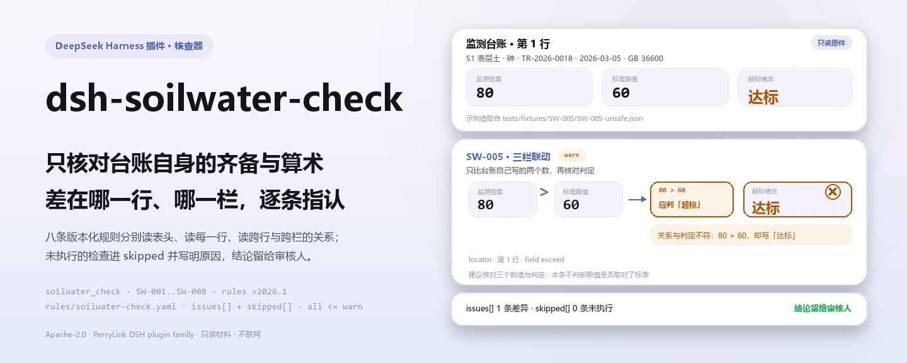
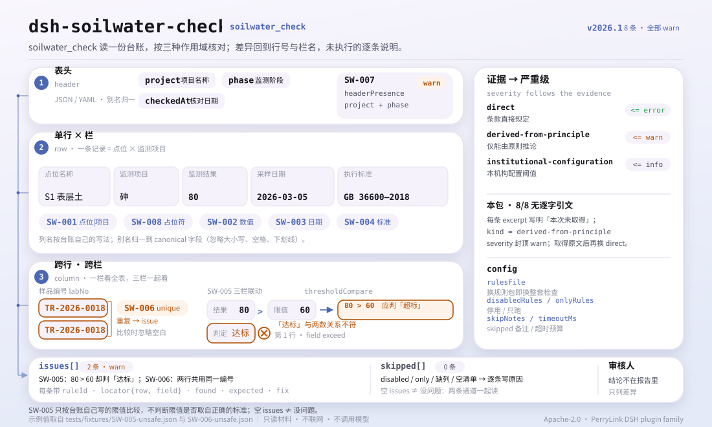

<div align="center">

<picture>
  <source media="(prefers-color-scheme: dark)" srcset="docs/assets/dsh-soilwater-check-hero-zh-dark.webp">
   60 与判定不符，差异落在第 1 行 · field exceed；报告 1 条差异、0 条未执行，结论留给审核人">
</picture>

# dsh-soilwater-check

**核对土壤与地下水监测台账的齐备与算术自洽——输出「哪一行、哪一栏、差什么」的清单，结论留给审核人。**

面向 DeepSeek Harness 的数据型核查插件：读取一份监测台账（项目表头加每个点位与监测项目一行），按随包的版本化规则包（SW-001..SW-008）逐条核对，只列材料内部能指认的差异，不判合规、不认定责任。

[安装](#三步上手) · [配置](#配置) · [FAQ](#faq) · [简体中文](README.md) · [English](README.en.md) · [Español](README.es.md) · [Português](README.pt.md) · [हिन्दी](README.hi.md)

[](LICENSE)
[](#兼容性)
[](https://www.npmjs.com/package/dsh-soilwater-check)
[](https://github.com/PerryLink/dsh-soilwater-check/actions/workflows/ci.yml)
[](#兼容性)

[](https://github.com/PerryLink/dsh-soilwater-check/stargazers)
[](https://www.npmjs.com/package/dsh-soilwater-check)
[](https://dshfind.com/en/plugins/PerryLink/dsh-soilwater-check?ref=badge)
[](https://securityscorecards.dev/viewer/?uri=github.com/PerryLink/dsh-soilwater-check)
[](https://dsh.market/)
[](https://gitee.com/perrylink/dsh-soilwater-check)

```sh
dsh plugin --profile <name> add dsh-soilwater-check
```

</div>

<sub>社区插件，与 DeepSeek 官方无关。唯一仓库：<https://github.com/PerryLink/dsh-soilwater-check>（Gitee 为镜像）。</sub>

## 它是什么

`dsh-soilwater-check` 读取一份土壤与地下水监测台账——项目表头加每个点位与监测项目一行——核对这份台账自身的齐备与算术：每条记录是否写明点位名称与监测项目、监测结果是否可解析为数值、采样日期是否可解析且不晚于核对日、是否填写了执行标准、超标判定是否与台账自己写的结果和限值的关系相符、样品编号是否重复、表头是否声明项目与监测阶段、监测项目栏是否残留模板占位符。

它不判合规、不认定责任、不替代审核人；只列材料内部能逐条指认的差异。

- **给谁用**：环保监测、场地调查的记录与审核人员；不用懂命令行，在对话里把材料交给它即可。
- **你交什么**：这项核对用到的原始材料（台账表格、清单或文书）；不改原件。Excel 可先转成 JSON/YAML，对话里也能代转。
- **它交什么**：一份「哪一行、哪一栏、差什么、怎么补」的清单；没能执行的检查逐条列入 `skipped` 并写明原因。

<picture>
  <source media="(prefers-color-scheme: dark)" srcset="docs/assets/dsh-soilwater-check-flow-v5-dark.svg">
  
</picture>

## 三步上手

1. **安装**（三选一）：

   ```sh
   # git 通道（最新 main；等价于 git+https://github.com/PerryLink/dsh-soilwater-check.git）
   dsh plugin --profile <name> add github:PerryLink/dsh-soilwater-check
   # npm 通道（已发布版本）
   dsh plugin --profile <name> add dsh-soilwater-check
   # tarball 通道：本仓库 pnpm pack 后
   dsh plugin --profile <name> add ./dsh-soilwater-check-<version>.tgz
   ```

2. **最小配置**（默认即可用；bundle 行不带 `config` 时全部走默认值，规则包路径指向随包的 `rules/soilwater-check.yaml`）：

   ```yaml
   - insert:
       - id: dsh-soilwater-check
         name: dsh-soilwater-check
   ```

3. **验证已生效**：

   ```sh
   dsh --profile <name> --dump-config | grep 'dsh-soilwater-check'
   ```

   在仓库内先 `pnpm run build` 产出 `lib/`，再跑随包样例（输入在 `samples/quickstart/input/`，期望输出在 `samples/quickstart/expected/result.json`）：

   ```sh
   node samples/quickstart/run.mjs --json
   ```

   ```json
   {
     "tool": "soilwater_check",
     "issueCount": 1,
     "summary": {
       "error": 0,
       "warn": 1,
       "info": 0
     },
     "skippedCount": 0
   }
   ```

**卸载**：`dsh plugin --profile <name> remove dsh-soilwater-check`（或从 profile patch 删掉该行）。

<details>
<summary>在 WorkBuddy / 扣子中使用</summary>

在 WorkBuddy / 扣子搜「职业文档核对全集」（总包，本检查是其中一项；上架以商城为准）即可调用同一套核对能力，无需命令行。

</details>

<details>
<summary>从 DSH Desktop 市场安装</summary>

所有 PerryLink 插件均可在 DSH Desktop 内置市场中浏览：**市场 → 来源 → 添加来源 → 粘贴** `https://perrylink-dsh-catalog.perrylink.workers.dev/catalog-source.json` **→ 选中**。安装仍需通过市场的 npm 身份校验与你的确认。

</details>

## 核心能力

`dsh-soilwater-check` 注册 `soilwater_check` 工具：读入一份监测台账，套用版本化规则包，返回一份报告。

- **八条规则一包带走** —— 规则包是数据不是代码（`rules/soilwater-check.yaml`），换掉规则包即换掉整套检查，不动一行 TypeScript。
- **只读材料** —— 接受 JSON 或 YAML，原件永不修改；纯 ESM，无网络请求、不调用模型。
- **引文不造假** —— 每条规则都带 `document` / `number` / `clause` / `excerpt` / `kind` / `source` 六个字段。本规则包的每个 `excerpt` 都如实写明「该条文本次未取得」，不把转述冒充引文；加载期守卫分不清引文与描述，因此另有一条测试断言每个 `excerpt` 都承认这一缺口。
- **严重级跟着证据走** —— `derived-from-principle` 最高 `warn`，本机构配置（`institutional-configuration`）最高 `info`，并有测试断言；本规则包全部规则为 `derived-from-principle`，一律封顶 `warn`。
- **空清单 ≠ 没问题** —— 每条没能执行的检查都进 `skipped` 并写明原因；必填清单未配置、缺列或无法解析时，规则自我报告 `skipped`，绝不静默通过。
- **措辞不作裁决** —— 报告只列差异，不判定合规、责任或正确性；措辞守卫（wording guard）强制执行，报告永远附带免责声明。

| 规则 | 核对内容 | 严重级 | 依据类别 |
|---|---|---|---|
| `SW-001` | 点位名称与监测项目已记录 | warn | principle |
| `SW-002` | 监测结果可解析为数值 | warn | principle |
| `SW-003` | 采样日期可解析且不在未来 | warn | principle |
| `SW-004` | 每条记录填写了执行标准 | warn | principle |
| `SW-005` | 超标判定与结果、限值的关系相符 | warn | principle |
| `SW-006` | 样品编号在台账内唯一 | warn | principle |
| `SW-007` | 表头声明项目与监测阶段 | warn | principle |
| `SW-008` | 监测项目栏无未替换的占位符 | warn | principle |

### 示例

以下为插件真实入口；安装后调用一次即可。

**详细示例** — 工具 `soilwater_check`，输入：

~~~json
{"rows":[{"监测结果":"80","标准限值":"60","超标情况":"达标"}]}
~~~

输出：

~~~json
{
  "id": "dsh-soilwater-check.SW-005.de09b5a6",
  "ruleId": "SW-005",
  "severity": "warn",
  "locator": {
    "row": 1,
    "field": "exceed"
  },
  "found": "第 1 行「result」为 80、「limit」为 60，而判定为「达标」",
  "expected": "80 超过限值 60，判定应表示超标",
  "fix": "核对三个数值与判定；本条只按台账自己写的限值比较，不判断该限值是否取对了标准"
}
~~~

*来源：`dsh-soilwater-check/tests/fixtures/SW-005/SW-005-unsafe.json`*

## 依据的标准

| 文件 | 文号 | 引用它的规则 |
|---|---|---|
| 《建设用地土壤污染状况调查技术导则》 | HJ 25.1—2019（代替 HJ 25.1-2014；条号本次未取得） | SW-001, SW-003, SW-007, SW-008 |
| 《地下水环境监测技术规范》 | HJ 164—2020（代替 HJ/T 164—2004；2020-12-01 发布、2021-03-01 实施；条号本次未取得） | SW-002, SW-006 |
| 《土壤环境质量 建设用地土壤污染风险管控标准（试行）》 | GB 36600—2018（本次未取得条文） | SW-004, SW-005 |

**效力层级：** GB 36600—2018 是国家标准（强制性，现行，2024-07-23 复审结论「继续有效」，标准号不带 `/T`）；GB/T 14848—2017 是推荐性国家标准（规则包未把它单列为任何一条规则的依据文件）；HJ 25.1—2019 与 HJ 164—2020 是行业标准，非强制性国标。引用时不要把 HJ/T 164—2004 与 HJ 164—2020 混为同一个编号。

## 配置

全部可调参数都是 `src/config.ts` 里的 Schemastery `Config` 字段（可从 cordis.yml 覆盖），逐条阈值在 `rules/` 下的规则库文件里。按 id 覆盖会替换整行——请重述所有需要的键。

| 键 | 类型 | 默认值 | 说明 |
|---|---|---|---|
| `rulesFile` | string | `rules/soilwater-check.yaml` | 规则库文件路径，相对插件包根目录 |
| `disabledRules` | string[] | `[]` | 要停用的规则 id 列表；每条都会出现在 `skipped` 中 |
| `onlyRules` | string[] | `[]` | 只执行这些规则 id；留空表示执行全部规则 |
| `skipNotes` | string | `""` | 附加到每条 `skipped` 说明后的备注 |
| `timeoutMs` | number | `120000` | 工具协作式超时预算（毫秒） |

值得了解的规则级参数：

- `SW-005` `valueField` / `limitField` / `verdictField` / `overValues` / `atMostValues` / `tolerance` —— 三个列名与两份判定词表，默认 `[超标, 是, Y, yes, true, 超出, 不合格]` 与 `[达标, 否, N, no, false, 未超标, 合格]`。判定取值不在两侧清单内时会单独报出，新的措辞不会悄悄漏过。
- `SW-008` `terms` —— 要查找的占位符词表（默认含 `【`、`】`、`{{`、`XXX`、`待填`、`TBD`、`示例` 等）。
- `SW-001` `fields`、`SW-002` `field`、`SW-003` `field`、`SW-004` `field`、`SW-006` `field`、`SW-007` `fields` —— 各条规则读取的列名，默认值见 `rules/soilwater-check.yaml`。

profile patch 覆盖示例：

```yaml
- insert:
    - id: dsh-soilwater-check
      name: dsh-soilwater-check
      config:
        disabledRules: [SW-008]
        timeoutMs: 180000
```

## 材料格式

工具接受 JSON 或 YAML：

```yaml
project: 某某场地调查
phase: 初步调查
rows:
  - { 序号: '1', 点位名称: S1 表层土, 介质: 土壤, 采样日期: 2026-03-05,
      样品编号: TR-2026-0018, 监测项目: 砷, 监测结果: '12.5', 单位: mg/kg,
      执行标准: GB 36600—2018 第二类用地筛选值, 标准限值: '60', 超标情况: 达标 }
```

列名匹配忽略大小写，并忽略空格、下划线与连字符；台账自己的列名会被保留，因此发现里写明的列就是它实际读到的列。监测结果可带单位；检出限写法（如 `未检出`、`<0.01`）会被判为不可解析而报出。字段在读取层是可选的，由检查引擎校验，因此部分导出的材料会产生「缺项」类差异，而不是让程序崩溃。表头 `project` 对应项目名称、`phase` 对应监测阶段（初步调查／详细调查／修复效果评估等）。

## 规则来源

规则数据在 `rules/soilwater-check.yaml`，与代码分离：每条规则都带文件名、文号、按原文自身编号体系的条款号、逐字摘录与来源地址。规则包头部完整写明本次引文缺口，每条规则的 `note` 复述与该条相关的部分。加载期守卫通常强制「摘录必须是不少于八个字符的真实引文」，但它分不清引文与描述——因此本规则包依靠头部声明、逐条 `note`，以及一条断言所有 `excerpt` 都承认缺口的测试来兜底。夸大依据的规则库会在加载期失败，而不会产出一份看起来很有底气的报告。核验中确认的边界与「刻意没有作出的结论」随包收录在 `rules/evidence/` 目录。

## FAQ

<details>
<summary>台账填的是「达标」，但监测结果比旁边写的标准限值还高，能查出来吗？</summary>

能。`SW-005` 拿台账自己写的结果与限值相比，判定与这个关系不符时逐行报出。它不内置任何限值，所以发现不了「限值取错了标准或用地类别」；判定取值不在配置的超标／未超标两份清单内时，也会单独报出。

</details>

<details>
<summary>监测结果栏写的是「未检出」或 `<0.01`（低于检出限），会怎么处理？</summary>

`SW-002` 会把它报出来。本条只取单元格里的数字部分（`0.85`、`1.2×10-3` 这类写法可解析），所以检出限写法会被故意判为不可解析而报出——请把 `result` 栏统一为数值、备注另设一栏，或停用本条。它只核对可解析性，不判断数值是否真实、检测方法是否正确。

</details>

<details>
<summary>有一行的「执行标准」栏是空的，能查出来吗？</summary>

`SW-004` 要求凡是带这一栏的行都要填写执行标准。它只核对「是否写了标准」，不核对「写的是不是应当适用的那一部」——所填标准与用地类型、监测介质是否匹配，需要查阅标准与场地资料，本插件不做。

</details>

<details>
<summary>采样日期比核对日还晚，或写成了 `2026/3/15`，会怎么处理？</summary>

`SW-003` 会报出晚于核对日的 `sampledAt`。本条识别 `2026-03-15` 与 `2026-03-15 09:30` 两种写法，其它写法会作为无法解析单独报出，不会静默跳过。它只核对日期先后，不判断数据是否可靠。

</details>

<details>
<summary>同一个样品编号出现在两行上，是错吗？</summary>

`SW-006` 会报出重复的样品编号，因为重复会让检测报告与台账对不上；比较时忽略空白字符。同一样品的不同监测项目共用同一个样品编号正是正常情形——各占一行即可，但不要重复使用行号栏。台账里根本没有样品编号栏时，本条会出现在 `skipped` 中，而不是静默通过。

</details>

<details>
<summary>监测项目栏还留着「待填」或「【】」，会怎么处理？</summary>

`SW-008` 会报出监测项目栏残留的占位符（`【`、`】`、`{{`、`XXX`、`待填`、`TBD`、`示例` 等，词表可在规则库中调整）。注意 `SW-001` 只要求点位名称与监测项目「至少填了一个」，占位符在它那里算已填；真正抓住它的是占位符这一条。两条都不判断监测因子选得对不对。

</details>

## 安全边界

本插件核对一份**土壤与地下水监测台账**的齐备性与算术——每条记录是否写明点位与监测参数，结果是否可解析为数值，采样日期是否不在未来，是否记录适用标准，超标判定结论是否与「结果相对于台账写明限值的比较结果」一致，样品编号是否唯一，台账是否写明其项目与监测阶段，以及是否残留占位符。它**不**判定场地是否受到污染、是否需要修复、修复目标是否达到，或某次调查的结论是否成立。

> ### ⚠️ 本插件刻意做不到哪些事
>
> **它不自带任何限值，也不核对限值是否取自正确的标准。** `SW-005` 把实测结果与**台账自己记录的**限值相比，并核对结论是否与之一致。因此它**发现不了那个后果严重的错误：筛选值取自错误的标准或错误的用地类别。** 在 GB 36600 第一类与第二类筛选值之间做选择，或者在 GB 36600 与 GB/T 14848 之间做选择，取决于用地性质与介质——这两样本插件都不读取。这一局限已写在规则库的库头、`SW-004` 与 `SW-005` 的 note 中，以及排障一节。
>
> `SW-002` 要求结果可解析为数值，因此台账若写成检出限的记法（`未检出`、`<0.01`），会被**有意报为无法解析**——请把数值连同备注一起记录，或停用该条规则。
>
> **规则库中的每一个 `excerpt` 都明文写着：条款原文本次未取得。** 该制度见于 GB 36600—2018、GB/T 14848—2017、HJ 25.1 与 HJ 164。核验环节无法取得逐字条款原文，因此规则库在 `excerpt` 字段本身写明这一缺口，并把每条规则保持在 `warn` 或 `info`。**待取得原文后，请把每个 `excerpt` 换成真实条款，并把 `kind` 提到 `direct`。**

围绕这条能力边界，本插件还遵守以下约束：

- **只读材料。** 工具只读取交给它的 JSON/YAML，不写文件、不联网、不调用模型（`package.json#dsh.demo` 声明 `reads` 为用户指定的材料文件、`writes: []`、`network: false`）。
- **不作裁决。** 报告只列差异并附免责声明；措辞守卫禁止合规、责任或正确性结论。
- **不伪造引文。** 无原文时 `kind` 封顶 `derived-from-principle`、严重级封顶 `warn`，绝不给引用缺口配上 `direct` 的底气。
- **不静默通过。** 每条没能执行的检查都进 `skipped` 并写明原因；`issues` 为空不等于「材料没问题」。

## 已知限制

- **不核对限值是否取自正确的标准。** `SW-005` 只与台账自己写的限值比较。该限值是否属于正确的标准与用地类别，是它不触碰的实质问题。
- **等于限值不算超标。** 判定 `SW-005` 时等号按「未超过」处理；若本机构口径把「等于筛选值」视为超标，请把 `tolerance` 略微调到零以下，或调整数据。
- **检出限写法会被判为不可解析。** `SW-002` 要求可解析的数值；`未检出` 不是数字，请把数值连同备注记录，或停用该条。
- **同一样品的多个参数必须各占一行。** 它们共用样品编号是正常的；`SW-006` 以样品编号栏为键，不要把行号栏当样品编号用。

### 排障

- **插件装上了但工具不出现。** 确认 `main` 指向 `lib/index.mjs` 且 `pnpm run build` 已生成该文件；`main` 写错会让加载器静默跳过该条目。
- **`dsh plugin add` 报版本不兼容。** peer 范围覆盖 `0.1.x` 与 `0.2.x`；若运行时在其之外，可显式豁免：`dsh plugin --profile <name> allow-version dsh-soilwater-check@0.1.0 --dsh-version <runtime> --accept-risk`
- **某条规则没有执行。** 查看 `skipped` 数组，其中写明了规则 id 与原因。
- **`check` 报 `manifest-peers` 失败。** 静态检查器比对的是一份早于 0.2 世代的硬编码 peer 范围；安装期的 peer 校验以运行时为准。这是 `dsh-plugin-dev` 的已知上游问题。
- **时间看起来偏移。** 全部计算都是对输入字符串做墙上时钟运算，不做时区换算。

## 与其他 DSH 插件的互操作性

本插件是数据型核查器，只注册一个工具 `soilwater_check`，不参与宿主的事件链：

- **无工具名冲突。** 工具名 `soilwater_check` 为本插件专有；不占用任何内置工具名。
- **无服务键冲突。** 不提供任何服务键，因此不存在服务键冲突。
- **无 slot 与路由冲突。** 不注册客户端 slot，也不注册任何 `webServer` 前缀或 HTTP 路由。
- **无事件冲突。** 不监听 `agent/pre-step`、`tools/post-execute` 等共享事件，因此不参与监听器链条的排序竞争。
- **无 patch 层冲突。** 组合包 patch（`cordis.patch.yml`）只 `insert` 自己那一行，从不覆写内置行的 `config`。
- **无全局改写。** 不改原型、不改写 `process.env`、不替换全局 fetch dispatcher。
- **只读自己的入参。** 工具只读调用方传入的材料文本，不读取其他插件的存储，也不发起网络请求或模型调用。

## 兼容性

| 项目 | 状态 |
|---|---|
| Harness | 对等版本范围 `>=0.1.2-rc.1 <0.2.0 \|\| >=0.2.0-0 <0.3.0` —— 已实测同时接受 `0.2.0-rc.2` 与 `0.2.1-rc.2`。**已声明 `engines.dsh`**：0.2.1 起由宿主单独裁决，范围为 `>=0.2.1-0 <0.3.0` |
| Node | `^22.19.0 \|\| >=24.0.0` |
| 平台 | 全平台（纯 ESM；无原生代码、无联网、不调用模型） |
| 工具模式 | `native` / `ptc` 均可；批量校验整个目录时建议 `ptc`，schema 成本只付一次 |

## 生态与质量

- [Gitee 镜像](https://gitee.com/perrylink/dsh-soilwater-check)（同步镜像，以 GitHub 为准）
- [dshfind 插件页](https://dshfind.com/en/plugins/PerryLink/dsh-soilwater-check)（安装量与排名）
- [OpenSSF Scorecard 报告](https://securityscorecards.dev/viewer/?uri=github.com/PerryLink/dsh-soilwater-check)（由 [.github/workflows/scorecard.yml](.github/workflows/scorecard.yml) 驱动）
- [DSH Market](https://dsh.market/)（已上架）
- **1024 商店渠道**：先 `npm i -g dsh1024`，再 `dsh1024 plugin --profile <name> add dsh-soilwater-check`（计入 [deepseek1024.com](https://deepseek1024.com) 安装排行）
- [生态实测知识库](https://perrylink.github.io/dsh-plugin-guide/)：插件开发指南 · 选型实测数据 · 维护取舍判据

## 开发

```sh
pnpm install                                        # node ^22.19 || >=24
pnpm run typecheck                                  # tsc --noEmit
pnpm test                                           # vitest：共享表格插件套件 + 成对夹具
pnpm run build                                      # tsdown -> lib/index.mjs + lib/index.d.mts
pnpm run verify:self-contained                      # 依赖 spec 均来自 registry
pnpm run check:lockfile                             # lockfile 漂移检查
pnpm run check:readmes                              # 五语 README 一致性
pnpm run check:citations                            # 规则包引文基线
node ../scripts/sync-shared.mjs dsh-soilwater-check   # 从 ../_shared 刷新 src/shared
pnpm pack                                           # 发布 tarball
```

`sync-shared` 把 `../_shared` 的共享件同步进 `src/shared/`；每次改动共享件后都要重跑。本插件是**数据型**的：`src/model.ts` 声明表格结构，共享套件提供读取器与检查引擎，规则包声明每一条检查。

本地样例试跑（需先 `pnpm run build` 产出 `lib/`）：

```sh
node samples/quickstart/run.mjs --json
```

样例输入在 `samples/quickstart/input/`，期望输出在 `samples/quickstart/expected/result.json`。README 配图由 [`scripts/gen-readme-assets.py`](scripts/gen-readme-assets.py) 程序化生成（Pillow 生成 hero，手写 SVG 生成结构图），可重复执行；旧的单版流程图与演示图保留在 `docs/assets/` 供外链使用，README 只引用 hero 与 flow-v5 的深浅双版。

Topics：`deepseek-harness`, `dsh`, `dsh-plugin`, `cordis`, `soilwater`

## 家族与致谢

本项目是 [PerryLink](https://github.com/PerryLink) 维护的 DeepSeek Harness 插件家族成员（全部 Apache-2.0）。完整家族索引见[按材料选核查器](https://perrylink.github.io/zh/checkers/choose/)与[全部插件](https://github.com/PerryLink)。如果这个插件帮到了你，**给个 star**——它不解锁任何功能，但会让下一个人更容易找到它。

- [@PerryLink](https://github.com/PerryLink) —— 创建者与维护者：数据型规则包（SW-001..SW-008）、`soilwater_check` 工具、引文核验记录与五语文档。

<details>
<summary>展开全部插件</summary>

| 插件 | 状态 |
|---|---|
| **[dsh-aqua-input-check](https://github.com/PerryLink/dsh-aqua-input-check)** |  |
| **[dsh-archive-check](https://github.com/PerryLink/dsh-archive-check)** |  |
| **[dsh-auto-review](https://github.com/PerryLink/dsh-auto-review)** |  |
| **[dsh-autotier](https://github.com/PerryLink/dsh-autotier)** | 🧊 已冻结 — 见仓库 README |
| **[dsh-bid-ca-precheck](https://github.com/PerryLink/dsh-bid-ca-precheck)** |  |
| **[dsh-bid-qual-check](https://github.com/PerryLink/dsh-bid-qual-check)** |  |
| **[dsh-cert-mcp](https://github.com/PerryLink/dsh-cert-mcp)** | 🧊 已冻结 — 见仓库 README |
| **[dsh-checkpoint-rewind](https://github.com/PerryLink/dsh-checkpoint-rewind)** |  |
| **[dsh-click](https://github.com/PerryLink/dsh-click)** |  |
| **[dsh-composer-history](https://github.com/PerryLink/dsh-composer-history)** |  |
| **[dsh-contract-stance](https://github.com/PerryLink/dsh-contract-stance)** |  |
| **[dsh-customs-doc-check](https://github.com/PerryLink/dsh-customs-doc-check)** |  |
| **[dsh-data-quality](https://github.com/PerryLink/dsh-data-quality)** | 🧊 已冻结 — 见仓库 README |
| **[dsh-demurrage-ledger](https://github.com/PerryLink/dsh-demurrage-ledger)** |  |
| **[dsh-doublecheck](https://github.com/PerryLink/dsh-doublecheck)** |  |
| **[dsh-drill-script-check](https://github.com/PerryLink/dsh-drill-script-check)** |  |
| **[dsh-eia-guide-check](https://github.com/PerryLink/dsh-eia-guide-check)** |  |
| **[dsh-emergency-plan](https://github.com/PerryLink/dsh-emergency-plan)** |  |
| **[dsh-essay-rubric-check](https://github.com/PerryLink/dsh-essay-rubric-check)** |  |
| **[dsh-evidence-check](https://github.com/PerryLink/dsh-evidence-check)** |  |
| **[dsh-export-ctl-check](https://github.com/PerryLink/dsh-export-ctl-check)** |  |
| **[dsh-fast](https://github.com/PerryLink/dsh-fast)** |  |
| **[dsh-fmea-table-check](https://github.com/PerryLink/dsh-fmea-table-check)** |  |
| **[dsh-forecast-penalty](https://github.com/PerryLink/dsh-forecast-penalty)** |  |
| **[dsh-fund-research](https://github.com/PerryLink/dsh-fund-research)** |  |
| **[dsh-github](https://github.com/PerryLink/dsh-github)** |  |
| **[dsh-gongwen-flow-check](https://github.com/PerryLink/dsh-gongwen-flow-check)** |  |
| **[dsh-gongwen-word-check](https://github.com/PerryLink/dsh-gongwen-word-check)** |  |
| **[dsh-guard-plan-qc](https://github.com/PerryLink/dsh-guard-plan-qc)** |  |
| **[dsh-hazchem-check](https://github.com/PerryLink/dsh-hazchem-check)** |  |
| **[dsh-hazplan-check](https://github.com/PerryLink/dsh-hazplan-check)** |  |
| **[dsh-hidden-risk-map](https://github.com/PerryLink/dsh-hidden-risk-map)** |  |
| **[dsh-hs-classify](https://github.com/PerryLink/dsh-hs-classify)** |  |
| **[dsh-icd-rule-check](https://github.com/PerryLink/dsh-icd-rule-check)** |  |
| **[dsh-industry-research](https://github.com/PerryLink/dsh-industry-research)** |  |
| **[dsh-lawcite-adapter](https://github.com/PerryLink/dsh-lawcite-adapter)** |  |
| **[dsh-laya](https://github.com/PerryLink/dsh-laya)** |  |
| **[dsh-lc-doc-check](https://github.com/PerryLink/dsh-lc-doc-check)** |  |
| **[dsh-learning-gap-check](https://github.com/PerryLink/dsh-learning-gap-check)** |  |
| **[dsh-library](https://github.com/PerryLink/dsh-library)** |  |
| **[dsh-local-ai](https://github.com/PerryLink/dsh-local-ai)** |  |
| **[dsh-lsp-actions](https://github.com/PerryLink/dsh-lsp-actions)** |  |
| **[dsh-mask](https://github.com/PerryLink/dsh-mask)** |  |
| **[dsh-mcp-panel](https://github.com/PerryLink/dsh-mcp-panel)** |  |
| **[dsh-medrec-qc](https://github.com/PerryLink/dsh-medrec-qc)** |  |
| **[dsh-memento](https://github.com/PerryLink/dsh-memento)** | 🧊 已冻结 — 见仓库 README |
| **[dsh-nsfc-form-check](https://github.com/PerryLink/dsh-nsfc-form-check)** |  |
| **[dsh-nurse-record-check](https://github.com/PerryLink/dsh-nurse-record-check)** |  |
| **[dsh-observe](https://github.com/PerryLink/dsh-observe)** |  |
| **[dsh-origin-rvc-check](https://github.com/PerryLink/dsh-origin-rvc-check)** |  |
| **[dsh-ota-review-check](https://github.com/PerryLink/dsh-ota-review-check)** |  |
| **[dsh-output-styles](https://github.com/PerryLink/dsh-output-styles)** |  |
| **[dsh-paper-doc-adapter](https://github.com/PerryLink/dsh-paper-doc-adapter)** |  |
| **[dsh-permission-rules](https://github.com/PerryLink/dsh-permission-rules)** |  |
| **[dsh-permit-report-check](https://github.com/PerryLink/dsh-permit-report-check)** |  |
| **[dsh-pipeline-check](https://github.com/PerryLink/dsh-pipeline-check)** |  |
| **[dsh-pleading-draft](https://github.com/PerryLink/dsh-pleading-draft)** |  |
| **[dsh-plugin-doctor](https://github.com/PerryLink/dsh-plugin-doctor)** | 🚫 已退役（仓库已归档） |
| **[dsh-plugin-guide](https://github.com/PerryLink/dsh-plugin-guide)** |  |
| **[dsh-plugin-kit](https://github.com/PerryLink/dsh-plugin-kit)** | 🚫 已退役（仓库已归档） |
| **[dsh-plugin-upgrade](https://github.com/PerryLink/dsh-plugin-upgrade)** | 🚫 已退役（仓库已归档） |
| **[dsh-policy-brief-draft](https://github.com/PerryLink/dsh-policy-brief-draft)** |  |
| **[dsh-power-loss-split](https://github.com/PerryLink/dsh-power-loss-split)** |  |
| **[dsh-power-ticket-check](https://github.com/PerryLink/dsh-power-ticket-check)** |  |
| **[dsh-ppap-check](https://github.com/PerryLink/dsh-ppap-check)** |  |
| **[dsh-protest-deadline](https://github.com/PerryLink/dsh-protest-deadline)** |  |
| **[dsh-railway-window](https://github.com/PerryLink/dsh-railway-window)** |  |
| **[dsh-repair-order-qc](https://github.com/PerryLink/dsh-repair-order-qc)** |  |
| **[dsh-research-report](https://github.com/PerryLink/dsh-research-report)** |  |
| **[dsh-review-reply-check](https://github.com/PerryLink/dsh-review-reply-check)** |  |
| **[dsh-rulefile-check](https://github.com/PerryLink/dsh-rulefile-check)** |  |
| **[dsh-safety-brief-check](https://github.com/PerryLink/dsh-safety-brief-check)** |  |
| **[dsh-score](https://github.com/PerryLink/dsh-score)** | 🧊 已冻结 — 见仓库 README |
| **[dsh-session-sync](https://github.com/PerryLink/dsh-session-sync)** |  |
| **[dsh-site-log-check](https://github.com/PerryLink/dsh-site-log-check)** |  |
| **[dsh-skill-pack-security](https://github.com/PerryLink/dsh-skill-pack-security)** |  |
| **[dsh-soe-decision-check](https://github.com/PerryLink/dsh-soe-decision-check)** |  |
| **[dsh-soilwater-check](https://github.com/PerryLink/dsh-soilwater-check)** |  |
| **[dsh-sop-sync-check](https://github.com/PerryLink/dsh-sop-sync-check)** |  |
| **[dsh-spc-gbt-adapter](https://github.com/PerryLink/dsh-spc-gbt-adapter)** |  |
| **[dsh-talk](https://github.com/PerryLink/dsh-talk)** |  |
| **[dsh-tender-extract](https://github.com/PerryLink/dsh-tender-extract)** |  |
| **[dsh-tender-matrix](https://github.com/PerryLink/dsh-tender-matrix)** |  |
| **[dsh-test-drive](https://github.com/PerryLink/dsh-test-drive)** |  |
| **[dsh-ticktick](https://github.com/PerryLink/dsh-ticktick)** | 🚫 已退役（仓库已归档） |
| **[dsh-translate](https://github.com/PerryLink/dsh-translate)** |  |
| **[dsh-warranty-calc](https://github.com/PerryLink/dsh-warranty-calc)** |  |
| **[dsh-budget](https://github.com/PerryLink/dsh-budget)** | 🧊 已冻结 — 见仓库 README |
| **[dsh-claude-move](https://github.com/PerryLink/dsh-claude-move)** | 🧊 已冻结 — 见仓库 README |
| **[dsh-defend](https://github.com/PerryLink/dsh-defend)** | 🧊 已冻结 — 见仓库 README |
| **[dsh-draw](https://github.com/PerryLink/dsh-draw)** | 🧊 已冻结 — 见仓库 README |
| **[dsh-reach](https://github.com/PerryLink/dsh-reach)** | 🧊 已冻结 — 见仓库 README |
| **[dsh-background-agents](https://github.com/PerryLink/dsh-background-agents)** | 🚫 已退役（仓库已归档） |
| **[dsh-session-pin](https://github.com/PerryLink/dsh-session-pin)** | 🚫 已退役（仓库已归档） |
| **[dsh-team-rooms](https://github.com/PerryLink/dsh-team-rooms)** | 🚫 已退役（仓库已归档） |

</details>

## License

[LICENSE](LICENSE)（Apache License 2.0）© 2026 dsh-soilwater-check contributors

<p align="center"><sub>Apache-2.0 · 社区插件，与 DeepSeek 无关。</sub></p>
