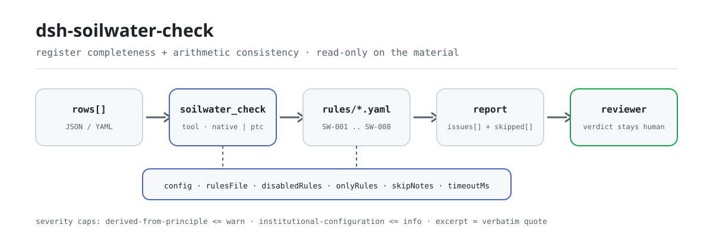

<div align="center">

<picture>
  <source media="(prefers-color-scheme: dark)" srcset="docs/assets/dsh-soilwater-check-flow-dark.svg">
  
</picture>

# dsh-soilwater-check

**Verifique um registo de monitorização de solo e águas subterrâneas quanto à integridade e à coerência aritmética — recebe uma lista de que linha, que coluna e o que corrigir; o veredicto fica com o revisor.**

Um plugin verificador só de dados para o DeepSeek Harness: lê um registo de monitorização (o cabeçalho do projeto mais uma linha por ponto e parâmetro), aplica o pacote de regras versionado que inclui (SW-001..SW-008) e lista apenas as diferenças que consegue apontar dentro do material — nunca um veredicto de conformidade, nunca uma atribuição de responsabilidade.

[Instalação](#instalação-em-três-passos) · [Configuração](#configuração) · [FAQ](#faq) · [简体中文](README.md) · [English](README.en.md) · [Español](README.es.md) · [Português](README.pt.md) · [हिन्दी](README.hi.md)

[](LICENSE)
[](#compatibilidade)
[](https://www.npmjs.com/package/dsh-soilwater-check)
[](https://github.com/PerryLink/dsh-soilwater-check/actions/workflows/ci.yml)
[](#compatibilidade)

[](https://github.com/PerryLink/dsh-soilwater-check/stargazers)
[](https://www.npmjs.com/package/dsh-soilwater-check)
[](https://dshfind.com/en/plugins/PerryLink/dsh-soilwater-check?ref=badge)
[](https://securityscorecards.dev/viewer/?uri=github.com/PerryLink/dsh-soilwater-check)
[](https://dsh.market/)
[](https://gitee.com/perrylink/dsh-soilwater-check)

```sh
dsh plugin --profile <name> add dsh-soilwater-check
```

</div>

<sub>Plugin da comunidade, não afiliado à DeepSeek. Repositório canónico: <https://github.com/PerryLink/dsh-soilwater-check> (o Gitee é um espelho).</sub>

## O que é

`dsh-soilwater-check` lê um registo de monitorização de solo e águas subterrâneas —o cabeçalho do projeto mais uma linha por ponto e parâmetro— e verifica a integridade e a aritmética desse próprio registo: se cada linha indica o seu ponto e o seu parâmetro, se o resultado registado é analisável como número, se a data de amostragem é analisável e não é posterior à data de verificação, se está registada uma norma aplicável, se o veredicto de superação concorda com a relação entre o resultado e o limite que o próprio registo declara, se não há números de amostra repetidos, se o cabeçalho declara o projeto e a fase de monitorização, e se não resta nenhum marcador de modelo na coluna do parâmetro.

Não decide conformidade, não atribui responsabilidades e não substitui o revisor; apenas lista as diferenças que consegue apontar dentro do material.

- **Para quem**: pessoal de registos e revisão de monitorização ambiental e investigação de sítios; não é preciso saber usar a linha de comandos — entregue o material no chat.
- **O que entrega**: o material original sobre o qual a verificação trabalha (um registo, tabela ou documento); o original nunca é modificado. O Excel pode ser convertido antes para JSON/YAML, também no chat se a plataforma o permitir.
- **O que recebe**: uma lista de «que linha, que coluna, o que falta, como corrigir»; cada verificação que não pôde ser executada aparece em `skipped` com o motivo.

## Instalação em três passos

1. **Instalar** (escolha um canal):

   ```sh
   # canal git (último main; equivale a git+https://github.com/PerryLink/dsh-soilwater-check.git)
   dsh plugin --profile <name> add github:PerryLink/dsh-soilwater-check
   # canal npm (versões publicadas)
   dsh plugin --profile <name> add dsh-soilwater-check
   # canal tarball: após pnpm pack neste repositório
   dsh plugin --profile <name> add ./dsh-soilwater-check-<version>.tgz
   ```

2. **Configuração mínima** (os valores por omissão bastam; uma linha de bundle sem `config` usa todos os valores por omissão, com o caminho do pacote de regras a apontar para o `rules/soilwater-check.yaml` incluído):

   ```yaml
   - insert:
       - id: dsh-soilwater-check
         name: dsh-soilwater-check
   ```

3. **Verificar que é montado**:

   ```sh
   dsh --profile <name> --dump-config | grep 'dsh-soilwater-check'
   ```

   Num checkout, execute primeiro `pnpm run build` para produzir `lib/`, e depois a amostra incluída (entrada em `samples/quickstart/input/`, saída esperada em `samples/quickstart/expected/result.json`):

   ```sh
   node samples/quickstart/run.mjs --json
   ```

   ```json
   {
     "tool": "soilwater_check",
     "issueCount": 1,
     "summary": {
       "error": 0,
       "warn": 1,
       "info": 0
     },
     "skippedCount": 0
   }
   ```

**Desinstalar**: `dsh plugin --profile <name> remove dsh-soilwater-check` (ou remova a linha do patch do perfil).

<details>
<summary>Usar no WorkBuddy / Coze</summary>

Pesquise «Professional Document Check Suite» (o conjunto completo; esta verificação é uma parte; disponibilidade conforme o catálogo) no WorkBuddy / Coze para usar a mesma capacidade de verificação sem linha de comandos.

</details>

<details>
<summary>Instalar a partir do mercado do DSH Desktop</summary>

Todos os plugins PerryLink estão listados no mercado integrado do DSH Desktop: **Mercado → Fontes → Adicionar fonte → colar** `https://perrylink-dsh-catalog.perrylink.workers.dev/catalog-source.json` **→ selecionar**. A instalação continua a exigir a verificação de identidade npm do mercado e a sua confirmação.

</details>

## Capacidades principais

`dsh-soilwater-check` regista a ferramenta `soilwater_check`: lê um registo de monitorização, aplica um pacote de regras versionado e devolve um relatório.

- **Oito regras num pacote de dados** — o pacote de regras é dados, não código (`rules/soilwater-check.yaml`); substituí-lo troca todo o conjunto de verificações sem tocar numa linha de TypeScript.
- **Só leitura sobre o material** — aceita JSON ou YAML e nunca modifica o original; ESM puro, sem pedidos de rede, sem chamadas ao modelo.
- **Sem citações fabricadas** — cada regra leva `document` / `number` / `clause` / `excerpt` / `kind` / `source`. Cada `excerpt` deste pacote diz, por palavras, que o texto da cláusula não foi obtido; uma paráfrase nunca é disfarçada de citação. O guarda de carregamento não distingue uma citação de uma descrição, por isso um teste exige que cada `excerpt` admita essa lacuna.
- **A gravidade segue a evidência** — `derived-from-principle` fica limitado a `warn`, a configuração institucional (`institutional-configuration`) a `info`, e um teste exige-o; todas as regras deste pacote são `derived-from-principle` e, por isso, limitadas a `warn`.
- **Uma lista vazia nunca é «não há nada de errado»** — cada verificação que não pôde ser executada é reportada em `skipped` com o motivo; um campo em falta, uma lista por configurar ou um valor não analisável fazem a regra reportar-se em `skipped` em vez de passar em silêncio.
- **Sem linguagem que adjudique** — o relatório lista diferenças e nunca se pronuncia sobre conformidade, responsabilidade ou correção; um guarda de redação impõe-no e todos os relatórios levam o aviso legal.

| Regra | Verificação | Gravidade | Tipo de base |
|---|---|---|---|
| `SW-001` | o ponto e o parâmetro estão registados | warn | principle |
| `SW-002` | o resultado é analisável como número | warn | principle |
| `SW-003` | a data de amostragem é analisável e não é futura | warn | principle |
| `SW-004` | cada linha regista uma norma aplicável | warn | principle |
| `SW-005` | o veredicto concorda com o resultado e o limite | warn | principle |
| `SW-006` | os números de amostra são únicos no registo | warn | principle |
| `SW-007` | o cabeçalho nomeia o projeto e a fase de monitorização | warn | principle |
| `SW-008` | a coluna do parâmetro não conserva marcadores por substituir | warn | principle |

### Exemplos

Estes são os pontos de entrada reais do plugin; instale uma vez e chame um.

**Exemplo detalhado** — ferramenta `soilwater_check`, entrada:

~~~json
{"rows":[{"监测结果":"80","标准限值":"60","超标情况":"达标"}]}
~~~

Saída:

~~~json
{
  "id": "dsh-soilwater-check.SW-005.de09b5a6",
  "ruleId": "SW-005",
  "severity": "warn",
  "locator": {
    "row": 1,
    "field": "exceed"
  },
  "found": "第 1 行「result」为 80、「limit」为 60，而判定为「达标」",
  "expected": "80 超过限值 60，判定应表示超标",
  "fix": "核对三个数值与判定；本条只按台账自己写的限值比较，不判断该限值是否取对了标准"
}
~~~

*Observado em `dsh-soilwater-check/tests/fixtures/SW-005/SW-005-unsafe.json`*

## Normas que segue

| Documento | Número | Regras que o citam |
|---|---|---|
| Diretrizes técnicas para a investigação da contaminação do solo em terrenos de construção (título chinês canónico em `rules/evidence/`) | HJ 25.1—2019 (substitui HJ 25.1-2014; números de cláusula não obtidos nesta passagem) | SW-001, SW-003, SW-007, SW-008 |
| Especificação técnica para a monitorização ambiental de águas subterrâneas (título chinês canónico em `rules/evidence/`) | HJ 164—2020 (substitui HJ/T 164—2004; publicada em 2020-12-01, em vigor desde 2021-03-01; números de cláusula não obtidos nesta passagem) | SW-002, SW-006 |
| Qualidade ambiental do solo — Norma de controlo de riscos de contaminação do solo em terrenos de desenvolvimento (ensaio) (título chinês canónico em `rules/evidence/`) | GB 36600—2018 (texto da cláusula não obtido nesta passagem) | SW-004, SW-005 |

**Hierarquia normativa:** GB 36600—2018 é uma norma nacional (obrigatória, em vigor; a revisão de 2024-07-23 manteve-a válida; o número não leva `/T`); GB/T 14848—2017 é uma norma nacional recomendada (não é a base de nenhuma regra deste pacote); HJ 25.1—2019 e HJ 164—2020 são normas setoriais, não normas nacionais obrigatórias. Não confunda HJ/T 164—2004 com HJ 164—2020: o número novo não leva `/T`.

## Configuração

Todos os parâmetros ajustáveis são campos Schemastery `Config` de `src/config.ts` (alteráveis a partir do cordis.yml); os limites por regra estão no pacote de regras em `rules/`. Uma substituição dirigida por id substitui a linha inteira — repita todas as chaves de que precisa.

| Chave | Tipo | Padrão | Descrição |
|---|---|---|---|
| `rulesFile` | string | `rules/soilwater-check.yaml` | Caminho do pacote de regras, relativo à raiz do pacote |
| `disabledRules` | string[] | `[]` | Ids de regras a desativar; cada uma aparece em `skipped` |
| `onlyRules` | string[] | `[]` | Executar apenas estas regras; vazio executa todas |
| `skipNotes` | string | `""` | Nota acrescentada a cada motivo de `skipped` |
| `timeoutMs` | number | `120000` | Orçamento de tempo limite cooperativo da ferramenta |

Parâmetros ao nível da regra que vale a pena conhecer:

- `SW-005` `valueField` / `limitField` / `verdictField` / `overValues` / `atMostValues` / `tolerance` — as três colunas e os dois vocabulários de veredicto. Um veredicto fora de ambas as listas é reportado para que uma nova redação não passe despercebida.
- `SW-008` `terms` — o vocabulário de marcadores a procurar.
- `SW-001` `fields`, `SW-002` `field`, `SW-003` `field`, `SW-004` `field`, `SW-006` `field`, `SW-007` `fields` — as colunas que cada regra lê; os padrões estão em `rules/soilwater-check.yaml`.

Vocabulários padrão incluídos (mantidos literalmente porque as colunas do registo estão em chinês):

```text
SW-005 overValues:   [超标, 是, Y, yes, true, 超出, 不合格]
SW-005 atMostValues: [达标, 否, N, no, false, 未超标, 合格]
SW-008 terms:        ["【","】","{{","}}","XXX","xxx","待填","待补充","TBD","todo","示例"]
```

Exemplo de substituição no patch do perfil:

```yaml
- insert:
    - id: dsh-soilwater-check
      name: dsh-soilwater-check
      config:
        disabledRules: [SW-008]
        timeoutMs: 180000
```

## Formato do material

A ferramenta aceita JSON ou YAML:

```yaml
project: 某某场地调查
phase: 初步调查
rows:
  - { 序号: '1', 点位名称: S1 表层土, 介质: 土壤, 采样日期: 2026-03-05,
      样品编号: TR-2026-0018, 监测项目: 砷, 监测结果: '12.5', 单位: mg/kg,
      执行标准: GB 36600—2018 第二类用地筛选值, 标准限值: '60', 超标情况: 达标 }
```

Os nomes das colunas são comparados sem distinguir maiúsculas de minúsculas e ignorando espaços, sublinhados e hífenes; os nomes de coluna do próprio registo são mantidos, pelo que um achado nomeia a coluna que leu. O resultado pode levar unidade; a notação de limite de deteção (como «não detetado» ou `<0.01`) é reportada como não analisável de propósito. Os campos são opcionais na camada de leitura e validados pelo motor, pelo que uma exportação parcial produz achados sobre o que falta em vez de uma falha. O `project` do cabeçalho é o nome do projeto e `phase` a fase de monitorização (investigação preliminar, investigação detalhada, avaliação da eficácia da remediação, etc.).

## Origem das regras

Os dados das regras estão em `rules/soilwater-check.yaml`, separados do código: cada regra leva documento, número, cláusula na numeração própria da fonte, extrato literal e URL de origem. O cabeçalho do pacote expõe por completo a lacuna de citações, e o `note` de cada regra repete a parte que lhe diz respeito. O guarda de carregamento que normalmente exige «um extrato deve ser uma citação real de pelo menos oito caracteres» não distingue uma citação de uma descrição; por isso este pacote apoia-se no cabeçalho, nas notas por regra e num teste que exige que cada `excerpt` admita a lacuna. Um pacote que exagera a sua base falha no carregamento em vez de produzir um relatório de aparência convincente. Os limites verificados e as conclusões deliberadamente **não** afirmadas estão incluídos no diretório `rules/evidence/`.

## FAQ

<details>
<summary>O registo diz «达标», mas o resultado é superior ao limite escrito ao lado. Isso é detetado?</summary>

Sim. `SW-005` compara o resultado com o limite que o próprio registo declara e assinala a linha quando o veredicto não concorda com essa comparação. Não traz limites próprios, por isso não consegue detetar um limite retirado da norma ou da categoria de uso do solo errada, e um veredicto fora das listas configuradas é reportado em separado.

</details>

<details>
<summary>A célula do resultado diz «não detetado» ou `<0.01`, porque o valor está abaixo do limite de deteção. O que faz a verificação?</summary>

`SW-002` reporta-o. A regra lê apenas a parte numérica da célula (`0.85` e `1.2×10-3` são aceites), pelo que a notação de limite de deteção é reportada como não analisável de propósito — registe o valor e coloque a observação noutra coluna, ou desative a regra. Verifica se é analisável, não se o valor é verdadeiro nem se o método está correto.

</details>

<details>
<summary>Uma linha deixa a coluna da norma vazia. Isso é detetado?</summary>

`SW-004` exige que a norma esteja preenchida em todas as linhas que tenham essa coluna. Verifica que uma norma está escrita, não que seja a norma aplicável: se a norma registada corresponde ao uso do solo e ao meio é uma questão substantiva que o plugin deixa ao leitor.

</details>

<details>
<summary>Uma data de amostragem é posterior à data de verificação, e outra linha escreve a data como `2026/3/15`. O que acontece?</summary>

`SW-003` reporta um `sampledAt` posterior à data de verificação. A regra lê `2026-03-15` e `2026-03-15 09:30`; qualquer outro formato é reportado como não analisável em vez de ser ignorado em silêncio. Compara apenas datas: não julga se o dado é fiável.

</details>

<details>
<summary>O mesmo número de amostra aparece em duas linhas. É um erro?</summary>

`SW-006` reporta um número de amostra repetido, porque a repetição quebra a ligação entre o relatório do laboratório e o registo; a comparação ignora espaços. Vários parâmetros de uma mesma amostra a partilhar um número de amostra é a forma prevista: mantenha-os em linhas separadas, mas não reutilize a coluna do número de linha. Sem coluna de número de amostra, a regra reporta-se em `skipped` em vez de passar em silêncio.

</details>

<details>
<summary>A célula do parâmetro ainda contém um marcador de modelo, porque o registo foi copiado do modelo. Isso é detetado?</summary>

`SW-008` reporta o marcador que resta na coluna do parâmetro (parênteses retos, chavetas duplas, `XXX`, `TBD` e as palavras de modelo para «por preencher» e «exemplo»; a lista é editável no pacote). Note que `SW-001` apenas exige que o nome do ponto ou o parâmetro esteja preenchido, pelo que um marcador conta como preenchido ali; é a regra dos marcadores que o deteta. Nenhuma das duas julga se o fator é o que deve ser monitorizado.

</details>

## Limites de segurança

Este plugin verifica um **registo de monitorização de solo e águas subterrâneas** quanto à integridade e à aritmética: se cada registo nomeia o seu ponto e parâmetro, se o resultado é analisável como número, se a data de amostragem não é futura, se está registada uma norma aplicável, se o veredicto de superação concorda com a relação entre o resultado e o limite que o registo declara, se os números de amostra são únicos, se o registo nomeia o projeto e a fase de monitorização, e se não sobrevive nenhum marcador. **Não** decide se um sítio está contaminado, se é necessária remediação, se os objetivos de remediação foram atingidos ou se as conclusões de uma investigação se sustentam.

> ### ⚠️ O que este plugin deliberadamente não consegue fazer
>
> **Não traz limites e não verifica se o limite foi retirado da norma correta.** `SW-005` compara o resultado medido com o limite **que o próprio registo declara** e verifica se o veredicto concorda. Por isso **não consegue encontrar o erro consequente: um valor de triagem retirado da norma ou da categoria de uso do solo errada.** Escolher entre os valores de triagem da primeira e da segunda categoria da GB 36600, ou entre a GB 36600 e a GB/T 14848, depende do uso do solo e do meio — este plugin não lê nenhum dos dois. Esse limite está declarado no cabeçalho do pacote, nas notas de `SW-004` e `SW-005`, e na secção de resolução de problemas.
>
> `SW-002` exige um número analisável, por isso um registo que escreva notação de limite de deteção («não detetado», `<0.01`) é **reportado como não analisável de propósito** — registe o valor com uma observação, ou desative a regra.
>
> **Cada `excerpt` do pacote de regras diz, por palavras, que o texto da cláusula não foi obtido.** O regime vive na GB 36600—2018, GB/T 14848—2017, HJ 25.1 e HJ 164. A passagem de verificação não conseguiu recuperar o texto literal das cláusulas, por isso o pacote declara a lacuna no próprio campo `excerpt` e mantém cada regra em `warn` ou `info`. **Quando os textos estiverem disponíveis, substitua cada `excerpt` pela cláusula real e eleve `kind` para `direct`.**

Em torno desse limite de capacidade, o plugin também respeita estas restrições:

- **Só leitura sobre o material.** A ferramenta lê apenas o JSON/YAML que lhe é entregue; não escreve ficheiros, não faz pedidos de rede e não chama nenhum modelo (`package.json#dsh.demo` declara `reads` como o ficheiro de material indicado pelo utilizador, `writes: []` e `network: false`).
- **Sem adjudicação.** O relatório lista diferenças e leva o aviso legal; um guarda de redação proíbe conclusões de conformidade, responsabilidade ou correção.
- **Sem citações fabricadas.** Sem o texto de origem, `kind` fica limitado a `derived-from-principle` e a gravidade a `warn` — uma lacuna de citação nunca recebe a confiança de `direct`.
- **Sem aprovação silenciosa.** Cada verificação que não pôde ser executada vai para `skipped` com o motivo; uma lista `issues` vazia não significa «o material está bem».

## Limitações conhecidas

- **Não verifica se o limite veio da norma correta.** `SW-005` compara apenas com o limite que o próprio registo declara. Se esse limite pertence à norma e à categoria de uso do solo corretas é uma questão substantiva que não toca.
- **Um resultado igual ao limite não é tratado como superação.** `SW-005` trata a igualdade como «não superado»; se o seu critério considerar que «igual ao valor de triagem» supera, ajuste `tolerance` ligeiramente abaixo de zero ou ajuste os dados.
- **A notação de limite de deteção é reportada como não analisável.** `SW-002` exige um número analisável; «não detetado» não é um número — registe o valor com uma observação, ou desative a regra.
- **Vários parâmetros de uma amostra devem ter a sua própria linha.** Partilhar um número de amostra é normal; `SW-006` usa como chave a coluna do número de amostra, por isso não reutilize a coluna do número de linha.

### Resolução de problemas

- **O plugin instala mas a ferramenta não aparece.** Confirme que `main` resolve para `lib/index.mjs` e que `pnpm run build` o gerou; um `main` errado faz o carregador ignorar a entrada em silêncio.
- **`dsh plugin add` recusa o pacote como incompatível.** O intervalo de peers cobre `0.1.x` e `0.2.x`; se o seu runtime estiver fora, conceda uma isenção explícita: `dsh plugin --profile <name> allow-version dsh-soilwater-check@0.1.0 --dsh-version <runtime> --accept-risk`
- **Uma regra não foi executada.** Leia o arranjo `skipped`; indica o id da regra e o motivo.
- **`check` reporta `manifest-peers` como falha.** O verificador estático compara com um intervalo de peers codificado anterior à linha 0.2. O runtime aplica a compatibilidade na instalação, por isso o intervalo declarado é o correto; é um problema conhecido do `dsh-plugin-dev`.
- **Os horários parecem deslocados.** Toda a aritmética é de hora local sobre as cadeias fornecidas, sem conversão de fuso horário.

## Interoperabilidade com outros plugins de DSH

Este plugin é um verificador só de dados que regista uma única ferramenta, `soilwater_check`, e não entra na cadeia de eventos do host:

- **Sem colisão de nomes de ferramenta.** O nome `soilwater_check` é próprio deste plugin; não ocupa o nome de uma ferramenta integrada.
- **Sem colisão de chaves de serviço.** Não fornece nenhuma chave de serviço, por isso não pode colidir numa.
- **Sem colisão de slots nem de rotas.** Não regista nenhum slot de cliente nem qualquer prefixo `webServer` ou rota HTTP.
- **Sem colisão de eventos.** Não escuta nenhum evento partilhado (`agent/pre-step`, `tools/post-execute` e semelhantes), por isso não compete numa cadeia de listeners.
- **Sem colisão de camadas de patch.** O patch do bundle (`cordis.patch.yml`) apenas `insert`a a sua própria linha; nunca substitui o `config` de uma linha integrada.
- **Sem mutação global.** Não altera protótipos, não reescreve `process.env` nem substitui o dispatcher global de fetch.
- **Lê apenas a sua própria entrada.** A ferramenta lê o texto do material que o chamador lhe passa; não lê o armazenamento de outro plugin, não faz pedidos de rede nem chama um modelo.

## Compatibilidade

| Superfície | Estado |
|---|---|
| Harness | Intervalo de peers `>=0.1.2-rc.1 <0.2.0 \|\| >=0.2.0-0 <0.3.0` — verificado para aceitar tanto `0.2.0-rc.2` como `0.2.1-rc.2`. **`engines.dsh` é declarado como `>=0.2.1-0 <0.3.0`** e o host aplica-o desde 0.2.1 |
| Node | `^22.19.0 \|\| >=24.0.0` |
| Plataformas | Todas (ESM puro; sem código nativo, sem rede, sem chamada ao modelo) |
| Modo de ferramenta | Funciona em `native` e `ptc`; para uma ronda de amostragem completa use `ptc` |

## Ecossistema e qualidade

- [Espelho no Gitee](https://gitee.com/perrylink/dsh-soilwater-check) (espelho sincronizado; o GitHub é o canónico)
- [Página do plugin no dshfind](https://dshfind.com/en/plugins/PerryLink/dsh-soilwater-check) (instalações e ranking)
- [Relatório OpenSSF Scorecard](https://securityscorecards.dev/viewer/?uri=github.com/PerryLink/dsh-soilwater-check) (impulsionado por [.github/workflows/scorecard.yml](.github/workflows/scorecard.yml))
- [DSH Market](https://dsh.market/) (listado)
- **Canal da loja 1024**: `npm i -g dsh1024` uma vez, depois `dsh1024 plugin --profile <name> add dsh-soilwater-check` (conta para o ranking de instalações de [deepseek1024.com](https://deepseek1024.com))
- [Base de conhecimento do ecossistema](https://perrylink.github.io/dsh-plugin-guide/) — guia de desenvolvimento de plugins · dados de seleção medidos · critérios de manutenção

## Desenvolvimento

```sh
pnpm install                                        # node ^22.19 || >=24
pnpm run typecheck                                  # tsc --noEmit
pnpm test                                           # vitest: suite partilhada de plugins de tabela + fixtures emparelhadas
pnpm run build                                      # tsdown -> lib/index.mjs + lib/index.d.mts
pnpm run verify:self-contained                      # as dependências resolvem-se a partir do registry
pnpm run check:lockfile                             # verificação de deriva do lockfile
pnpm run check:readmes                              # consistência dos README em cinco idiomas
pnpm run check:citations                            # linha de base de citações do pacote de regras
node ../scripts/sync-shared.mjs dsh-soilwater-check   # atualizar src/shared a partir de ../_shared
pnpm pack                                           # o tarball publicado
```

`sync-shared` copia o kit partilhado de `../_shared` para `src/shared/`; volte a executá-lo após cada alteração partilhada. O plugin é **só de dados**: `src/model.ts` declara a forma da tabela, o kit partilhado fornece o leitor e o motor de verificação, e o pacote de regras declara cada verificação.

Execução local da amostra (requer `pnpm run build` antes para produzir `lib/`):

```sh
node samples/quickstart/run.mjs --json
```

A entrada da amostra está em `samples/quickstart/input/` e a saída esperada em `samples/quickstart/expected/result.json`. As imagens do README são geradas programaticamente por [`scripts/gen-readme-assets.py`](scripts/gen-readme-assets.py) (Python + Pillow) e podem ser reexecutadas; o diagrama de fluxo e as imagens de demonstração de uma só versão permanecem em `docs/assets/` para ligações externas, enquanto os README referenciam apenas o novo par claro/escuro.

Topics: `deepseek-harness`, `dsh`, `dsh-plugin`, `cordis`, `soilwater`

## Família e agradecimentos

Este projeto faz parte da família de plugins DeepSeek Harness da [PerryLink](https://github.com/PerryLink) (todos Apache-2.0). Índice completo da família: [escolher um verificador por material](https://perrylink.github.io/zh/checkers/choose/) e [todos os plugins](https://github.com/PerryLink). Se for útil, **uma estrela ajuda a próxima pessoa a encontrá-lo** — não desbloqueia nada.

- [@PerryLink](https://github.com/PerryLink) — criador e mantenedor: o pacote de regras só de dados (SW-001..SW-008), a ferramenta `soilwater_check`, o registo de verificação de citações e a documentação em cinco idiomas.

<details>
<summary>Expandir todos os plugins</summary>

| Plugin | Status |
|---|---|
| **[dsh-aqua-input-check](https://github.com/PerryLink/dsh-aqua-input-check)** |  |
| **[dsh-archive-check](https://github.com/PerryLink/dsh-archive-check)** |  |
| **[dsh-auto-review](https://github.com/PerryLink/dsh-auto-review)** |  |
| **[dsh-autotier](https://github.com/PerryLink/dsh-autotier)** | 🧊 CONGELADO — ver o README do repo |
| **[dsh-bid-ca-precheck](https://github.com/PerryLink/dsh-bid-ca-precheck)** |  |
| **[dsh-bid-qual-check](https://github.com/PerryLink/dsh-bid-qual-check)** |  |
| **[dsh-cert-mcp](https://github.com/PerryLink/dsh-cert-mcp)** | 🧊 CONGELADO — ver o README do repo |
| **[dsh-checkpoint-rewind](https://github.com/PerryLink/dsh-checkpoint-rewind)** |  |
| **[dsh-click](https://github.com/PerryLink/dsh-click)** |  |
| **[dsh-composer-history](https://github.com/PerryLink/dsh-composer-history)** |  |
| **[dsh-contract-stance](https://github.com/PerryLink/dsh-contract-stance)** |  |
| **[dsh-customs-doc-check](https://github.com/PerryLink/dsh-customs-doc-check)** |  |
| **[dsh-data-quality](https://github.com/PerryLink/dsh-data-quality)** | 🧊 CONGELADO — ver o README do repo |
| **[dsh-demurrage-ledger](https://github.com/PerryLink/dsh-demurrage-ledger)** |  |
| **[dsh-doublecheck](https://github.com/PerryLink/dsh-doublecheck)** |  |
| **[dsh-drill-script-check](https://github.com/PerryLink/dsh-drill-script-check)** |  |
| **[dsh-eia-guide-check](https://github.com/PerryLink/dsh-eia-guide-check)** |  |
| **[dsh-emergency-plan](https://github.com/PerryLink/dsh-emergency-plan)** |  |
| **[dsh-essay-rubric-check](https://github.com/PerryLink/dsh-essay-rubric-check)** |  |
| **[dsh-evidence-check](https://github.com/PerryLink/dsh-evidence-check)** |  |
| **[dsh-export-ctl-check](https://github.com/PerryLink/dsh-export-ctl-check)** |  |
| **[dsh-fast](https://github.com/PerryLink/dsh-fast)** |  |
| **[dsh-fmea-table-check](https://github.com/PerryLink/dsh-fmea-table-check)** |  |
| **[dsh-forecast-penalty](https://github.com/PerryLink/dsh-forecast-penalty)** |  |
| **[dsh-fund-research](https://github.com/PerryLink/dsh-fund-research)** |  |
| **[dsh-github](https://github.com/PerryLink/dsh-github)** |  |
| **[dsh-gongwen-flow-check](https://github.com/PerryLink/dsh-gongwen-flow-check)** |  |
| **[dsh-gongwen-word-check](https://github.com/PerryLink/dsh-gongwen-word-check)** |  |
| **[dsh-guard-plan-qc](https://github.com/PerryLink/dsh-guard-plan-qc)** |  |
| **[dsh-hazchem-check](https://github.com/PerryLink/dsh-hazchem-check)** |  |
| **[dsh-hazplan-check](https://github.com/PerryLink/dsh-hazplan-check)** |  |
| **[dsh-hidden-risk-map](https://github.com/PerryLink/dsh-hidden-risk-map)** |  |
| **[dsh-hs-classify](https://github.com/PerryLink/dsh-hs-classify)** |  |
| **[dsh-icd-rule-check](https://github.com/PerryLink/dsh-icd-rule-check)** |  |
| **[dsh-industry-research](https://github.com/PerryLink/dsh-industry-research)** |  |
| **[dsh-lawcite-adapter](https://github.com/PerryLink/dsh-lawcite-adapter)** |  |
| **[dsh-laya](https://github.com/PerryLink/dsh-laya)** |  |
| **[dsh-lc-doc-check](https://github.com/PerryLink/dsh-lc-doc-check)** |  |
| **[dsh-learning-gap-check](https://github.com/PerryLink/dsh-learning-gap-check)** |  |
| **[dsh-library](https://github.com/PerryLink/dsh-library)** |  |
| **[dsh-local-ai](https://github.com/PerryLink/dsh-local-ai)** |  |
| **[dsh-lsp-actions](https://github.com/PerryLink/dsh-lsp-actions)** |  |
| **[dsh-mask](https://github.com/PerryLink/dsh-mask)** |  |
| **[dsh-mcp-panel](https://github.com/PerryLink/dsh-mcp-panel)** |  |
| **[dsh-medrec-qc](https://github.com/PerryLink/dsh-medrec-qc)** |  |
| **[dsh-memento](https://github.com/PerryLink/dsh-memento)** | 🧊 CONGELADO — ver o README do repo |
| **[dsh-nsfc-form-check](https://github.com/PerryLink/dsh-nsfc-form-check)** |  |
| **[dsh-nurse-record-check](https://github.com/PerryLink/dsh-nurse-record-check)** |  |
| **[dsh-observe](https://github.com/PerryLink/dsh-observe)** |  |
| **[dsh-origin-rvc-check](https://github.com/PerryLink/dsh-origin-rvc-check)** |  |
| **[dsh-ota-review-check](https://github.com/PerryLink/dsh-ota-review-check)** |  |
| **[dsh-output-styles](https://github.com/PerryLink/dsh-output-styles)** |  |
| **[dsh-paper-doc-adapter](https://github.com/PerryLink/dsh-paper-doc-adapter)** |  |
| **[dsh-permission-rules](https://github.com/PerryLink/dsh-permission-rules)** |  |
| **[dsh-permit-report-check](https://github.com/PerryLink/dsh-permit-report-check)** |  |
| **[dsh-pipeline-check](https://github.com/PerryLink/dsh-pipeline-check)** |  |
| **[dsh-pleading-draft](https://github.com/PerryLink/dsh-pleading-draft)** |  |
| **[dsh-plugin-doctor](https://github.com/PerryLink/dsh-plugin-doctor)** | 🚫 APOSENTADO (repo arquivado) |
| **[dsh-plugin-guide](https://github.com/PerryLink/dsh-plugin-guide)** |  |
| **[dsh-plugin-kit](https://github.com/PerryLink/dsh-plugin-kit)** | 🚫 APOSENTADO (repo arquivado) |
| **[dsh-plugin-upgrade](https://github.com/PerryLink/dsh-plugin-upgrade)** | 🚫 APOSENTADO (repo arquivado) |
| **[dsh-policy-brief-draft](https://github.com/PerryLink/dsh-policy-brief-draft)** |  |
| **[dsh-power-loss-split](https://github.com/PerryLink/dsh-power-loss-split)** |  |
| **[dsh-power-ticket-check](https://github.com/PerryLink/dsh-power-ticket-check)** |  |
| **[dsh-ppap-check](https://github.com/PerryLink/dsh-ppap-check)** |  |
| **[dsh-protest-deadline](https://github.com/PerryLink/dsh-protest-deadline)** |  |
| **[dsh-railway-window](https://github.com/PerryLink/dsh-railway-window)** |  |
| **[dsh-repair-order-qc](https://github.com/PerryLink/dsh-repair-order-qc)** |  |
| **[dsh-research-report](https://github.com/PerryLink/dsh-research-report)** |  |
| **[dsh-review-reply-check](https://github.com/PerryLink/dsh-review-reply-check)** |  |
| **[dsh-rulefile-check](https://github.com/PerryLink/dsh-rulefile-check)** |  |
| **[dsh-safety-brief-check](https://github.com/PerryLink/dsh-safety-brief-check)** |  |
| **[dsh-score](https://github.com/PerryLink/dsh-score)** | 🧊 CONGELADO — ver o README do repo |
| **[dsh-session-sync](https://github.com/PerryLink/dsh-session-sync)** |  |
| **[dsh-site-log-check](https://github.com/PerryLink/dsh-site-log-check)** |  |
| **[dsh-skill-pack-security](https://github.com/PerryLink/dsh-skill-pack-security)** |  |
| **[dsh-soe-decision-check](https://github.com/PerryLink/dsh-soe-decision-check)** |  |
| **[dsh-soilwater-check](https://github.com/PerryLink/dsh-soilwater-check)** |  |
| **[dsh-sop-sync-check](https://github.com/PerryLink/dsh-sop-sync-check)** |  |
| **[dsh-spc-gbt-adapter](https://github.com/PerryLink/dsh-spc-gbt-adapter)** |  |
| **[dsh-talk](https://github.com/PerryLink/dsh-talk)** |  |
| **[dsh-tender-extract](https://github.com/PerryLink/dsh-tender-extract)** |  |
| **[dsh-tender-matrix](https://github.com/PerryLink/dsh-tender-matrix)** |  |
| **[dsh-test-drive](https://github.com/PerryLink/dsh-test-drive)** |  |
| **[dsh-ticktick](https://github.com/PerryLink/dsh-ticktick)** | 🚫 APOSENTADO (repo arquivado) |
| **[dsh-translate](https://github.com/PerryLink/dsh-translate)** |  |
| **[dsh-warranty-calc](https://github.com/PerryLink/dsh-warranty-calc)** |  |
| **[dsh-budget](https://github.com/PerryLink/dsh-budget)** | 🧊 CONGELADO — ver o README do repo |
| **[dsh-claude-move](https://github.com/PerryLink/dsh-claude-move)** | 🧊 CONGELADO — ver o README do repo |
| **[dsh-defend](https://github.com/PerryLink/dsh-defend)** | 🧊 CONGELADO — ver o README do repo |
| **[dsh-draw](https://github.com/PerryLink/dsh-draw)** | 🧊 CONGELADO — ver o README do repo |
| **[dsh-reach](https://github.com/PerryLink/dsh-reach)** | 🧊 CONGELADO — ver o README do repo |
| **[dsh-background-agents](https://github.com/PerryLink/dsh-background-agents)** | 🚫 APOSENTADO (repo arquivado) |
| **[dsh-session-pin](https://github.com/PerryLink/dsh-session-pin)** | 🚫 APOSENTADO (repo arquivado) |
| **[dsh-team-rooms](https://github.com/PerryLink/dsh-team-rooms)** | 🚫 APOSENTADO (repo arquivado) |

</details>

## Licença

[LICENSE](LICENSE) (Apache License 2.0) © 2026 dsh-soilwater-check contributors

<p align="center"><sub>Apache-2.0 · Plugin da comunidade, não afiliado à DeepSeek.</sub></p>
